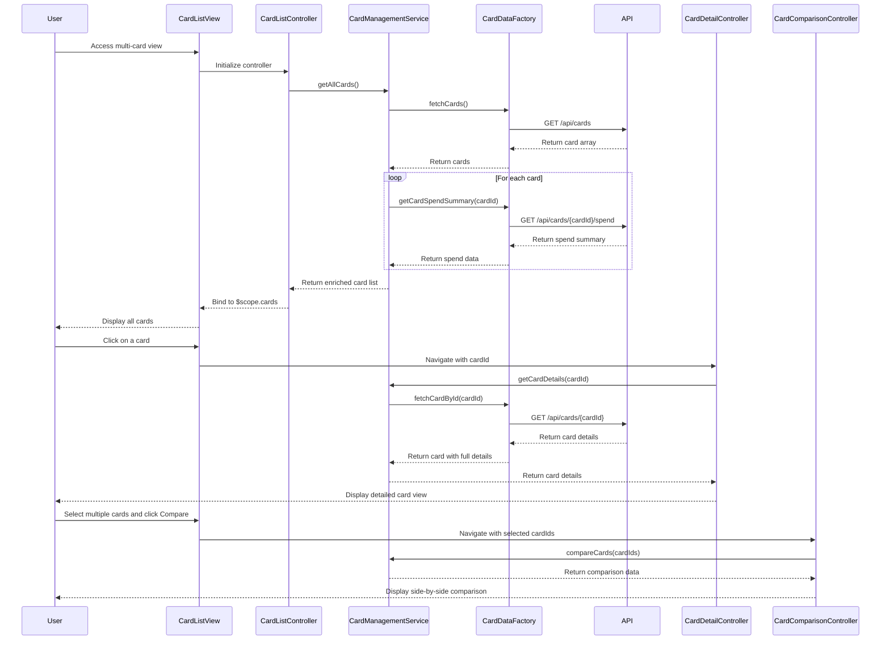

# Low-Level Design: Multi-Card Management and Monitoring
**Epic ID:** QE-8350

## a. Architecture Mapping

| HLD Component | AngularJS Artifact | Mapping |
|---------------|-------------------|----------|
| User Interface Multi-Card View | Module: `cardManagementModule` | Main module for multi-card features |
| Card Management Service | Service: `CardManagementService` | Business logic for card operations and comparisons |
| Credit Card Data Repository | Factory: `CardDataFactory` | REST API calls for card data retrieval |
| User Authentication Service | Service: `AuthService` | User authentication and secure access |
| Card List Controller | Controller: `CardListController` | Manages multi-card list view and filtering |
| Card Detail Controller | Controller: `CardDetailController` | Manages individual card detail view |
| Card Comparison Controller | Controller: `CardComparisonController` | Manages side-by-side card comparison |
| Card Item Directive | Directive: `cardItem` | Reusable component for displaying card summary |

**Recommended Folder Structure:**
```
app/
├── modules/
│   └── card-management/
│       ├── card-management.module.js
│       ├── controllers/
│       │   ├── card-list.controller.js
│       │   ├── card-detail.controller.js
│       │   └── card-comparison.controller.js
│       ├── services/
│       │   ├── card-management.service.js
│       │   └── auth.service.js
│       ├── factories/
│       │   └── card-data.factory.js
│       ├── directives/
│       │   ├── card-item.directive.js
│       │   └── card-filter.directive.js
│       └── views/
│           ├── card-list.html
│           ├── card-detail.html
│           ├── card-comparison.html
│           └── card-item.template.html
```

## b. Component Specifications

| Component Name | Artifact Type | Responsibility | Key Dependencies |
|----------------|---------------|----------------|------------------|
| cardManagementModule | Module | Encapsulates all multi-card management features | ngRoute, ui.bootstrap |
| CardListController | Controller | Manages card list display, filtering, and selection | CardManagementService, $scope, $location |
| CardDetailController | Controller | Displays detailed information for a single card including spend analysis | CardManagementService, $routeParams, $scope |
| CardComparisonController | Controller | Manages side-by-side comparison of multiple selected cards | CardManagementService, $scope |
| CardManagementService | Service | Orchestrates card retrieval, filtering, spend analysis, and comparison logic | CardDataFactory, $q |
| CardDataFactory | Factory | Makes REST API calls to retrieve card data and spend summaries | $http, $q |
| AuthService | Service | Handles user authentication and secure card access | $http, $window |
| cardItem | Directive | Renders individual card summary with masked number, limit, balance, and spend | None |
| cardFilter | Directive | Provides UI for filtering cards by issuer, type, or status | $scope |

## c. Data Model

**CreditCard Object:**
```javascript
{
  cardId: String,
  cardNumber: String, // masked (e.g., "**** **** **** 1234")
  cardType: String, // Visa, MasterCard, Amex
  issuer: String,
  creditLimit: Number,
  balance: Number,
  availableCredit: Number,
  outstandingAmount: Number,
  status: String, // Active, Inactive, Blocked
  expiryDate: String // MM/YY
}
```

**CardSpendSummary Object:**
```javascript
{
  cardId: String,
  currentMonthSpend: Number,
  lastMonthSpend: Number,
  yearToDateSpend: Number,
  topCategories: Array<{category: String, amount: Number}>
}
```

**CardFilter Object:**
```javascript
{
  issuers: Array<String>,
  cardTypes: Array<String>,
  statuses: Array<String>
}
```

## d. Data Flow

User accesses the multi-card view, initializing CardListController. The controller calls CardManagementService.getAllCards() to fetch all linked cards. CardManagementService invokes CardDataFactory.fetchCards() to make a GET request to `/api/cards`. The API returns an array of CreditCard objects. For each card, the service fetches spend summaries via CardDataFactory.getCardSpendSummary(cardId) using GET `/api/cards/{cardId}/spend`. The service enriches each card with spend data and returns the complete list to the controller. The controller binds the card list to $scope, and cardItem directives render each card. User can filter cards using cardFilter directive, which updates the filter criteria and triggers CardManagementService.filterCards(). Clicking a card navigates to CardDetailController, which fetches detailed card info and spend analysis. Selecting multiple cards and clicking "Compare" navigates to CardComparisonController, which displays selected cards side-by-side.

## e. Primary Sequence Diagram



## f. Implementation Notes

- Use AngularJS DI to inject services and factories into controllers; register all components with cardManagementModule.
- Implement card filtering using AngularJS $filter service for client-side filtering when card count is under 50; use server-side filtering for larger datasets.
- Use $q.all() to fetch spend summaries for multiple cards in parallel to improve performance.
- Apply responsive design using Bootstrap grid (col-md-4 for card items) to ensure mobile compatibility.
- Use ES6: const/let for variables, arrow functions for array operations, template literals for dynamic API URLs.

## g. Error Handling

Use $http interceptor for global API error handling; display error notifications using toastr; handle missing card data gracefully by showing placeholder or "Data unavailable" message.

## h. Security Notes

Requires token-based auth via existing SSO; all API calls include auth token; mask sensitive card numbers in UI; ensure backend filters cards by authenticated user ID.