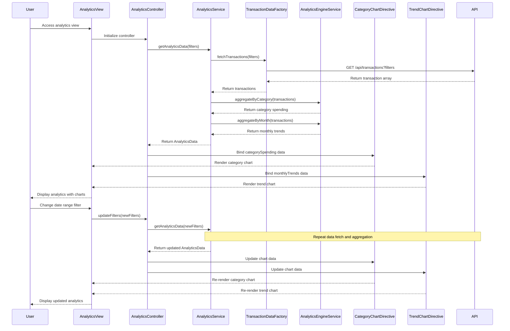

# Low-Level Design: Analytics and Spending Insights
**Epic ID:** QE-8351

## a. Architecture Mapping

| HLD Component | AngularJS Artifact | Mapping |
|---------------|-------------------|----------|
| User Interface Analytics Module | Module: `spendingInsightsModule` | Main module for spending insights features |
| Analytics Service | Service: `AnalyticsService` | Business logic for analytics and data aggregation |
| Transaction Data Service | Factory: `TransactionDataFactory` | REST API calls for transaction data |
| Analytics Engine | Service: `AnalyticsEngineService` | Client-side data processing and aggregation |
| Analytics Controller | Controller: `AnalyticsController` | Manages analytics view and chart interactions |
| Category Chart Directive | Directive: `categoryChart` | Renders category-wise spending chart |
| Trend Chart Directive | Directive: `trendChart` | Renders monthly spend trend chart |

**Recommended Folder Structure:**
```
app/
├── modules/
│   └── spending-insights/
│       ├── spending-insights.module.js
│       ├── controllers/
│       │   └── analytics.controller.js
│       ├── services/
│       │   ├── analytics.service.js
│       │   └── analytics-engine.service.js
│       ├── factories/
│       │   └── transaction-data.factory.js
│       ├── directives/
│       │   ├── category-chart.directive.js
│       │   ├── trend-chart.directive.js
│       │   └── date-range-filter.directive.js
│       └── views/
│           ├── analytics.html
│           └── chart-templates/
│               ├── category-chart.template.html
│               └── trend-chart.template.html
```

## b. Component Specifications

| Component Name | Artifact Type | Responsibility | Key Dependencies |
|----------------|---------------|----------------|------------------|
| spendingInsightsModule | Module | Encapsulates all spending insights and analytics features | ngRoute, chart.js or angular-chart.js |
| AnalyticsController | Controller | Manages analytics view, filter selection, and chart data binding | AnalyticsService, $scope, $filter |
| AnalyticsService | Service | Orchestrates data retrieval, aggregation, and chart data preparation | TransactionDataFactory, AnalyticsEngineService, $q |
| AnalyticsEngineService | Service | Performs client-side aggregation by category and month | lodash or native Array methods |
| TransactionDataFactory | Factory | Makes REST API calls to retrieve categorized transaction data | $http, $q |
| categoryChart | Directive | Renders interactive pie or bar chart for category-wise spending | Chart.js library |
| trendChart | Directive | Renders line chart for monthly spend trends over time | Chart.js library |
| dateRangeFilter | Directive | Provides UI for selecting date range and category filters | $scope |

## c. Data Model

**Transaction Object:**
```javascript
{
  transactionId: String,
  cardId: String,
  amount: Number,
  category: String, // Food and Dining, Fuel, Shopping, Travel, Entertainment, Utilities, Healthcare, Education, Miscellaneous
  transactionDate: Date,
  merchantName: String
}
```

**CategorySpending Object:**
```javascript
{
  category: String,
  totalAmount: Number,
  transactionCount: Number,
  percentage: Number
}
```

**MonthlyTrend Object:**
```javascript
{
  month: String, // YYYY-MM
  totalSpend: Number
}
```

**AnalyticsData Object:**
```javascript
{
  categorySpending: Array<CategorySpending>,
  monthlyTrends: Array<MonthlyTrend>,
  totalSpend: Number,
  dateRange: {startDate: Date, endDate: Date}
}
```

## d. Data Flow

User accesses the analytics view, initializing AnalyticsController. The controller calls AnalyticsService.getAnalyticsData() with default filters (last 12 months, all categories, all cards). AnalyticsService invokes TransactionDataFactory.fetchTransactions() to make a GET request to `/api/transactions` with date range and card filters. The API returns an array of Transaction objects. AnalyticsService passes transactions to AnalyticsEngineService, which aggregates data by category and month using lodash groupBy and sumBy. The service calculates CategorySpending (total per category, percentage of total) and MonthlyTrend (total per month). AnalyticsService transforms aggregated data into chart-compatible format and returns AnalyticsData to the controller. The controller binds AnalyticsData to $scope, and categoryChart and trendChart directives render interactive visualizations. User interactions (filter changes, drill-down) trigger controller methods that update filters and re-fetch data.

## e. Primary Sequence Diagram



## f. Implementation Notes

- Use AngularJS DI to inject services into controllers; register all components with spendingInsightsModule.
- Integrate Chart.js via angular-chart.js for declarative chart rendering with two-way data binding.
- Use lodash _.groupBy to group transactions by category and month, _.sumBy to calculate totals.
- Implement caching in AnalyticsService to avoid redundant API calls when filters haven't changed.
- Apply ES6: const/let for variables, arrow functions for array operations, template literals for dynamic API URLs.

## g. Error Handling

Use $http interceptor for global API error handling; display error notifications using toastr; handle empty datasets by showing "No data available for selected filters" message.

## h. Security Notes

Requires token-based auth via existing SSO; all API calls include auth token in Authorization header; ensure transaction data is filtered by authenticated user ID on the backend.