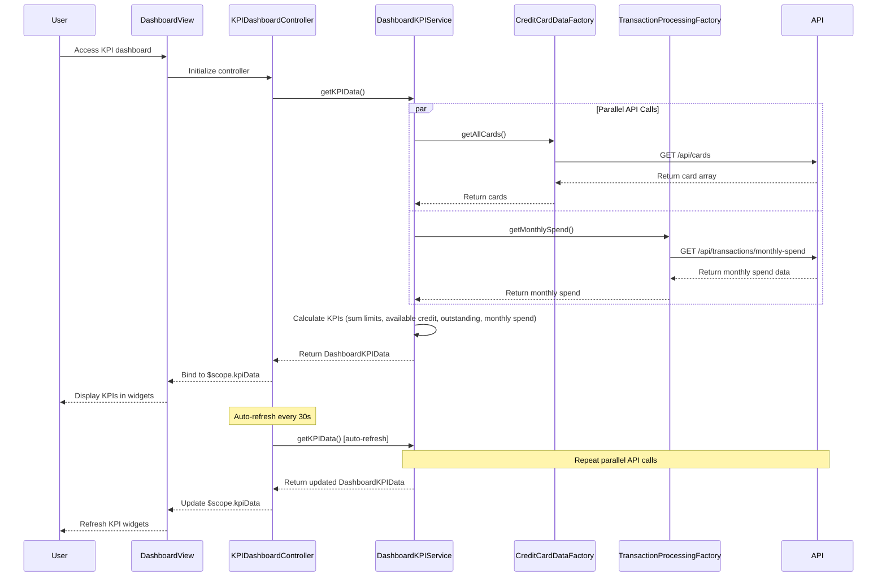

# Low-Level Design: Dashboard and KPI Management
**Epic ID:** QE-8352

## a. Architecture Mapping

| HLD Component | AngularJS Artifact | Mapping |
|---------------|-------------------|----------|
| User Interface Dashboard | Module: `kpiDashboardModule` | Main module for KPI dashboard features |
| Dashboard Service | Service: `DashboardKPIService` | Business logic for KPI calculation and data aggregation |
| Credit Card Data Service | Factory: `CreditCardDataFactory` | REST API calls for credit card data |
| Transaction Processing Service | Factory: `TransactionProcessingFactory` | REST API calls for transaction data and monthly spend calculation |
| Dashboard Controller | Controller: `KPIDashboardController` | Manages dashboard view, KPI display, and auto-refresh |
| KPI Widget Directive | Directive: `kpiWidget` | Reusable component for displaying individual KPI metrics |

**Recommended Folder Structure:**
```
app/
├── modules/
│   └── kpi-dashboard/
│       ├── kpi-dashboard.module.js
│       ├── controllers/
│       │   └── kpi-dashboard.controller.js
│       ├── services/
│       │   └── dashboard-kpi.service.js
│       ├── factories/
│       │   ├── credit-card-data.factory.js
│       │   └── transaction-processing.factory.js
│       ├── directives/
│       │   └── kpi-widget.directive.js
│       └── views/
│           ├── kpi-dashboard.html
│           └── kpi-widget.template.html
```

## b. Component Specifications

| Component Name | Artifact Type | Responsibility | Key Dependencies |
|----------------|---------------|----------------|------------------|
| kpiDashboardModule | Module | Encapsulates all KPI dashboard features | ngRoute, ui.bootstrap |
| KPIDashboardController | Controller | Manages dashboard initialization, KPI display, and auto-refresh logic | DashboardKPIService, $scope, $interval |
| DashboardKPIService | Service | Orchestrates KPI calculation (monthly spend, total credit limit, available credit, outstanding) | CreditCardDataFactory, TransactionProcessingFactory, $q |
| CreditCardDataFactory | Factory | Makes REST API calls to retrieve credit card balances and limits | $http, $q |
| TransactionProcessingFactory | Factory | Makes REST API calls to retrieve transaction data and calculate monthly spend | $http, $q |
| kpiWidget | Directive | Renders individual KPI with label, value, icon, and optional trend indicator | None |

## c. Data Model

**KPI Object:**
```javascript
{
  label: String, // "Monthly Spend", "Total Credit Limit", "Available Credit", "Outstanding Amount"
  value: Number,
  currency: String,
  icon: String, // CSS class for icon (e.g., "fa-credit-card")
  trend: String, // "up", "down", "neutral"
  trendValue: Number
}
```

**CreditCard Object:**
```javascript
{
  cardId: String,
  cardNumber: String, // masked
  balance: Number,
  creditLimit: Number,
  availableCredit: Number,
  outstandingAmount: Number
}
```

**MonthlySpend Object:**
```javascript
{
  currentMonth: Number,
  previousMonth: Number,
  trend: String // "up", "down", "neutral"
}
```

**DashboardKPIData Object:**
```javascript
{
  kpis: Array<KPI>,
  lastUpdated: Date
}
```

## d. Data Flow

User accesses the dashboard, initializing KPIDashboardController. The controller calls DashboardKPIService.getKPIData() to fetch all KPIs. DashboardKPIService makes parallel API calls: CreditCardDataFactory.getAllCards() to GET `/api/cards` for card balances and limits, and TransactionProcessingFactory.getMonthlySpend() to GET `/api/transactions/monthly-spend` for current month spending. The service aggregates data from all cards: sums all credit limits to get total credit limit, sums all available credit, sums all outstanding amounts. It retrieves monthly spend from the transaction API. The service creates an array of KPI objects with calculated values and trends, wraps them in DashboardKPIData, and returns to the controller. The controller binds DashboardKPIData to $scope, and kpiWidget directives render each KPI. The controller sets up $interval to auto-refresh KPIs every 30 seconds by re-calling DashboardKPIService.getKPIData().

## e. Primary Sequence Diagram



## f. Implementation Notes

- Use AngularJS DI to inject services and factories into controllers; register all components with kpiDashboardModule.
- Use $q.all() to make parallel API calls for cards and transactions to improve dashboard load time.
- Implement auto-refresh using $interval service with 30-second interval; cancel interval on $scope.$destroy to prevent memory leaks.
- Apply responsive design using Bootstrap grid (col-md-3 for KPI widgets) to ensure mobile compatibility.
- Use ES6: const/let for variables, arrow functions for callbacks, template literals for dynamic API URLs.

## g. Error Handling

Use $http interceptor to catch API errors globally; display error notifications using toastr; handle partial data failures gracefully by showing available KPIs and error message for failed ones.

## h. Security Notes

Requires token-based auth via existing SSO; all API calls include auth token in Authorization header; ensure backend filters data by authenticated user ID.