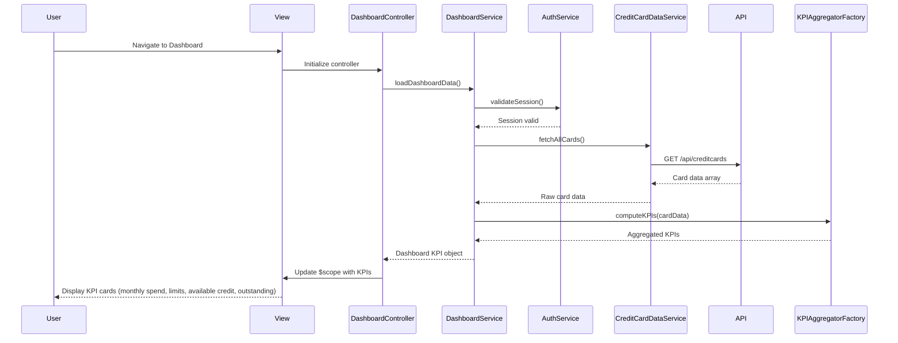

# Low-Level Design: QE-8353 - Credit Card Dashboard and KPI Management

## a. Architecture Mapping

**HLD Component → AngularJS Artifact Mapping:**

- User Interface → AngularJS Module (`creditCardDashboard`) + Controller (`DashboardController`) + View Template (HTML5)
- Dashboard Service → AngularJS Service (`DashboardService`) for orchestrating KPI data retrieval
- KPI Aggregation Engine → AngularJS Factory (`KPIAggregatorFactory`) for computing monthly spend, available credit, outstanding amounts
- Credit Card Data Repository → REST API integration via AngularJS Service (`CreditCardDataService`)
- User Authentication Service → AngularJS Service (`AuthService`) with HTTP interceptor for session management

**Recommended Folder Structure:**
```
app/
├── modules/
│   └── dashboard/
│       ├── dashboard.module.js
│       ├── controllers/
│       │   └── dashboard.controller.js
│       ├── services/
│       │   ├── dashboard.service.js
│       │   └── creditcard-data.service.js
│       ├── factories/
│       │   └── kpi-aggregator.factory.js
│       └── views/
│           └── dashboard.html
├── shared/
│   └── services/
│       └── auth.service.js
└── assets/
    ├── css/
    └── js/
```

## b. Component Specifications

| Component Name | Artifact Type | Responsibility | Key Dependencies |
|----------------|---------------|----------------|------------------|
| creditCardDashboard | Module | Root module for dashboard feature, registers all controllers, services, and factories | angular, ui.router, ngAnimate |
| DashboardController | Controller | Manages dashboard view state, binds KPI data to UI, handles user interactions | DashboardService, $scope, $timeout |
| DashboardService | Service | Orchestrates data flow between controller and backend services, coordinates KPI retrieval | CreditCardDataService, KPIAggregatorFactory, AuthService |
| CreditCardDataService | Service | Handles REST API calls to fetch credit card details, balances, limits, and transaction data | $http, $q, API_ENDPOINTS |
| KPIAggregatorFactory | Factory | Computes KPIs (monthly spend, total credit limit, available credit, outstanding amount) from raw card data | None (pure computation) |
| AuthService | Service | Manages user authentication state, token storage, and session validation | $http, $window, $q |
| AuthInterceptor | Factory | HTTP interceptor to attach auth tokens to API requests and handle 401 responses | $q, $injector, AuthService |
| dashboardDirective | Directive (optional) | Encapsulates KPI card UI component for reusability across dashboard | None |

## c. Data Model

**CreditCard Object:**
```javascript
{
  cardId: String,
  cardNumber: String (masked),
  cardType: String,
  cardHolderName: String,
  creditLimit: Number,
  outstandingAmount: Number,
  availableCredit: Number,
  monthlySpend: Number,
  lastUpdated: Date
}
```

**DashboardKPI Object:**
```javascript
{
  totalMonthlySpend: Number,
  totalCreditLimit: Number,
  totalAvailableCredit: Number,
  totalOutstandingAmount: Number,
  cardCount: Number,
  lastRefreshed: Date
}
```

## d. Data Flow

User navigates to the dashboard view, triggering `DashboardController` initialization. The controller invokes `DashboardService.loadDashboardData()`, which first validates the user session via `AuthService`. Upon successful authentication, `CreditCardDataService` makes a REST API call (GET /api/creditcards) to retrieve all credit card data for the authenticated user. The raw card data is passed to `KPIAggregatorFactory`, which computes aggregated KPIs (total monthly spend, total credit limit, total available credit, total outstanding amount). The computed KPIs are returned to the controller and bound to `$scope`, triggering Angular's digest cycle to update the view with KPI cards displaying real-time financial metrics. Bootstrap CSS ensures responsive layout across devices.

## e. Primary Sequence Diagram



## f. Implementation Notes

- Use AngularJS 1.x module pattern with dependency injection for all services, factories, and controllers to ensure testability and maintainability.
- Implement ES6 classes for services and controllers where possible; transpile using Babel if targeting older browsers.
- Use `$http` service with promise-based API calls; handle responses with `.then()` and `.catch()` for async flow control.
- Apply Bootstrap grid system (col-xs, col-sm, col-md, col-lg) for responsive KPI card layout; use CSS3 media queries for fine-tuned adjustments.
- Leverage AngularJS `$timeout` service instead of native setTimeout to ensure proper digest cycle integration and avoid manual `$scope.$apply()` calls.

## g. Error Handling

HTTP interceptor-based error handling with user-friendly toast notifications for API failures; try/catch blocks in KPI computation logic with fallback to zero values.

## h. Security Notes

Requires token-based authentication via existing SSO; all API calls include Authorization header with JWT token managed by AuthService and AuthInterceptor.