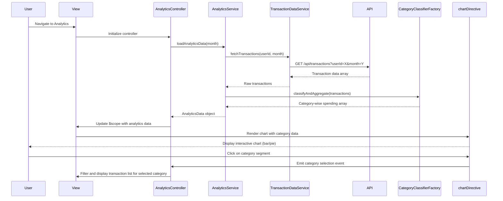

# Low-Level Design: QE-8354 - Transaction Analytics and Category-wise Spending Insights

## a. Architecture Mapping

**HLD Component → AngularJS Artifact Mapping:**

- User Interface → AngularJS Module (`transactionAnalytics`) + Controller (`AnalyticsController`) + View Template (HTML5 with Chart.js integration)
- Analytics Service → AngularJS Service (`AnalyticsService`) for orchestrating transaction data retrieval and analytics computation
- Category Classification Engine → AngularJS Factory (`CategoryClassifierFactory`) for mapping transactions to 9 predefined categories
- Transaction Data Service → REST API integration via AngularJS Service (`TransactionDataService`)
- Data Visualization Library → Chart.js wrapped in AngularJS Directive (`chartDirective`) for rendering interactive charts

**Recommended Folder Structure:**
```
app/
├── modules/
│   └── analytics/
│       ├── analytics.module.js
│       ├── controllers/
│       │   └── analytics.controller.js
│       ├── services/
│       │   ├── analytics.service.js
│       │   └── transaction-data.service.js
│       ├── factories/
│       │   └── category-classifier.factory.js
│       ├── directives/
│       │   └── chart.directive.js
│       └── views/
│           └── analytics.html
└── assets/
    ├── css/
    └── js/
        └── chart.min.js
```

## b. Component Specifications

| Component Name | Artifact Type | Responsibility | Key Dependencies |
|----------------|---------------|----------------|------------------|
| transactionAnalytics | Module | Root module for analytics feature, registers controllers, services, factories, and directives | angular, ui.router, chart.js |
| AnalyticsController | Controller | Manages analytics view state, binds category-wise spending data to UI, handles chart interactions | AnalyticsService, $scope, $filter |
| AnalyticsService | Service | Orchestrates transaction data retrieval, invokes category classification, prepares data for visualization | TransactionDataService, CategoryClassifierFactory |
| TransactionDataService | Service | Handles REST API calls to fetch transaction data for the authenticated user | $http, $q, API_ENDPOINTS |
| CategoryClassifierFactory | Factory | Classifies transactions into 9 predefined categories (Food & Dining, Fuel, Shopping, Travel, Entertainment, Utilities, Healthcare, Education, Miscellaneous) | None (rule-based logic) |
| chartDirective | Directive | Wraps Chart.js library to render interactive, responsive bar/pie charts for category-wise spending | Chart.js, $timeout |
| TransactionListController | Controller (optional) | Manages transaction listing view with filtering and sorting capabilities | AnalyticsService, $scope |

## c. Data Model

**Transaction Object:**
```javascript
{
  transactionId: String,
  cardId: String,
  amount: Number,
  currency: String,
  category: String,
  merchantName: String,
  transactionDate: Date,
  description: String
}
```

**CategorySpending Object:**
```javascript
{
  category: String,
  totalAmount: Number,
  transactionCount: Number,
  percentage: Number
}
```

**AnalyticsData Object:**
```javascript
{
  categorySpendingArray: Array<CategorySpending>,
  totalSpend: Number,
  transactionList: Array<Transaction>,
  monthYear: String,
  lastUpdated: Date
}
```

## d. Data Flow

User navigates to the analytics view, triggering `AnalyticsController` initialization. The controller invokes `AnalyticsService.loadAnalyticsData()`, which calls `TransactionDataService` to fetch transaction data via REST API (GET /api/transactions?userId=X&month=Y). The raw transaction array is passed to `CategoryClassifierFactory`, which iterates through each transaction and assigns it to one of the 9 predefined categories based on merchant name or transaction description patterns. The factory aggregates spending by category, computing total amount, transaction count, and percentage of total spend for each category. The categorized data is returned to `AnalyticsService`, which formats it for chart rendering. The controller binds this data to `$scope`, and the `chartDirective` consumes the data to render an interactive bar or pie chart using Chart.js. Users can click on chart segments to drill down into transaction details, triggering controller methods that filter and display the transaction list for the selected category.

## e. Primary Sequence Diagram



## f. Implementation Notes

- Use AngularJS directive to wrap Chart.js for declarative chart rendering; pass data via isolated scope bindings (`scope: { data: '=', options: '=' }`).
- Implement CategoryClassifierFactory with a rule-based classification engine using regex patterns or keyword matching on merchant names and descriptions.
- Use AngularJS `$filter` service for formatting currency, dates, and percentages in the transaction list and chart tooltips.
- Leverage Chart.js responsive configuration to ensure charts adapt to mobile, tablet, and desktop screen sizes; set `maintainAspectRatio: false` for flexible height.
- Cache transaction data in AnalyticsService for the current month to avoid redundant API calls when switching between chart and list views; invalidate cache on month change.

## g. Error Handling

HTTP interceptor-based error handling for API failures with user-friendly error messages; try/catch in category classification logic with fallback to 'Miscellaneous' for unclassified transactions.

## h. Security Notes

Standard input validation and secure API calls assumed; transaction data access restricted to authenticated users via token-based authorization.