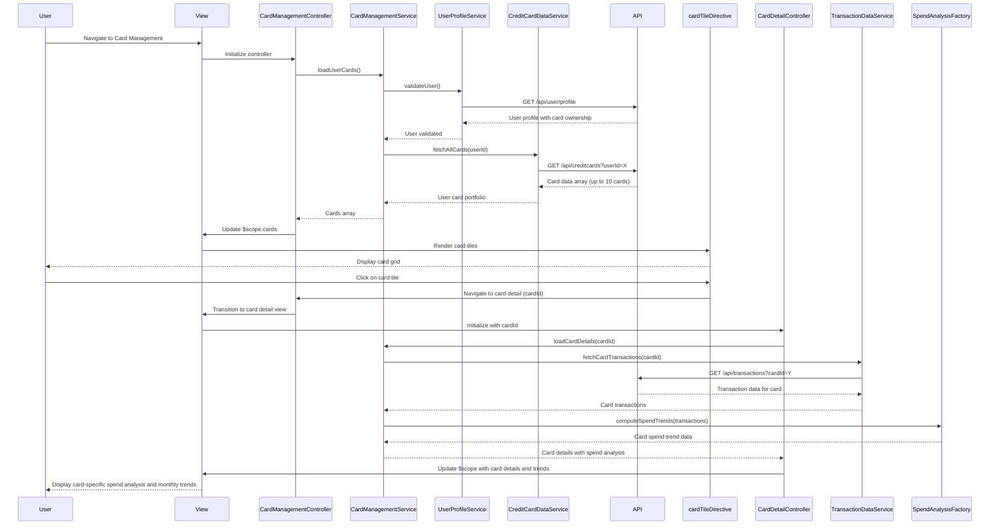

# Low-Level Design: QE-8355 - Multiple Credit Card Management

## a. Architecture Mapping

**HLD Component → AngularJS Artifact Mapping:**

- User Interface → AngularJS Module (`cardManagement`) + Controller (`CardManagementController`) + View Template (HTML5 with card grid layout)
- Card Management Service → AngularJS Service (`CardManagementService`) for orchestrating card data retrieval and spend analysis
- User Profile Service → REST API integration via AngularJS Service (`UserProfileService`) for user identity and card ownership verification
- Credit Card Data Repository → REST API integration via AngularJS Service (`CreditCardDataService`)
- Transaction Data Service → REST API integration via AngularJS Service (`TransactionDataService`)
- Spend Analysis Engine → AngularJS Factory (`SpendAnalysisFactory`) for computing card-wise spend trends and monthly aggregations

**Recommended Folder Structure:**
```
app/
├── modules/
│   └── card-management/
│       ├── card-management.module.js
│       ├── controllers/
│       │   ├── card-management.controller.js
│       │   └── card-detail.controller.js
│       ├── services/
│       │   ├── card-management.service.js
│       │   ├── creditcard-data.service.js
│       │   ├── transaction-data.service.js
│       │   └── user-profile.service.js
│       ├── factories/
│       │   └── spend-analysis.factory.js
│       ├── directives/
│       │   └── card-tile.directive.js
│       └── views/
│           ├── card-list.html
│           └── card-detail.html
└── assets/
    ├── css/
    └── images/
```

## b. Component Specifications

| Component Name | Artifact Type | Responsibility | Key Dependencies |
|----------------|---------------|----------------|------------------|
| cardManagement | Module | Root module for card management feature, registers controllers, services, factories, and directives | angular, ui.router, ngAnimate |
| CardManagementController | Controller | Manages card list view state, binds multiple card data to UI, handles card selection and navigation | CardManagementService, $scope, $state |
| CardDetailController | Controller | Manages individual card detail view, displays card-specific spend analysis and monthly trends | CardManagementService, $scope, $stateParams |
| CardManagementService | Service | Orchestrates card data retrieval, coordinates with user profile validation, invokes spend analysis | UserProfileService, CreditCardDataService, TransactionDataService, SpendAnalysisFactory |
| CreditCardDataService | Service | Handles REST API calls to fetch credit card details, limits, and balances for the authenticated user | $http, $q, API_ENDPOINTS |
| TransactionDataService | Service | Handles REST API calls to fetch transaction history for specific cards or all cards | $http, $q, API_ENDPOINTS |
| UserProfileService | Service | Validates user identity and retrieves card ownership information from user profile API | $http, $q, API_ENDPOINTS |
| SpendAnalysisFactory | Factory | Computes card-wise spend trends, monthly spend aggregations, and comparative spend metrics across cards | None (pure computation) |
| cardTileDirective | Directive | Encapsulates individual card tile UI component for displaying card summary (card number, limit, balance, monthly spend) | None |

## c. Data Model

**CreditCard Object:**
```javascript
{
  cardId: String,
  cardNumber: String (masked),
  cardType: String,
  cardHolderName: String,
  creditLimit: Number,
  outstandingAmount: Number,
  availableCredit: Number,
  monthlySpend: Number,
  lastUpdated: Date,
  isActive: Boolean
}
```

**CardSpendTrend Object:**
```javascript
{
  cardId: String,
  monthlySpendArray: Array<{month: String, amount: Number}>,
  averageMonthlySpend: Number,
  highestSpendMonth: String,
  lowestSpendMonth: String
}
```

**UserCardPortfolio Object:**
```javascript
{
  userId: String,
  cards: Array<CreditCard>,
  totalCards: Number,
  totalCreditLimit: Number,
  totalOutstanding: Number,
  lastRefreshed: Date
}
```

## d. Data Flow

User navigates to the card management view, triggering `CardManagementController` initialization. The controller invokes `CardManagementService.loadUserCards()`, which first calls `UserProfileService` to validate user identity and retrieve card ownership information via REST API (GET /api/user/profile). Upon successful validation, `CreditCardDataService` fetches all credit cards associated with the user (GET /api/creditcards?userId=X), supporting up to 10 cards per user. The raw card data is bound to `$scope.cards` and rendered as a grid of card tiles using `cardTileDirective`. When a user clicks on a specific card tile, the controller navigates to the card detail view, passing the cardId via `$stateParams`. `CardDetailController` initializes and invokes `CardManagementService.loadCardDetails(cardId)`, which fetches card-specific transaction data via `TransactionDataService` (GET /api/transactions?cardId=Y). The transaction data is passed to `SpendAnalysisFactory`, which computes monthly spend trends and aggregations. The computed spend analysis is bound to `$scope` and displayed as charts or tables in the card detail view, enabling users to understand spending patterns for that specific card.

## e. Primary Sequence Diagram



## f. Implementation Notes

- Use AngularJS ui-router for state-based navigation between card list view and card detail view; pass cardId via state params for deep linking support.
- Implement cardTileDirective with isolated scope to encapsulate card tile UI logic; use two-way binding for card data and event callbacks for user interactions.
- Use AngularJS `$q.all()` to parallelize API calls when fetching card data and transaction data simultaneously, reducing overall load time.
- Apply Bootstrap card component styling for card tiles; use CSS Grid or Flexbox for responsive card grid layout that adapts to different screen sizes.
- Implement data refresh mechanism with a manual refresh button or auto-refresh every 3 seconds using `$interval` service; ensure proper cleanup on scope destruction to prevent memory leaks.

## g. Error Handling

HTTP interceptor-based error handling for API failures with user-friendly notifications; validation checks for card ownership before displaying card details to prevent unauthorized access.

## h. Security Notes

Requires token-based authentication via existing SSO; card data access restricted to authenticated users with validated card ownership through UserProfileService.