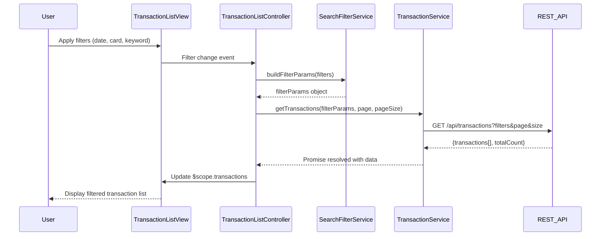

# Low-Level Design: Transaction Management and Monitoring
**Epic ID:** QE-8356

## a. Architecture Mapping

- **Transaction Management Module** → AngularJS Module (`app.transactions`)
- **Transaction List Controller** → AngularJS Controller (`TransactionListController`)
- **Transaction Detail Controller** → AngularJS Controller (`TransactionDetailController`)
- **Transaction Service** → AngularJS Service (`TransactionService`)
- **Search Filter Service** → AngularJS Service (`SearchFilterService`)
- **Pagination Directive** → AngularJS Directive (`txPagination`)

**Folder Structure:**
```
/app
  /modules
    /transactions
      /controllers
        - transaction-list.controller.js
        - transaction-detail.controller.js
      /services
        - transaction.service.js
        - search-filter.service.js
      /directives
        - tx-pagination.directive.js
      /views
        - transaction-list.html
        - transaction-detail.html
      - transactions.module.js
```

## b. Component Specifications

| Component Name | Artifact Type | Responsibility | Key Dependencies |
|----------------|---------------|----------------|------------------|
| TransactionListController | Controller | Manages transaction list view, handles pagination and user interactions | TransactionService, SearchFilterService, $scope |
| TransactionDetailController | Controller | Displays individual transaction details and metadata | TransactionService, $routeParams, $scope |
| TransactionService | Service | Fetches transaction data from REST API, manages transaction state | $http, $q, API_CONFIG |
| SearchFilterService | Service | Handles search, filtering, and date range operations on transactions | $filter, moment.js |
| txPagination | Directive | Renders pagination controls and manages page navigation | None |
| TransactionListView | HTML Template | Displays paginated transaction list with search/filter UI | Bootstrap grid, ng-repeat |
| TransactionDetailView | HTML Template | Shows detailed transaction information | Bootstrap card components |

## c. Data Model

**Transaction Object:**
```javascript
{
  transactionId: String,
  cardId: String,
  cardName: String,
  merchantName: String,
  category: String,
  amount: Number,
  currency: String,
  transactionDate: Date,
  status: String,
  description: String
}
```

**SearchFilter Object:**
```javascript
{
  cardId: String,
  startDate: Date,
  endDate: Date,
  keyword: String,
  category: String
}
```

**PaginationState Object:**
```javascript
{
  currentPage: Number,
  pageSize: Number,
  totalRecords: Number,
  totalPages: Number
}
```

## d. Data Flow

User enters search criteria or selects filters in the Transaction List View → TransactionListController captures input and invokes SearchFilterService to build filter parameters → TransactionService makes REST API call to `/api/transactions` with filter and pagination params → API returns paginated transaction data → TransactionService resolves promise with transaction array → Controller updates $scope.transactions → View renders transaction list via ng-repeat with txPagination directive → User clicks transaction row → TransactionDetailController fetches full transaction details via TransactionService → Detail view displays complete transaction information.

## e. Primary Sequence Diagram



## f. Implementation Notes

- Use AngularJS 1.x module pattern with dependency injection for all services and controllers
- Implement REST API calls using $http service with promise-based error handling
- Apply ng-repeat with track by transactionId for optimal rendering performance
- Use Bootstrap responsive grid (col-xs/sm/md/lg) for mobile-first transaction list layout
- Implement client-side caching in TransactionService using $cacheFactory for recently viewed transactions

## g. Error Handling

HTTP interceptor captures API errors; user-friendly messages displayed via Bootstrap alert component with retry option.

## h. Security Notes

Requires token-based auth via existing SSO; all API calls include Authorization header with JWT token.