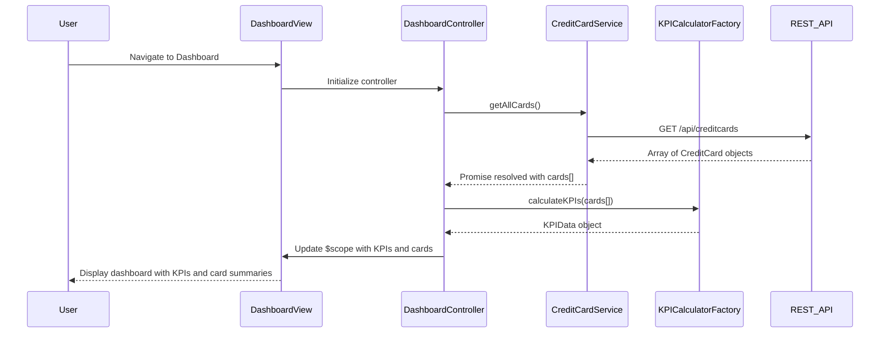

# Low-Level Design: Dashboard KPIs and Credit Card Overview
**Epic ID:** QE-8357

## a. Architecture Mapping

- **Dashboard Module** → AngularJS Module (`app.dashboard`)
- **Dashboard Controller** → AngularJS Controller (`DashboardController`)
- **Credit Card Service** → AngularJS Service (`CreditCardService`)
- **KPI Calculator Service** → AngularJS Factory (`KPICalculatorFactory`)
- **Card Summary Directive** → AngularJS Directive (`cardSummary`)
- **KPI Widget Directive** → AngularJS Directive (`kpiWidget`)

**Folder Structure:**
```
/app
  /modules
    /dashboard
      /controllers
        - dashboard.controller.js
      /services
        - credit-card.service.js
      /factories
        - kpi-calculator.factory.js
      /directives
        - card-summary.directive.js
        - kpi-widget.directive.js
      /views
        - dashboard.html
      - dashboard.module.js
```

## b. Component Specifications

| Component Name | Artifact Type | Responsibility | Key Dependencies |
|----------------|---------------|----------------|------------------|
| DashboardController | Controller | Orchestrates dashboard data loading, manages KPI refresh cycle | CreditCardService, KPICalculatorFactory, $scope, $interval |
| CreditCardService | Service | Fetches credit card data from REST API, manages card portfolio state | $http, $q, API_CONFIG |
| KPICalculatorFactory | Factory | Aggregates and calculates KPIs across multiple cards | None |
| cardSummary | Directive | Renders individual credit card summary with key metrics | None |
| kpiWidget | Directive | Displays individual KPI with value, label, and trend indicator | None |
| DashboardView | HTML Template | Responsive layout for KPIs and card summaries | Bootstrap grid, flexbox |

## c. Data Model

**CreditCard Object:**
```javascript
{
  cardId: String,
  cardName: String,
  cardNumber: String,
  cardType: String,
  creditLimit: Number,
  availableCredit: Number,
  outstandingAmount: Number,
  monthlySpend: Number,
  dueDate: Date,
  status: String
}
```

**KPIData Object:**
```javascript
{
  totalCreditLimit: Number,
  totalAvailableCredit: Number,
  totalOutstanding: Number,
  totalMonthlySpend: Number,
  creditUtilizationPercent: Number,
  activeCardsCount: Number
}
```

## d. Data Flow

User navigates to dashboard → DashboardController initializes and calls CreditCardService.getAllCards() → Service makes REST API call to `/api/creditcards` → API returns array of credit card objects → CreditCardService resolves promise with card data → DashboardController passes card array to KPICalculatorFactory.calculateKPIs() → Factory aggregates totals and computes utilization percentage → Controller updates $scope.kpiData and $scope.cards → Dashboard view renders KPI widgets and card summary directives with real-time data → $interval triggers periodic refresh every 5 minutes to update KPIs.

## e. Primary Sequence Diagram



## f. Implementation Notes

- Use AngularJS factory pattern for KPICalculatorFactory to enable stateless KPI computation logic
- Implement $interval service for auto-refresh with 5-minute polling interval; clear on $destroy event
- Apply Bootstrap responsive utilities (hidden-xs, col-md-3) for adaptive KPI widget layout
- Use ng-class for dynamic styling based on credit utilization thresholds (green <30%, yellow 30-70%, red >70%)
- Cache card data in CreditCardService using ES6 Map for quick lookup by cardId

## g. Error Handling

HTTP interceptor with $q rejection; display error notification using Bootstrap toast with manual retry button.

## h. Security Notes

Requires token-based auth via existing SSO; user-specific card data filtered server-side based on authenticated user context.