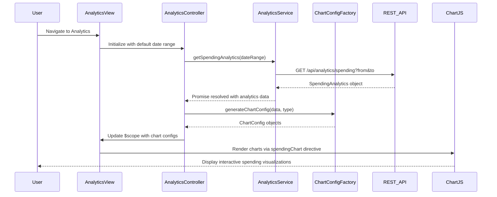

# Low-Level Design: Spending Analytics and Insights
**Epic ID:** QE-8358

## a. Architecture Mapping

- **Analytics Module** → AngularJS Module (`app.analytics`)
- **Analytics Controller** → AngularJS Controller (`AnalyticsController`)
- **Analytics Service** → AngularJS Service (`AnalyticsService`)
- **Categorization Service** → AngularJS Service (`CategorizationService`)
- **Chart Directive** → AngularJS Directive (`spendingChart`)
- **Chart Config Factory** → AngularJS Factory (`ChartConfigFactory`)

**Folder Structure:**
```
/app
  /modules
    /analytics
      /controllers
        - analytics.controller.js
      /services
        - analytics.service.js
        - categorization.service.js
      /factories
        - chart-config.factory.js
      /directives
        - spending-chart.directive.js
      /views
        - analytics.html
      - analytics.module.js
```

## b. Component Specifications

| Component Name | Artifact Type | Responsibility | Key Dependencies |
|----------------|---------------|----------------|------------------|
| AnalyticsController | Controller | Manages analytics view state, handles chart type selection and filtering | AnalyticsService, $scope, $filter |
| AnalyticsService | Service | Fetches aggregated spending data from REST API, manages analytics state | $http, $q, API_CONFIG |
| CategorizationService | Service | Provides category definitions and mapping logic for 9 spending categories | None |
| spendingChart | Directive | Renders interactive charts using Chart.js library with responsive behavior | ChartConfigFactory, Chart.js |
| ChartConfigFactory | Factory | Generates Chart.js configuration objects for different chart types | None |
| AnalyticsView | HTML Template | Responsive layout for analytics filters and chart containers | Bootstrap grid, tabs |

## c. Data Model

**SpendingAnalytics Object:**
```javascript
{
  userId: String,
  period: String,
  monthlyTrends: Array<{month: String, amount: Number}>,
  cardWiseSpending: Array<{cardId: String, cardName: String, amount: Number}>,
  categoryWiseSpending: Array<{category: String, amount: Number, percentage: Number}>
}
```

**Category Object:**
```javascript
{
  categoryId: String,
  categoryName: String, // One of: Food & Dining, Fuel, Shopping, Travel, Entertainment, Utilities, Healthcare, Education, Miscellaneous
  color: String,
  icon: String
}
```

**ChartConfig Object:**
```javascript
{
  type: String, // 'line', 'bar', 'pie', 'doughnut'
  data: Object,
  options: Object
}
```

## d. Data Flow

User navigates to analytics view → AnalyticsController initializes with default date range (last 12 months) → Controller calls AnalyticsService.getSpendingAnalytics(dateRange) → Service makes REST API call to `/api/analytics/spending` with date parameters → API returns aggregated spending data (monthly trends, card-wise, category-wise) → AnalyticsService resolves promise with SpendingAnalytics object → Controller processes data and invokes ChartConfigFactory to generate chart configurations for each visualization type → spendingChart directives receive config and render interactive charts using Chart.js → User interacts with filters or drills down into specific category → Controller updates data and re-renders charts dynamically.

## e. Primary Sequence Diagram



## f. Implementation Notes

- Use Chart.js library (v2.x) integrated via angular-chart.js wrapper for declarative chart binding
- Implement ES6 arrow functions in ChartConfigFactory for concise chart option builders
- Apply responsive: true and maintainAspectRatio: false in Chart.js options for mobile adaptation
- Use AngularJS $filter service for date formatting and currency display in chart tooltips
- Implement lazy loading for Chart.js library using ocLazyLoad to reduce initial bundle size

## g. Error Handling

Try/catch blocks in AnalyticsService with $q.reject; display user-friendly error message via Bootstrap modal with retry action.

## h. Security Notes

Standard input validation and secure API calls assumed; analytics data scoped to authenticated user via server-side filtering.