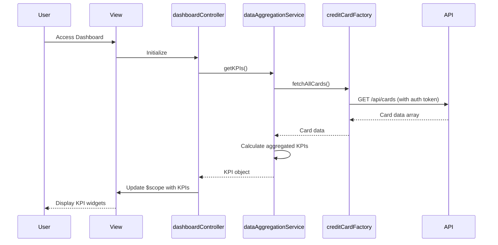

# Low-Level Design: Dashboard KPIs and Credit Card Overview
**Epic ID:** QE-8365  
**Tech Stack:** AngularJS 1.x, JavaScript ES6, HTML5, CSS3, Bootstrap, REST APIs, MVC

---

## a. Architecture Mapping

- **User Interface** → AngularJS View (HTML5 + Bootstrap responsive layout)
- **Dashboard Controller** → AngularJS Controller (`dashboardController.js`)
- **Data Aggregation Service** → AngularJS Service (`dataAggregationService.js`)
- **Credit Card Data Service** → AngularJS Factory (`creditCardFactory.js`)
- **User Authentication Service** → AngularJS Service (`authService.js`)

**Folder Structure:**
```
/app
  /modules
    /dashboard
      /controllers
        dashboardController.js
      /services
        dataAggregationService.js
      /factories
        creditCardFactory.js
      /views
        dashboard.html
  /shared
    /services
      authService.js
  /assets
    /css
    /js
```

---

## b. Component Specifications

| Component Name | Artifact Type | Responsibility | Key Dependencies |
|----------------|---------------|----------------|------------------|
| dashboardController | Controller | Manages dashboard state, fetches aggregated KPI data, handles user interactions | dataAggregationService, $scope, $timeout |
| dataAggregationService | Service | Aggregates multi-card KPIs (monthly spend, total limit, available credit, outstanding) | creditCardFactory, $q |
| creditCardFactory | Factory | Fetches credit card data from REST API endpoints | $http, authService |
| authService | Service | Manages user authentication and session tokens | $http, $window |
| dashboard.html | View | Renders KPI widgets in responsive Bootstrap grid layout | dashboardController |

---

## c. Data Model

**CreditCardKPI (JavaScript Object):**
```javascript
{
  userId: String,
  monthlySpend: Number,
  totalCreditLimit: Number,
  availableCredit: Number,
  outstandingAmount: Number,
  cards: Array<CreditCard>,
  lastUpdated: Date
}
```

**CreditCard (JavaScript Object):**
```javascript
{
  cardId: String,
  cardNumber: String (masked),
  creditLimit: Number,
  availableBalance: Number,
  outstandingBalance: Number,
  cardType: String
}
```

---

## d. Data Flow

User accesses the dashboard view → dashboardController initializes and calls dataAggregationService.getKPIs() → dataAggregationService invokes creditCardFactory.fetchAllCards() which makes REST API call (GET /api/cards) with auth token → API returns card data → dataAggregationService calculates aggregated KPIs (sum of limits, available credit, outstanding) → Controller updates $scope with KPI data → View renders KPI widgets using Bootstrap cards with two-way binding, refreshing every 30 seconds via $timeout.

---

## e. Primary Sequence Diagram



---

## f. Implementation Notes

- Use AngularJS Dependency Injection to inject services and factories into controllers.
- Implement ES6 arrow functions and Promises ($q) for asynchronous API calls.
- Use Bootstrap grid system (col-md-3, col-sm-6, col-xs-12) for responsive KPI card layout.
- Implement $timeout service for auto-refresh every 30 seconds to meet real-time requirement.
- REST API integration via $http service with interceptors for token injection and error handling.

---

## g. Error Handling

HTTP interceptor captures API errors, displays user-friendly notifications via toastr, and logs errors to console.

---

## h. Security Notes

Requires token-based authentication via existing SSO; tokens injected in API request headers via $http interceptor.