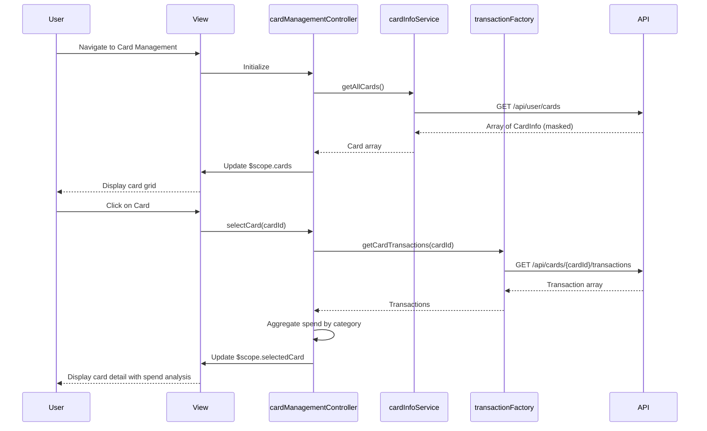

# Low-Level Design: Multiple Credit Card Management
**Epic ID:** QE-8366  
**Tech Stack:** AngularJS 1.x, JavaScript ES6, HTML5, CSS3, Bootstrap, REST APIs, MVC

---

## a. Architecture Mapping

- **User Interface** → AngularJS View (HTML5 + Bootstrap card components)
- **Card Management Controller** → AngularJS Controller (`cardManagementController.js`)
- **Card Information Service** → AngularJS Service (`cardInfoService.js`)
- **User Profile Service** → AngularJS Service (`userProfileService.js`)
- **Transaction Processing Service** → AngularJS Factory (`transactionFactory.js`)

**Folder Structure:**
```
/app
  /modules
    /cards
      /controllers
        cardManagementController.js
      /services
        cardInfoService.js
      /factories
        transactionFactory.js
      /views
        cardList.html
        cardDetail.html
  /shared
    /services
      userProfileService.js
  /assets
    /css
    /js
```

---

## b. Component Specifications

| Component Name | Artifact Type | Responsibility | Key Dependencies |
|----------------|---------------|----------------|------------------|
| cardManagementController | Controller | Manages card list display, card selection, comparison logic, card-wise analytics | cardInfoService, transactionFactory, userProfileService, $scope |
| cardInfoService | Service | Retrieves individual card details and metadata from API | $http, $q |
| userProfileService | Service | Fetches user-specific card associations and preferences | $http |
| transactionFactory | Factory | Fetches card-wise transaction data for spend analysis | $http |
| cardList.html | View | Displays multiple cards in grid layout with status indicators | cardManagementController |
| cardDetail.html | View | Shows detailed view of selected card with spend analysis | cardManagementController |

---

## c. Data Model

**CardInfo (JavaScript Object):**
```javascript
{
  cardId: String,
  userId: String,
  cardNumber: String (masked, last 4 digits visible),
  cardHolderName: String,
  cardType: String,
  creditLimit: Number,
  availableBalance: Number,
  outstandingAmount: Number,
  status: String,
  expiryDate: String,
  utilizationPercentage: Number
}
```

**CardTransaction (JavaScript Object):**
```javascript
{
  transactionId: String,
  cardId: String,
  amount: Number,
  category: String,
  date: Date,
  merchant: String
}
```

---

## d. Data Flow

User navigates to card management view → cardManagementController initializes and calls cardInfoService.getAllCards() → Service makes REST API call (GET /api/user/cards) with user token → API returns array of CardInfo objects with masked card numbers → Controller stores cards in $scope.cards and calculates utilization percentage for each card → View renders cards in Bootstrap grid using ng-repeat → User clicks on a card → Controller calls transactionFactory.getCardTransactions(cardId) → Factory fetches card-wise transactions (GET /api/cards/{cardId}/transactions) → Controller aggregates spend by category → View updates to show card detail with spend breakdown.

---

## e. Primary Sequence Diagram



---

## f. Implementation Notes

- Use AngularJS ng-repeat with track by cardId for efficient card list rendering (up to 20 cards).
- Implement ES6 template literals for dynamic card number masking (e.g., `**** **** **** ${last4}`).
- Use Bootstrap card components with responsive col classes for mobile and desktop layouts.
- Apply AngularJS filters for currency formatting and percentage calculation in views.
- Cache card data in service using simple object cache to reduce API calls; invalidate on user action.

---

## g. Error Handling

HTTP interceptor with try/catch blocks in service methods; display error toasts for failed API calls and fallback to cached data if available.

---

## h. Security Notes

Card numbers masked on server side; only last 4 digits exposed; all API calls secured with token-based auth via SSO.