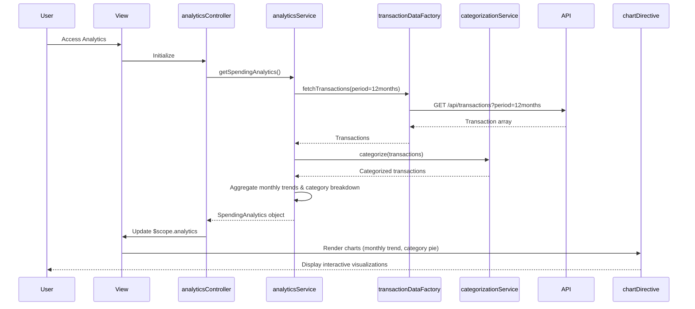

# Low-Level Design: Spending Analytics and Insights
**Epic ID:** QE-8367  
**Tech Stack:** AngularJS 1.x, JavaScript ES6, HTML5, CSS3, Bootstrap, REST APIs, MVC, Chart.js

---

## a. Architecture Mapping

- **User Interface** → AngularJS View (HTML5 + Bootstrap + Chart.js directives)
- **Analytics Controller** → AngularJS Controller (`analyticsController.js`)
- **Analytics Engine** → AngularJS Service (`analyticsService.js`)
- **Transaction Data Service** → AngularJS Factory (`transactionDataFactory.js`)
- **Categorization Service** → AngularJS Service (`categorizationService.js`)
- **Data Visualization Library** → AngularJS Directive wrapping Chart.js (`chartDirective.js`)

**Folder Structure:**
```
/app
  /modules
    /analytics
      /controllers
        analyticsController.js
      /services
        analyticsService.js
        categorizationService.js
      /factories
        transactionDataFactory.js
      /directives
        chartDirective.js
      /views
        analytics.html
  /assets
    /libs
      chart.js
```

---

## b. Component Specifications

| Component Name | Artifact Type | Responsibility | Key Dependencies |
|----------------|---------------|----------------|------------------|
| analyticsController | Controller | Manages analytics view state, fetches spending data, handles filter interactions | analyticsService, $scope, $filter |
| analyticsService | Service | Processes and aggregates transaction data for trends and category breakdowns | transactionDataFactory, categorizationService, $q |
| transactionDataFactory | Factory | Fetches historical transaction data (up to 12 months) from REST API | $http |
| categorizationService | Service | Maps transactions to predefined categories (Food, Fuel, Shopping, Travel, etc.) | None |
| chartDirective | Directive | Renders interactive Chart.js visualizations (line, pie, bar charts) | Chart.js library |
| analytics.html | View | Displays monthly trend chart and category-wise pie/bar charts with filters | analyticsController, chartDirective |

---

## c. Data Model

**SpendingAnalytics (JavaScript Object):**
```javascript
{
  userId: String,
  monthlyTrends: Array<MonthlySpend>,
  categoryBreakdown: Array<CategorySpend>,
  totalSpend: Number,
  period: String,
  lastUpdated: Date
}
```

**MonthlySpend (JavaScript Object):**
```javascript
{
  month: String (YYYY-MM),
  totalSpend: Number
}
```

**CategorySpend (JavaScript Object):**
```javascript
{
  category: String (Food & Dining, Fuel, Shopping, Travel, Entertainment, Utilities, Healthcare, Education, Miscellaneous),
  amount: Number,
  percentage: Number,
  transactionCount: Number
}
```

---

## d. Data Flow

User accesses analytics view → analyticsController calls analyticsService.getSpendingAnalytics() → analyticsService invokes transactionDataFactory.fetchTransactions() which makes REST API call (GET /api/transactions?period=12months) → API returns transaction array → analyticsService passes transactions to categorizationService.categorize() which maps each transaction to a predefined category → analyticsService aggregates data into monthlyTrends (grouped by month) and categoryBreakdown (grouped by category) → Controller updates $scope with analytics object → chartDirective renders line chart for monthly trends and pie chart for category breakdown using Chart.js → User applies filter (e.g., date range) → Controller re-aggregates data and updates charts.

---

## e. Primary Sequence Diagram



---

## f. Implementation Notes

- Use AngularJS custom directive to wrap Chart.js for reusable chart components with two-way data binding.
- Implement ES6 Array methods (map, reduce, filter) for efficient transaction aggregation and categorization.
- Use AngularJS $filter service for date range filtering and dynamic chart updates without re-fetching API data.
- Cache transaction data in analyticsService for 5 minutes to improve performance on filter changes.
- Ensure Chart.js responsive option is enabled for mobile compatibility.

---

## g. Error Handling

Service-level try/catch with $q.reject for promise chains; display error notifications via toastr and show fallback empty state in charts.

---

## h. Security Notes

Standard input validation and secure API calls assumed; transaction data filtered by authenticated user ID on server side.