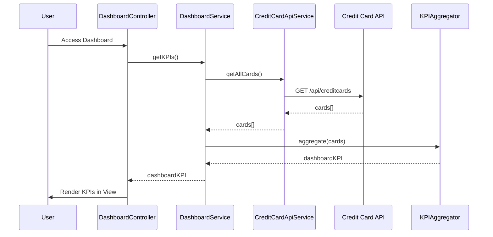

# Low-Level Design: QE-8368 - Dashboard KPIs and Financial Overview

## a. Architecture Mapping

- **Dashboard Module** → AngularJS Module (`app.dashboard`)
- **Dashboard Service** → AngularJS Service (`DashboardService`)
- **KPI Aggregation Engine** → AngularJS Factory (`KPIAggregator`)
- **Credit Card Data Source** → REST API integration via `$http` service
- **Responsive UI Renderer** → AngularJS Controller (`DashboardController`) + HTML5/CSS3/Bootstrap views

**Folder Structure:**
```
/app
  /modules
    /dashboard
      dashboard.module.js
      dashboard.controller.js
      dashboard.service.js
      dashboard.html
  /factories
    kpi-aggregator.factory.js
  /services
    credit-card-api.service.js
```

## b. Component Specifications

| Name | Artifact Type | Responsibility | Key Dependencies |
|------|---------------|----------------|------------------|
| DashboardModule | Module | Root module for dashboard feature | angular, ngRoute, ui.bootstrap |
| DashboardController | Controller | Manages dashboard view state and user interactions | DashboardService, KPIAggregator, $scope |
| DashboardService | Service | Orchestrates data fetching and KPI calculation | CreditCardApiService, $q |
| KPIAggregator | Factory | Aggregates monthly spend, total limit, available credit, outstanding amount | None (pure calculation logic) |
| CreditCardApiService | Service | Handles REST API calls to credit card data source | $http, $q |
| DashboardView | HTML Template | Responsive UI for displaying consolidated KPIs | Bootstrap grid, AngularJS directives |

## c. Data Model

**CreditCard Object:**
```javascript
{
  cardId: String,
  cardNumber: String,
  cardType: String,
  creditLimit: Number,
  outstandingAmount: Number,
  availableCredit: Number,
  monthlySpend: Number
}
```

**DashboardKPI Object:**
```javascript
{
  totalCreditLimit: Number,
  totalOutstanding: Number,
  totalAvailableCredit: Number,
  totalMonthlySpend: Number,
  cards: Array<CreditCard>
}
```

## d. Data Flow

User accesses the dashboard view → DashboardController initializes and calls DashboardService.getKPIs() → DashboardService invokes CreditCardApiService.getAllCards() to fetch card data via REST API → KPIAggregator processes the card array to calculate aggregated metrics (total credit limit, available credit, outstanding amount, monthly spend) → Aggregated DashboardKPI object is returned to DashboardController → Controller binds data to $scope → View renders KPIs using Bootstrap responsive grid and AngularJS data binding, with real-time refresh capability via periodic $interval or manual refresh trigger.

## e. Primary Sequence Diagram



## f. Implementation Notes

- Use AngularJS Dependency Injection for all services, factories, and controllers
- Implement $http interceptor for API error handling and loading state management
- Use Bootstrap responsive grid (col-xs/sm/md/lg) for cross-device layout
- Apply ES6 arrow functions and const/let for cleaner service implementations
- Use $q promises for asynchronous API calls and chaining

## g. Error Handling

HTTP interceptor-based error handling with user notification via Bootstrap alerts or toast service for API failures.

## h. Security Notes

Requires token-based auth via existing SSO; API calls include authorization headers.