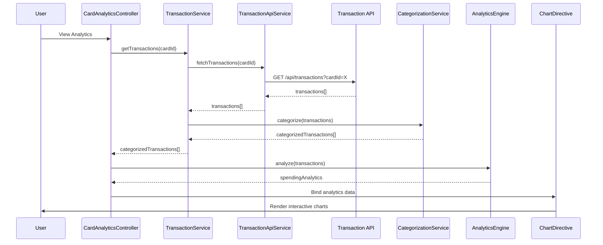

# Low-Level Design: QE-8369 - Credit Card Management and Spending Analytics

## a. Architecture Mapping

- **Card Management Module** → AngularJS Module (`app.cardManagement`)
- **Transaction Service** → AngularJS Service (`TransactionService`)
- **Analytics Engine** → AngularJS Factory (`AnalyticsEngine`)
- **Data Categorization Service** → AngularJS Service (`CategorizationService`)
- **Transaction Data Repository** → REST API integration via `$http` service
- **UI Layer** → AngularJS Controller (`CardAnalyticsController`) + Directives for charts

**Folder Structure:**
```
/app
  /modules
    /card-management
      card-management.module.js
      card-analytics.controller.js
      card-list.controller.js
      card-analytics.html
      card-list.html
  /services
    transaction.service.js
    categorization.service.js
    transaction-api.service.js
  /factories
    analytics-engine.factory.js
  /directives
    spending-chart.directive.js
    trend-chart.directive.js
```

## b. Component Specifications

| Name | Artifact Type | Responsibility | Key Dependencies |
|------|---------------|----------------|------------------|
| CardManagementModule | Module | Root module for card management and analytics | angular, ngRoute, chart.js, ui.bootstrap |
| CardAnalyticsController | Controller | Manages analytics view, chart data, and user interactions | TransactionService, AnalyticsEngine, $scope |
| CardListController | Controller | Displays multiple credit cards and transaction list | TransactionService, $scope |
| TransactionService | Service | Fetches transaction data and manages transaction state | TransactionApiService, CategorizationService, $q |
| AnalyticsEngine | Factory | Aggregates spending by category, month, and card; generates chart data | None (pure aggregation logic) |
| CategorizationService | Service | Classifies transactions into 9 spending categories | None (business logic) |
| TransactionApiService | Service | REST API calls for transaction history | $http, $q |
| SpendingChartDirective | Directive | Renders interactive category-wise spending chart | Chart.js library |
| TrendChartDirective | Directive | Renders monthly spend trend chart | Chart.js library |

## c. Data Model

**Transaction Object:**
```javascript
{
  transactionId: String,
  cardId: String,
  amount: Number,
  category: String, // Food & Dining, Fuel, Shopping, Travel, Entertainment, Utilities, Healthcare, Education, Miscellaneous
  description: String,
  timestamp: Date,
  merchantName: String
}
```

**SpendingAnalytics Object:**
```javascript
{
  categoryWiseSpend: Object, // {category: totalAmount}
  monthlyTrend: Array<{month: String, amount: Number}>,
  cardWiseSpend: Object, // {cardId: totalAmount}
  totalSpend: Number
}
```

## d. Data Flow

User accesses card analytics view → CardAnalyticsController calls TransactionService.getTransactions(cardId) → TransactionService invokes TransactionApiService to fetch transaction history from REST API → CategorizationService ensures each transaction has a valid category → TransactionService returns categorized transactions to controller → Controller passes transactions to AnalyticsEngine.analyze() → AnalyticsEngine aggregates data by category, month, and card → SpendingAnalytics object is returned to controller → Controller binds analytics data to $scope → SpendingChartDirective and TrendChartDirective render interactive Chart.js visualizations → User interacts with charts to explore spending patterns.

## e. Primary Sequence Diagram



## f. Implementation Notes

- Use AngularJS DI for all components; inject Chart.js as external library for visualizations
- Implement custom directives for chart rendering with two-way data binding for interactivity
- Use ES6 map/reduce/filter for efficient data aggregation in AnalyticsEngine
- Apply Bootstrap grid for responsive layout; ensure charts resize on viewport change
- Use $http interceptor for API error handling and loading indicators

## g. Error Handling

Interceptor-based error handling with try/catch in services; user notifications via Bootstrap modals or inline alerts.

## h. Security Notes

Standard input validation and secure API calls assumed; token-based authentication inherited from existing SSO.