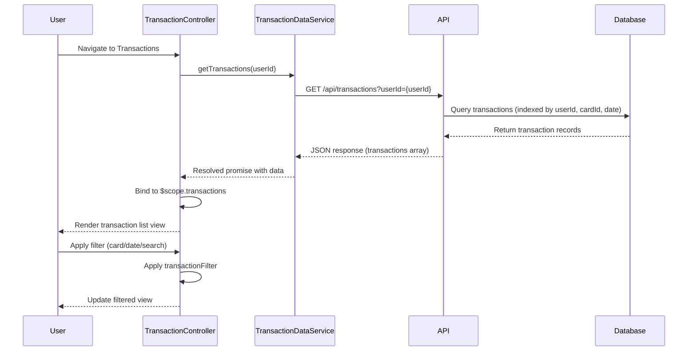

# Low-Level Design: Transaction Management and Monitoring
**Epic ID:** QE-8376  
**Technology Stack:** AngularJS 1.x, JavaScript ES6, HTML5, CSS3, Bootstrap, REST APIs, MVC Architecture

---

## a. Architecture Mapping

- **Transaction Management Service** → AngularJS Module (`transactionModule`) + Controller (`TransactionController`)
- **Transaction Data Service** → AngularJS Service/Factory (`TransactionDataService`) for REST API calls
- **Search and Filter Engine** → AngularJS Filter (`transactionFilter`) + Controller logic
- **Credit Card Service** → AngularJS Service (`CreditCardService`) for card metadata
- **User Authentication Service** → AngularJS Service (`AuthService`) with HTTP interceptor
- **Transaction Database** → Backend REST API endpoints consumed by services

**Recommended Folder Structure:**
```
/app
  /modules
    /transaction
      transaction.module.js
      transaction.controller.js
      transaction.service.js
      transaction.filter.js
  /services
    creditcard.service.js
    auth.service.js
  /views
    transaction-list.html
    transaction-detail.html
  /styles
    transaction.css
```

---

## b. Component Specifications

| Component Name | Artifact Type | Responsibility | Key Dependencies |
|----------------|---------------|----------------|------------------|
| `transactionModule` | Module | Defines transaction management module and routing | `ngRoute`, `AuthService` |
| `TransactionController` | Controller | Manages transaction list/detail views, handles user interactions | `TransactionDataService`, `CreditCardService`, `$scope`, `$filter` |
| `TransactionDataService` | Factory | Fetches transaction data via REST API, handles caching | `$http`, `$q`, `AuthService` |
| `CreditCardService` | Service | Retrieves card metadata for filtering | `$http`, `AuthService` |
| `transactionFilter` | Filter | Filters transactions by card, date range, search term | None |
| `AuthService` | Service | Manages authentication tokens and session | `$http`, `$window` |
| `transactionListView` | HTML Template | Displays paginated transaction list with search/filter UI | Bootstrap grid, `ng-repeat`, `ng-model` |
| `transactionDetailView` | HTML Template | Shows detailed transaction information | Bootstrap modal/panel |

---

## c. Data Model

**Transaction Model (`Transaction`):**
```javascript
{
  transactionId: String,
  userId: String,
  cardId: String,
  merchantName: String,
  amount: Number,
  currency: String,
  transactionDate: Date (ISO 8601),
  category: String,
  status: String // 'posted', 'pending'
}
```

**Card Model (`Card`):**
```javascript
{
  cardId: String,
  cardNumber: String (masked),
  cardType: String,
  cardholderName: String
}
```

---

## d. Data Flow

User authenticates and navigates to transaction view → `TransactionController` initializes and calls `TransactionDataService.getTransactions(userId)` → Service sends GET request to `/api/transactions?userId={userId}` with auth token → Backend retrieves transactions from database (indexed query, <300ms) → Response returns JSON array of transactions → Controller binds data to `$scope.transactions` → View renders transaction list using `ng-repeat` with `transactionFilter` applied → User applies filters (card, date, search) → Filter updates view in real-time → User clicks transaction → Controller navigates to detail view with selected transaction data.

---

## e. Primary Sequence Diagram



---

## f. Implementation Notes

- Use AngularJS Dependency Injection for all services and controllers; register via module config.
- Implement HTTP interceptor in `AuthService` to attach bearer token to all API requests and handle 401 responses.
- Use `$http` service with promise-based pattern; cache transaction data in service for 5 minutes using `$cacheFactory`.
- Implement client-side pagination using `limitTo` filter and custom pagination directive for large transaction sets (10,000+ records).
- Use Bootstrap responsive grid and cards for transaction list; apply `ng-class` for status-based styling (posted/pending).

---

## g. Error Handling

HTTP interceptor catches API errors; display user-friendly messages via Bootstrap alert component; log errors to console for debugging.

---

## h. Security Notes

Requires token-based auth via existing SSO; all API calls include Authorization header; input validation on search/filter parameters to prevent injection.

---