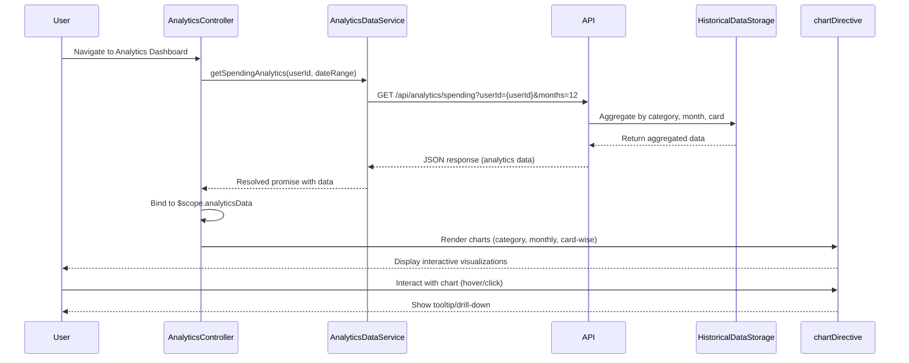

# Low-Level Design: Spending Analytics and Insights
**Epic ID:** QE-8377  
**Technology Stack:** AngularJS 1.x, JavaScript ES6, HTML5, CSS3, Bootstrap, REST APIs, MVC Architecture

---

## a. Architecture Mapping

- **Analytics Service** → AngularJS Module (`analyticsModule`) + Controller (`AnalyticsController`)
- **Data Analytics Engine** → Backend REST API consumed by AngularJS Service (`AnalyticsDataService`)
- **Transaction Categorization Service** → Backend service; category data consumed via REST API
- **Visualization Library** → AngularJS Directive (`chartDirective`) wrapping Chart.js or D3.js
- **Transaction Data Service** → AngularJS Service (`TransactionDataService`) for historical data
- **Historical Data Storage** → Backend REST API endpoints for aggregated data

**Recommended Folder Structure:**
```
/app
  /modules
    /analytics
      analytics.module.js
      analytics.controller.js
      analytics.service.js
  /directives
    chart.directive.js
  /services
    transaction.service.js
  /views
    analytics-dashboard.html
  /styles
    analytics.css
```

---

## b. Component Specifications

| Component Name | Artifact Type | Responsibility | Key Dependencies |
|----------------|---------------|----------------|------------------|
| `analyticsModule` | Module | Defines analytics module and routing | `ngRoute`, `chartDirective` |
| `AnalyticsController` | Controller | Manages analytics dashboard, handles user interactions (filter, date range) | `AnalyticsDataService`, `$scope`, `$filter` |
| `AnalyticsDataService` | Factory | Fetches aggregated spending data via REST API, handles caching | `$http`, `$q`, `AuthService` |
| `chartDirective` | Directive | Renders interactive charts (pie, bar, line) using Chart.js | Chart.js library, `$timeout` |
| `TransactionDataService` | Service | Retrieves raw transaction data if needed for client-side aggregation | `$http`, `AuthService` |
| `analyticsDashboardView` | HTML Template | Displays category-wise, monthly, and card-wise charts with filters | Bootstrap grid, `ng-repeat`, chart directive |

---

## c. Data Model

**SpendingAnalytics Model (`SpendingAnalytics`):**
```javascript
{
  userId: String,
  period: String, // 'monthly', 'yearly'
  categoryBreakdown: [
    { category: String, amount: Number, percentage: Number }
  ],
  monthlyTrend: [
    { month: String, totalSpend: Number }
  ],
  cardWiseSpend: [
    { cardId: String, cardName: String, totalSpend: Number }
  ]
}
```

**Category Enum:**
```javascript
['Food & Dining', 'Fuel', 'Shopping', 'Travel', 'Entertainment', 'Utilities', 'Healthcare', 'Education', 'Miscellaneous']
```

---

## d. Data Flow

User navigates to analytics dashboard → `AnalyticsController` initializes and calls `AnalyticsDataService.getSpendingAnalytics(userId, dateRange)` → Service sends GET request to `/api/analytics/spending?userId={userId}&months=12` with auth token → Backend aggregates transaction data by category, month, and card from historical storage → Response returns JSON with category breakdown, monthly trends, and card-wise spend → Controller binds data to `$scope.analyticsData` → View renders three chart directives (category pie chart, monthly trend line chart, card-wise bar chart) → Chart.js renders interactive visualizations (<1s) → User interacts with charts (hover, click) or applies filters → Controller updates data and re-renders charts.

---

## e. Primary Sequence Diagram



---

## f. Implementation Notes

- Use AngularJS Dependency Injection; register `chartDirective` as reusable component for all chart types.
- Integrate Chart.js via directive; pass data and config as directive attributes; use `$timeout` to ensure DOM ready before rendering.
- Cache aggregated analytics data in `AnalyticsDataService` for 10 minutes using `$cacheFactory` to meet <1s rendering NFR.
- Use Bootstrap responsive grid for chart layout; apply CSS media queries for mobile optimization.
- Implement date range picker using Angular-Bootstrap datepicker directive for filtering historical data.

---

## g. Error Handling

HTTP interceptor catches API errors; display user-friendly error message in dashboard view; fallback to cached data if available.

---

## h. Security Notes

Requires token-based auth via existing SSO; all API calls include Authorization header; validate date range inputs to prevent malicious queries.

---