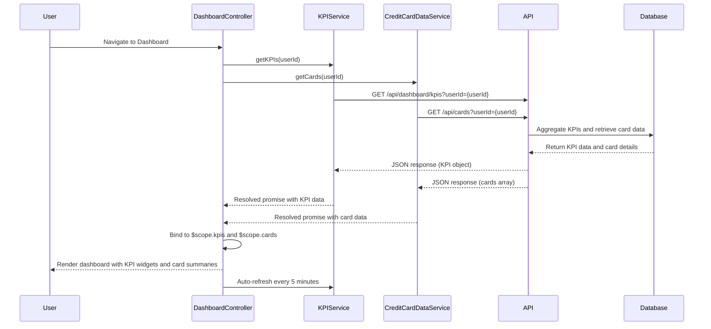

# Low-Level Design: Dashboard KPIs and Credit Card Overview
**Epic ID:** QE-8378  
**Technology Stack:** AngularJS 1.x, JavaScript ES6, HTML5, CSS3, Bootstrap, REST APIs, MVC Architecture

---

## a. Architecture Mapping

- **Dashboard Service** → AngularJS Module (`dashboardModule`) + Controller (`DashboardController`)
- **Credit Card Data Service** → AngularJS Service (`CreditCardDataService`) for REST API calls
- **Data Aggregation Service** → Backend REST API consumed by AngularJS Service (`KPIService`)
- **User Authentication Service** → AngularJS Service (`AuthService`) with HTTP interceptor
- **Database** → Backend REST API endpoints for credit card and KPI data

**Recommended Folder Structure:**
```
/app
  /modules
    /dashboard
      dashboard.module.js
      dashboard.controller.js
  /services
    creditcard.service.js
    kpi.service.js
    auth.service.js
  /views
    dashboard.html
  /components
    kpi-widget.directive.js
    card-summary.directive.js
  /styles
    dashboard.css
```

---

## b. Component Specifications

| Component Name | Artifact Type | Responsibility | Key Dependencies |
|----------------|---------------|----------------|------------------|
| `dashboardModule` | Module | Defines dashboard module and routing | `ngRoute`, `AuthService` |
| `DashboardController` | Controller | Manages dashboard view, fetches and displays KPIs and card data | `KPIService`, `CreditCardDataService`, `$scope`, `$interval` |
| `KPIService` | Factory | Fetches aggregated KPI data (monthly spend, total credit, available credit, outstanding) via REST API | `$http`, `$q`, `AuthService` |
| `CreditCardDataService` | Service | Retrieves individual credit card details | `$http`, `AuthService` |
| `kpiWidgetDirective` | Directive | Reusable component to display individual KPI metric with icon and value | None |
| `cardSummaryDirective` | Directive | Displays individual card summary (card number, limit, available, outstanding) | None |
| `dashboardView` | HTML Template | Displays KPI widgets and card summaries in responsive grid | Bootstrap grid, `ng-repeat`, directives |

---

## c. Data Model

**KPI Model (`DashboardKPI`):**
```javascript
{
  userId: String,
  monthlySpend: Number,
  totalCreditLimit: Number,
  totalAvailableCredit: Number,
  totalOutstanding: Number,
  lastUpdated: Date (ISO 8601)
}
```

**CreditCard Model (`CreditCard`):**
```javascript
{
  cardId: String,
  cardNumber: String (masked),
  cardType: String,
  creditLimit: Number,
  availableCredit: Number,
  outstandingAmount: Number,
  cardholderName: String
}
```

---

## d. Data Flow

User authenticates and navigates to dashboard → `DashboardController` initializes and calls `KPIService.getKPIs(userId)` and `CreditCardDataService.getCards(userId)` in parallel → Services send GET requests to `/api/dashboard/kpis?userId={userId}` and `/api/cards?userId={userId}` with auth token → Backend aggregates KPI data (sum of credit limits, available credit, outstanding across all cards, monthly spend from transaction summary) and retrieves individual card details → Responses return JSON with KPI object and cards array → Controller binds data to `$scope.kpis` and `$scope.cards` → View renders KPI widgets (4 widgets) and card summary cards using directives and `ng-repeat` → Dashboard loads in <2s (cached aggregation) → Controller sets up `$interval` to refresh KPIs every 5 minutes for real-time updates.

---

## e. Primary Sequence Diagram



---

## f. Implementation Notes

- Use AngularJS Dependency Injection; register all services and directives via module config.
- Implement `kpiWidgetDirective` and `cardSummaryDirective` as isolated scope directives with two-way binding for reusability.
- Use `$interval` service to poll KPI data every 5 minutes for real-time updates; cancel interval on scope destroy to prevent memory leaks.
- Cache KPI and card data in services using `$cacheFactory` with 5-minute TTL to meet <2s page load NFR.
- Use Bootstrap responsive grid (col-md-3 for KPI widgets, col-md-6 for card summaries) and CSS media queries for mobile/tablet optimization.

---

## g. Error Handling

HTTP interceptor catches API errors; display user-friendly error message in dashboard view; retry failed requests once before showing error.

---

## h. Security Notes

Requires token-based auth via existing SSO; all API calls include Authorization header; mask sensitive card data (show last 4 digits only).

---