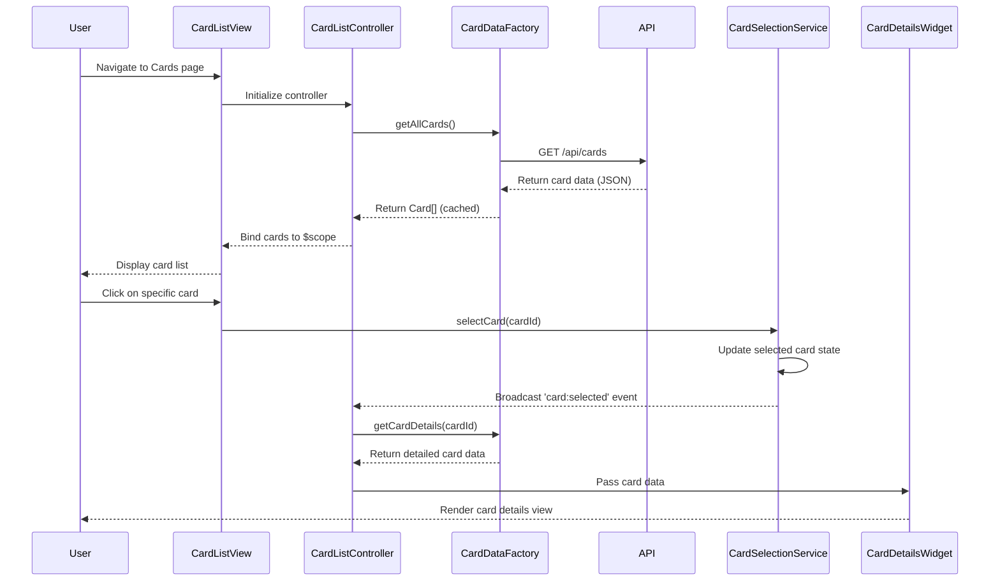

# Low-Level Design: QE-8385 - Multi-Card Management and Visualization

## a. Architecture Mapping

**HLD Component → AngularJS Artifact Mapping:**

- User Interface - Card List View → Module: `creditCard.cards` + Controller: `CardListController` + View: `card-list.html`
- Card Management Controller → Controller: `CardManagementController` with dependency injection of `CardService`
- Card Selection Handler → Service: `CardSelectionService` (singleton pattern for maintaining selected card state)
- Card Data Repository → Factory: `CardDataFactory` (handles API calls and data caching)
- Card Details View → Directive: `cardDetailsWidget` (reusable component for displaying individual card information)

**Recommended Folder Structure:**
```
app/
├── modules/
│   └── cards/
│       ├── controllers/
│       │   ├── card-list.controller.js
│       │   └── card-management.controller.js
│       ├── services/
│       │   ├── card-selection.service.js
│       │   └── card-data.factory.js
│       ├── directives/
│       │   └── card-details-widget.directive.js
│       └── views/
│           ├── card-list.html
│           └── card-details.html
```

## b. Component Specifications

| Component Name | Artifact Type | Responsibility | Key Dependencies |
|----------------|---------------|----------------|------------------|
| CardListController | Controller | Fetches and displays list of all user credit cards with summary information | CardDataFactory, CardSelectionService |
| CardManagementController | Controller | Orchestrates card switching, filtering, and state management across views | CardDataFactory, CardSelectionService, $scope |
| CardSelectionService | Service | Maintains currently selected card state and broadcasts selection changes | $rootScope (for event broadcasting) |
| CardDataFactory | Factory | Manages API calls to retrieve card details, balances, limits, and caches data for performance | $http, $q, CacheService |
| cardDetailsWidget | Directive | Renders individual card information including balance, limit, status, and spend analysis | CardDataFactory |
| CardFilterService | Service | Provides filtering and sorting logic for multiple cards | None |

## c. Data Model

**Card Object:**
```javascript
{
  cardId: String,
  cardNumber: String (masked),
  cardType: String (Visa/MasterCard/Amex),
  cardHolderName: String,
  creditLimit: Number,
  availableCredit: Number,
  outstandingAmount: Number,
  monthlySpend: Number,
  status: String (Active/Blocked/Expired),
  expiryDate: String (MM/YY),
  lastUpdated: Date
}
```

**CardList Object:**
```javascript
{
  userId: String,
  cards: Array<Card>,
  totalCards: Number,
  aggregatedCreditLimit: Number,
  aggregatedAvailableCredit: Number,
  aggregatedOutstanding: Number
}
```

## d. Data Flow

User navigates to the card management view → CardListController initializes and calls CardDataFactory.getAllCards() → Factory makes REST API call to /api/cards endpoint → Response is cached and transformed into Card objects → Controller binds card array to $scope → View renders card list using ng-repeat → User clicks on a card → CardSelectionService.selectCard(cardId) is invoked → Service broadcasts 'card:selected' event → CardManagementController listens to event and updates detailed view → cardDetailsWidget directive receives selected card data and renders card-specific information including balance, limit, status, and monthly spend.

## e. Primary Sequence Diagram



## f. Implementation Notes

- Use AngularJS module pattern with explicit dependency injection (array notation) to ensure minification safety
- Implement CardDataFactory with promise-based API calls using $q for consistent async handling and error propagation
- Leverage $cacheFactory or custom caching in CardDataFactory to store card data for 5 minutes, reducing redundant API calls during card switching
- Use $rootScope.$broadcast for card selection events and $scope.$on in controllers to maintain loose coupling between components
- Implement ng-repeat with track by cardId in card list view for optimized DOM rendering and smooth card switching experience

## g. Error Handling

HTTP interceptor-based error handling with user-friendly toast notifications for API failures; try/catch blocks in service methods with fallback to cached data when available.

## h. Security Notes

Requires token-based authentication via existing SSO; card numbers must be masked in UI; all API calls include authorization headers.