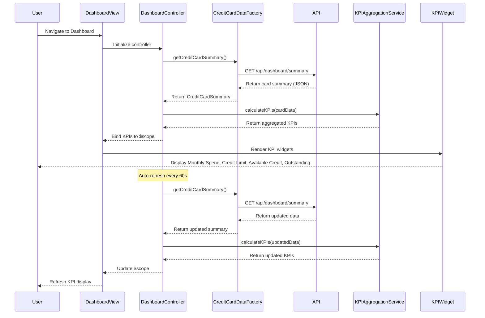

# Low-Level Design: QE-8386 - Credit Card Dashboard and KPI Monitoring

## a. Architecture Mapping

**HLD Component → AngularJS Artifact Mapping:**

- User Interface - Dashboard → Module: `creditCard.dashboard` + Controller: `DashboardController` + View: `dashboard.html`
- Dashboard Controller → Controller: `DashboardController` (orchestrates KPI data retrieval and view binding)
- KPI Aggregation Service → Service: `KPIAggregationService` (calculates and aggregates KPI metrics from card data)
- Credit Card Data Source → Factory: `CreditCardDataFactory` (handles API integration for card and transaction data)
- Data Presentation Layer → Directives: `kpiWidget`, `creditSummaryCard` (reusable UI components for KPI display)

**Recommended Folder Structure:**
```
app/
├── modules/
│   └── dashboard/
│       ├── controllers/
│       │   └── dashboard.controller.js
│       ├── services/
│       │   ├── kpi-aggregation.service.js
│       │   └── credit-card-data.factory.js
│       ├── directives/
│       │   ├── kpi-widget.directive.js
│       │   └── credit-summary-card.directive.js
│       └── views/
│           └── dashboard.html
```

## b. Component Specifications

| Component Name | Artifact Type | Responsibility | Key Dependencies |
|----------------|---------------|----------------|------------------|
| DashboardController | Controller | Initializes dashboard, fetches data, and binds KPIs to view | KPIAggregationService, CreditCardDataFactory, $scope, $interval |
| KPIAggregationService | Service | Calculates monthly spend, total credit limit, available credit, and outstanding amount from card data | None (pure calculation logic) |
| CreditCardDataFactory | Factory | Retrieves credit card data from REST API and manages data refresh cycles | $http, $q |
| kpiWidget | Directive | Renders individual KPI metric with label, value, and optional trend indicator | None |
| creditSummaryCard | Directive | Displays consolidated credit card summary with responsive layout | None |
| DashboardRefreshService | Service | Manages periodic data refresh for near-real-time updates | $interval, CreditCardDataFactory |

## c. Data Model

**KPI Object:**
```javascript
{
  monthlySpend: Number,
  totalCreditLimit: Number,
  availableCredit: Number,
  outstandingAmount: Number,
  lastUpdated: Date
}
```

**CreditCardSummary Object:**
```javascript
{
  userId: String,
  cards: Array<{
    cardId: String,
    creditLimit: Number,
    availableCredit: Number,
    outstandingAmount: Number,
    currentMonthSpend: Number
  }>,
  aggregatedKPIs: KPI
}
```

## d. Data Flow

User navigates to dashboard → DashboardController initializes and calls CreditCardDataFactory.getCreditCardSummary() → Factory makes REST API call to /api/dashboard/summary → Response containing all card data is returned → KPIAggregationService.calculateKPIs(cardData) processes raw data and computes monthly spend, total credit limit, available credit, and outstanding amount → Aggregated KPIs are bound to $scope → View renders KPI widgets using kpiWidget and creditSummaryCard directives → DashboardRefreshService triggers periodic refresh every 60 seconds → Updated data flows through the same pipeline and UI updates automatically via two-way binding.

## e. Primary Sequence Diagram



## f. Implementation Notes

- Use AngularJS $interval service in DashboardRefreshService for periodic data refresh with configurable interval (default 60 seconds); ensure proper cleanup on $scope.$destroy
- Implement KPIAggregationService as a stateless service with pure functions for testability and reusability across modules
- Leverage Bootstrap grid system (col-xs, col-sm, col-md, col-lg) in dashboard.html for responsive layout across devices
- Use ng-if and ng-show directives to handle loading states and empty data scenarios gracefully
- Implement kpiWidget directive with isolated scope and one-way binding (@) for label and value to ensure component reusability

## g. Error Handling

HTTP interceptor captures API errors and displays user-friendly error messages via toast notifications; fallback to last known good data if refresh fails.

## h. Security Notes

Requires token-based auth via existing SSO; sensitive financial data transmitted over HTTPS only; input validation applied to all user interactions.