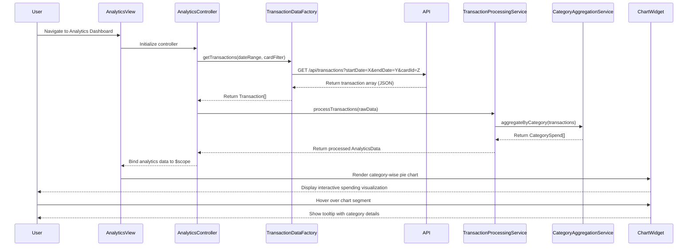

# Low-Level Design: QE-8387 - Spending Analytics and Transaction Insights

## a. Architecture Mapping

**HLD Component → AngularJS Artifact Mapping:**

- User Interface - Analytics Dashboard → Module: `creditCard.analytics` + Controller: `AnalyticsController` + View: `analytics-dashboard.html`
- Analytics Controller → Controller: `AnalyticsController` (manages analytics view state and user interactions)
- Transaction Data Service → Factory: `TransactionDataFactory` (retrieves transaction history from REST API)
- Data Processing Service → Service: `TransactionProcessingService` (aggregates and processes transaction data)
- Visualization Engine → Directive: `chartWidget` (wraps Chart.js or D3.js for rendering interactive charts)
- Category Aggregation Module → Service: `CategoryAggregationService` (groups transactions by predefined categories and calculates totals)

**Recommended Folder Structure:**
```
app/
├── modules/
│   └── analytics/
│       ├── controllers/
│       │   └── analytics.controller.js
│       ├── services/
│       │   ├── transaction-processing.service.js
│       │   ├── category-aggregation.service.js
│       │   └── transaction-data.factory.js
│       ├── directives/
│       │   └── chart-widget.directive.js
│       └── views/
│           └── analytics-dashboard.html
```

## b. Component Specifications

| Component Name | Artifact Type | Responsibility | Key Dependencies |
|----------------|---------------|----------------|------------------|
| AnalyticsController | Controller | Fetches transaction data, triggers processing, and binds analytics results to view | TransactionDataFactory, TransactionProcessingService, CategoryAggregationService, $scope |
| TransactionDataFactory | Factory | Retrieves transaction history from REST API with date range and card filters | $http, $q |
| TransactionProcessingService | Service | Processes raw transaction data, applies filters, and prepares data for visualization | CategoryAggregationService |
| CategoryAggregationService | Service | Aggregates transactions by 9 predefined categories and calculates category-wise spend totals | None (pure aggregation logic) |
| chartWidget | Directive | Renders interactive charts (pie, bar, line) using Chart.js library with responsive design | Chart.js library |
| SpendingTrendService | Service | Calculates monthly spend trends and identifies spending patterns over time | None |

## c. Data Model

**Transaction Object:**
```javascript
{
  transactionId: String,
  cardId: String,
  amount: Number,
  category: String (Food & Dining | Fuel | Shopping | Travel | Entertainment | Utilities | Healthcare | Education | Miscellaneous),
  merchantName: String,
  transactionDate: Date,
  description: String
}
```

**CategorySpend Object:**
```javascript
{
  category: String,
  totalSpend: Number,
  transactionCount: Number,
  percentage: Number
}
```

**AnalyticsData Object:**
```javascript
{
  userId: String,
  dateRange: { startDate: Date, endDate: Date },
  categoryWiseSpend: Array<CategorySpend>,
  monthlyTrends: Array<{ month: String, totalSpend: Number }>,
  cardWiseBreakdown: Array<{ cardId: String, totalSpend: Number }>,
  totalTransactions: Number,
  totalSpend: Number
}
```

## d. Data Flow

User navigates to analytics dashboard → AnalyticsController initializes and calls TransactionDataFactory.getTransactions(dateRange, cardFilter) → Factory makes REST API call to /api/transactions with query parameters → Raw transaction data is returned → TransactionProcessingService.processTransactions(rawData) validates and transforms data → CategoryAggregationService.aggregateByCategory(transactions) groups transactions into 9 predefined categories and calculates totals → SpendingTrendService.calculateMonthlyTrends(transactions) computes monthly spend patterns → Processed analytics data is bound to $scope → View renders chartWidget directives with category-wise pie chart, monthly trend line chart, and card-wise bar chart → User interacts with chart (hover, click) → Chart.js event handlers provide drill-down details and tooltips.

## e. Primary Sequence Diagram



## f. Implementation Notes

- Integrate Chart.js library via chartWidget directive with isolated scope; pass chart type, data, and options as directive attributes for reusability
- Implement CategoryAggregationService with ES6 Map for efficient category grouping and reduce() for calculating totals
- Use AngularJS $filter service for date formatting and currency display in charts and tables
- Leverage ng-options in date range selector for filtering transactions by month/quarter/year with two-way binding to controller
- Implement lazy loading for transaction data with pagination support to handle large datasets without performance degradation

## g. Error Handling

HTTP interceptor-based error handling with retry logic for transient failures; user notification via toast for persistent errors; graceful degradation with empty state messaging when no transaction data is available.

## h. Security Notes

Requires token-based auth via existing SSO; transaction data filtered by authenticated user context; standard input validation for date range and filter parameters to prevent injection attacks.