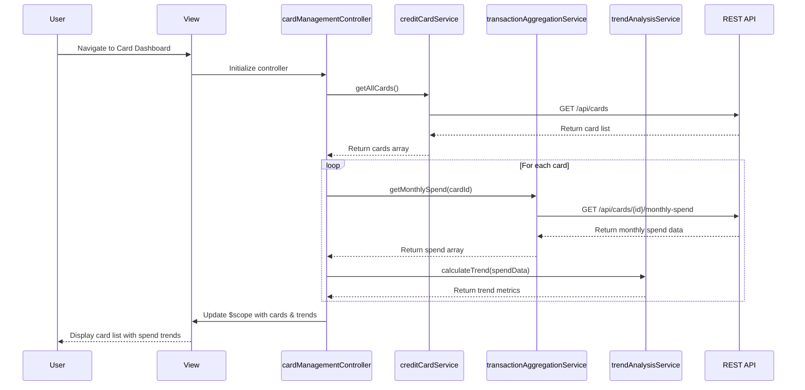

# Low-Level Design: Multiple Credit Card Management and Spend Analysis
**Epic ID:** QE-8388  
**Application Stack:** AngularJS 1.x, JavaScript ES6, HTML5, CSS3, Bootstrap, REST APIs, MVC Architecture

---

## a. Architecture Mapping

| HLD Component | AngularJS Artifact | Mapping |
|---------------|-------------------|----------|
| User Interface | View (HTML + Bootstrap) | Card listing page with responsive grid layout for displaying multiple cards |
| Card Management Controller | Controller (`cardManagementController.js`) | Orchestrates card data retrieval, filtering, and comparison logic |
| Credit Card Data Repository | Service (`creditCardService.js`) | RESTful API service for fetching card details, balances, and limits |
| Monthly Transaction Aggregation Service | Service (`transactionAggregationService.js`) | API service for retrieving monthly spend aggregates per card |
| Trend Analysis Engine | Service (`trendAnalysisService.js`) | Processes monthly data to generate trend visualizations |
| Comparison Service | Factory (`cardComparisonFactory.js`) | Utility for comparing spend metrics across multiple cards |

**Recommended Folder Structure:**
```
app/
├── modules/
│   └── cardManagement/
│       ├── controllers/
│       │   └── cardManagementController.js
│       ├── services/
│       │   ├── creditCardService.js
│       │   ├── transactionAggregationService.js
│       │   └── trendAnalysisService.js
│       ├── factories/
│       │   └── cardComparisonFactory.js
│       ├── views/
│       │   ├── card-list.html
│       │   ├── card-detail.html
│       │   └── card-comparison.html
│       └── cardManagement.module.js
├── shared/
│   ├── directives/
│   └── filters/
└── assets/
    ├── css/
    └── js/
```

---

## b. Component Specifications

| Component Name | Artifact Type | Responsibility | Key Dependencies |
|----------------|---------------|----------------|------------------|
| `cardManagementModule` | Module | Root module for card management feature | `ngRoute`, `ngResource` |
| `cardManagementController` | Controller | Manages card list state, handles user interactions, coordinates service calls | `creditCardService`, `transactionAggregationService`, `trendAnalysisService`, `$scope` |
| `creditCardService` | Service | Fetches card data from REST API (`GET /api/cards`), caches card information | `$http`, `$q` |
| `transactionAggregationService` | Service | Retrieves monthly spend aggregates per card (`GET /api/cards/{id}/monthly-spend`) | `$http`, `$q` |
| `trendAnalysisService` | Service | Processes monthly spend data to calculate trends and growth percentages | `transactionAggregationService` |
| `cardComparisonFactory` | Factory | Provides utility methods to compare spend, limits, and utilization across cards | None |
| `cardListView` | View | Displays responsive grid of credit cards with key metrics (balance, limit, spend) | Bootstrap grid, `ng-repeat` |
| `cardDetailView` | View | Shows detailed card information and monthly spend trend chart | Chart.js or similar |
| `cardComparisonView` | View | Side-by-side comparison of selected cards with visual indicators | Bootstrap columns |

---

## c. Data Model

**CreditCard Model:**
```javascript
{
  cardId: String,
  cardNumber: String,        // Masked (e.g., "**** **** **** 1234")
  cardHolderName: String,
  cardType: String,          // "Visa", "MasterCard", "Amex"
  bankName: String,
  creditLimit: Number,
  availableCredit: Number,
  outstandingAmount: Number,
  currentBalance: Number,
  dueDate: Date,
  status: String             // "Active", "Inactive", "Blocked"
}
```

**MonthlySpend Model:**
```javascript
{
  cardId: String,
  month: String,             // "YYYY-MM" format
  totalSpend: Number,
  transactionCount: Number,
  categoryBreakdown: Array   // [{category: String, amount: Number}]
}
```

**TrendData Model:**
```javascript
{
  cardId: String,
  months: Array,             // ["2024-01", "2024-02", ...]
  spendValues: Array,        // [1200, 1500, 1350, ...]
  growthRate: Number         // Percentage
}
```

---

## d. Data Flow

User navigates to the card management dashboard → View loads and `cardManagementController` initializes → Controller calls `creditCardService.getAllCards()` to fetch user's cards via `GET /api/cards` → Service returns array of card objects → Controller iterates through cards and calls `transactionAggregationService.getMonthlySpend(cardId)` for each card → Aggregation service fetches monthly spend data via `GET /api/cards/{id}/monthly-spend` → `trendAnalysisService` processes the monthly data to calculate trends → Controller updates `$scope.cards` and `$scope.trendData` → View renders card list with spend metrics and trend indicators using `ng-repeat` and Bootstrap cards → User selects cards for comparison → Controller invokes `cardComparisonFactory.compare()` → Comparison view displays side-by-side metrics.

---

## e. Primary Sequence Diagram



---

## f. Implementation Notes

- Use AngularJS module pattern with dependency injection for all services and controllers to ensure testability and maintainability.
- Implement `$http` interceptor for centralized API error handling and authentication token injection.
- Leverage ES6 arrow functions and template literals in service methods for cleaner async operations with promises.
- Cache card data using `$cacheFactory` or service-level caching to minimize API calls and meet 1-second retrieval NFR.
- Use Bootstrap's responsive grid system (`col-xs-*`, `col-md-*`) for multi-device card layout rendering.

---

## g. Error Handling

Implement `$http` interceptor to catch API errors (4xx/5xx), display user-friendly toast notifications using a notification service, and log errors to console for debugging.

---

## h. Security Notes

Standard input validation and secure API calls assumed; card numbers displayed in masked format; authentication token passed via HTTP headers for all API requests.