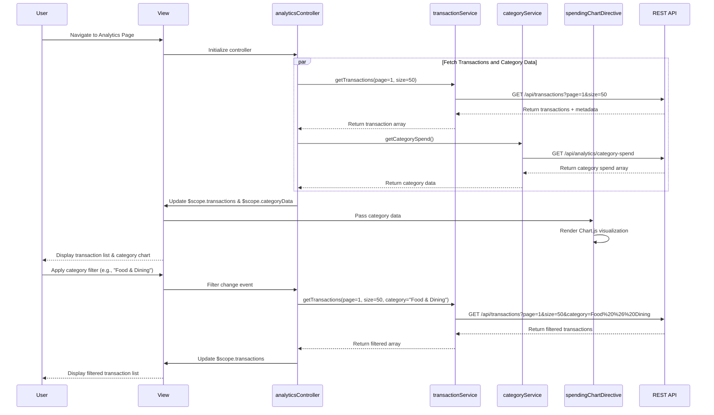

# Low-Level Design: Transaction and Category-wise Spending Analytics
**Epic ID:** QE-8389  
**Application Stack:** AngularJS 1.x, JavaScript ES6, HTML5, CSS3, Bootstrap, REST APIs, MVC Architecture

---

## a. Architecture Mapping

| HLD Component | AngularJS Artifact | Mapping |
|---------------|-------------------|----------|
| User Interface | View (HTML + Bootstrap) | Transaction list page with category filter and chart visualization area |
| Analytics Controller | Controller (`analyticsController.js`) | Manages transaction display, filtering, sorting, and chart data preparation |
| Transaction Data Service | Service (`transactionService.js`) | RESTful API service for fetching transaction history with pagination |
| Category Classification Engine | Service (`categoryService.js`) | API service for retrieving categorized transactions and category metadata |
| Visualization Engine | Directive (`spendingChartDirective.js`) | Custom directive wrapping Chart.js for rendering category-wise spending charts |
| Transaction Repository | Backend API | External data source accessed via REST endpoints |

**Recommended Folder Structure:**
```
app/
├── modules/
│   └── analytics/
│       ├── controllers/
│       │   └── analyticsController.js
│       ├── services/
│       │   ├── transactionService.js
│       │   └── categoryService.js
│       ├── directives/
│       │   └── spendingChartDirective.js
│       ├── views/
│       │   ├── transaction-list.html
│       │   └── category-analytics.html
│       └── analytics.module.js
├── shared/
│   ├── filters/
│   │   └── currencyFilter.js
│   └── constants/
│       └── categories.constant.js
└── assets/
    ├── css/
    └── libs/
        └── chart.js
```

---

## b. Component Specifications

| Component Name | Artifact Type | Responsibility | Key Dependencies |
|----------------|---------------|----------------|------------------|
| `analyticsModule` | Module | Root module for transaction analytics feature | `ngRoute`, `ngResource`, `chart.js` |
| `analyticsController` | Controller | Manages transaction list state, handles filtering/sorting, prepares chart data | `transactionService`, `categoryService`, `$scope`, `$filter` |
| `transactionService` | Service | Fetches paginated transaction data from REST API (`GET /api/transactions`) | `$http`, `$q` |
| `categoryService` | Service | Retrieves category-wise spending summary (`GET /api/analytics/category-spend`) | `$http`, `$q` |
| `spendingChartDirective` | Directive | Renders interactive pie/bar chart for category-wise spending using Chart.js | `categoryService`, Chart.js library |
| `transactionListView` | View | Displays paginated transaction table with filters for date range and category | Bootstrap table, `ng-repeat`, pagination controls |
| `categoryAnalyticsView` | View | Shows category breakdown with chart and summary cards for each category | Bootstrap cards, custom directive |
| `CATEGORIES` | Constant | Defines 9 spending categories (Food & Dining, Fuel, Shopping, Travel, Entertainment, Utilities, Healthcare, Education, Miscellaneous) | None |
| `currencyFilter` | Filter | Formats currency values for display | None |

---

## c. Data Model

**Transaction Model:**
```javascript
{
  transactionId: String,
  cardId: String,
  merchantName: String,
  category: String,          // One of 9 predefined categories
  amount: Number,
  transactionDate: Date,
  description: String,
  transactionType: String,   // "Debit", "Credit", "Refund"
  status: String             // "Completed", "Pending", "Failed"
}
```

**CategorySpend Model:**
```javascript
{
  category: String,
  totalAmount: Number,
  transactionCount: Number,
  percentage: Number,        // % of total spend
  color: String              // Hex color for chart visualization
}
```

**PaginationMetadata Model:**
```javascript
{
  currentPage: Number,
  pageSize: Number,
  totalRecords: Number,
  totalPages: Number
}
```

---

## d. Data Flow

User navigates to analytics page → View loads and `analyticsController` initializes → Controller calls `transactionService.getTransactions(page, pageSize, filters)` to fetch paginated transactions via `GET /api/transactions?page=1&size=50` → Service returns transaction array and pagination metadata → Controller updates `$scope.transactions` and `$scope.pagination` → View renders transaction table using `ng-repeat` with Bootstrap styling → Simultaneously, controller calls `categoryService.getCategorySpend()` via `GET /api/analytics/category-spend` → Service returns array of CategorySpend objects → Controller passes data to `spendingChartDirective` → Directive renders interactive pie chart using Chart.js → User applies category filter → Controller re-fetches filtered transactions → View updates transaction list and chart dynamically.

---

## e. Primary Sequence Diagram



---

## f. Implementation Notes

- Use AngularJS constant service to define the 9 spending categories for consistent reference across controllers and views.
- Implement pagination using AngularJS UI Bootstrap pagination directive or custom pagination controls with `ng-click` handlers.
- Leverage Chart.js library wrapped in a custom AngularJS directive for reusable, interactive chart rendering with responsive design.
- Use `$filter` service for client-side sorting and date formatting; server-side filtering for category and date range to optimize performance.
- Implement debouncing on filter inputs using `ng-model-options="{debounce: 500}"` to reduce API calls during user typing.

---

## g. Error Handling

Use `$http` interceptor to catch API failures, display user-friendly error messages via toast notifications, and provide retry mechanism for failed transaction fetches.

---

## h. Security Notes

Standard input validation and secure API calls assumed; authentication token required for all transaction API endpoints; sensitive transaction details sanitized before display.