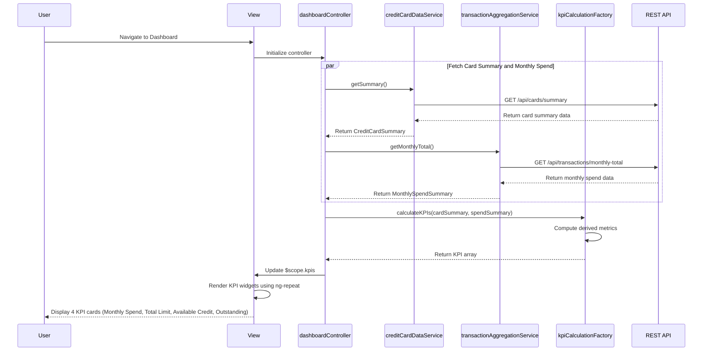

# Low-Level Design: Dashboard and KPI Management
**Epic ID:** QE-8390  
**Application Stack:** AngularJS 1.x, JavaScript ES6, HTML5, CSS3, Bootstrap, REST APIs, MVC Architecture

---

## a. Architecture Mapping

| HLD Component | AngularJS Artifact | Mapping |
|---------------|-------------------|----------|
| User Interface | View (HTML + Bootstrap) | Dashboard landing page with KPI widget cards in responsive grid layout |
| Dashboard Controller | Controller (`dashboardController.js`) | Orchestrates KPI data retrieval and aggregation, manages dashboard state |
| Credit Card Data Service | Service (`creditCardDataService.js`) | RESTful API service for fetching card balances and credit limits |
| Transaction Aggregation Service | Service (`transactionAggregationService.js`) | API service for retrieving monthly spend totals |
| KPI Calculation Engine | Factory (`kpiCalculationFactory.js`) | Business logic for computing available credit, outstanding amount, and other derived metrics |
| Data Repository | Backend API | External data source accessed via REST endpoints |

**Recommended Folder Structure:**
```
app/
├── modules/
│   └── dashboard/
│       ├── controllers/
│       │   └── dashboardController.js
│       ├── services/
│       │   ├── creditCardDataService.js
│       │   └── transactionAggregationService.js
│       ├── factories/
│       │   └── kpiCalculationFactory.js
│       ├── directives/
│       │   └── kpiWidgetDirective.js
│       ├── views/
│       │   └── dashboard.html
│       └── dashboard.module.js
├── shared/
│   ├── services/
│   └── filters/
└── assets/
    ├── css/
    └── js/
```

---

## b. Component Specifications

| Component Name | Artifact Type | Responsibility | Key Dependencies |
|----------------|---------------|----------------|------------------|
| `dashboardModule` | Module | Root module for dashboard feature | `ngRoute`, `ngResource` |
| `dashboardController` | Controller | Fetches and aggregates KPI data, updates view model with computed metrics | `creditCardDataService`, `transactionAggregationService`, `kpiCalculationFactory`, `$scope`, `$q` |
| `creditCardDataService` | Service | Fetches credit card summary data from REST API (`GET /api/cards/summary`) | `$http`, `$q` |
| `transactionAggregationService` | Service | Retrieves monthly spend aggregate (`GET /api/transactions/monthly-total`) | `$http`, `$q` |
| `kpiCalculationFactory` | Factory | Calculates available credit (limit - outstanding), validates data, formats KPI values | None |
| `kpiWidgetDirective` | Directive | Reusable widget component for displaying individual KPI with icon, value, and label | None |
| `dashboardView` | View | Displays 4 KPI cards (Monthly Spend, Total Credit Limit, Available Credit, Outstanding Amount) in responsive grid | Bootstrap grid, custom directive |

---

## c. Data Model

**CreditCardSummary Model:**
```javascript
{
  totalCreditLimit: Number,
  totalOutstandingAmount: Number,
  totalAvailableCredit: Number,
  cardCount: Number
}
```

**MonthlySpendSummary Model:**
```javascript
{
  currentMonth: String,      // "YYYY-MM" format
  totalSpend: Number,
  transactionCount: Number
}
```

**KPI Model:**
```javascript
{
  label: String,             // "Monthly Spend", "Total Credit Limit", etc.
  value: Number,
  formattedValue: String,    // Currency formatted (e.g., "$12,345.67")
  icon: String,              // CSS class for icon (e.g., "fa-credit-card")
  trend: String              // "up", "down", "neutral" (optional)
}
```

---

## d. Data Flow

User navigates to dashboard → View loads and `dashboardController` initializes → Controller uses `$q.all()` to make parallel API calls: `creditCardDataService.getSummary()` via `GET /api/cards/summary` and `transactionAggregationService.getMonthlyTotal()` via `GET /api/transactions/monthly-total` → Both services return promises with respective data → Controller receives CreditCardSummary and MonthlySpendSummary objects → Controller passes data to `kpiCalculationFactory.calculateKPIs()` which computes derived metrics (available credit = limit - outstanding) → Factory returns array of KPI objects → Controller updates `$scope.kpis` → View renders 4 KPI widgets using `ng-repeat` and `kpiWidgetDirective` in Bootstrap grid → Dashboard displays within 2 seconds per NFR.

---

## e. Primary Sequence Diagram



---

## f. Implementation Notes

- Use `$q.all()` to execute parallel API calls for card summary and monthly spend to minimize total load time and meet 2-second NFR.
- Implement custom `kpiWidgetDirective` with isolated scope for reusability across different dashboard sections and future KPI additions.
- Leverage ES6 promises and arrow functions in services for cleaner async code and better error propagation.
- Apply Bootstrap responsive grid classes (`col-xs-12 col-md-6 col-lg-3`) to ensure KPI cards stack properly on mobile and display in row on desktop.
- Use AngularJS `$interval` service to auto-refresh KPI data every 5-10 minutes for near real-time updates without full page reload.

---

## g. Error Handling

Implement global `$http` interceptor to catch API errors, display user-friendly error messages via notification service, and gracefully degrade KPI widgets to show cached or placeholder values.

---

## h. Security Notes

Requires token-based auth via existing SSO; all API endpoints protected with JWT validation; sensitive financial data transmitted over HTTPS only.