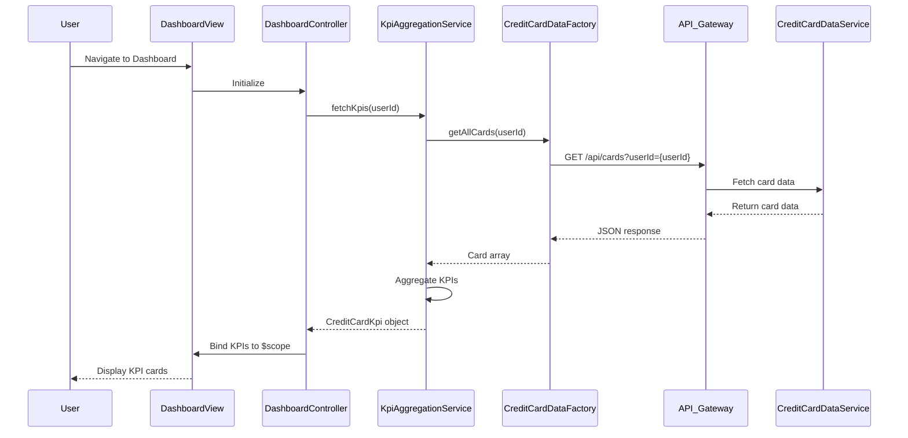

# Low-Level Design: QE-8413 - Credit Card Dashboard and KPI Overview

## a. Architecture Mapping

- **Dashboard UI Component** → AngularJS Module (`app.dashboard`) + Controller (`DashboardController`)
- **KPI Aggregation Logic** → AngularJS Service (`KpiAggregationService`)
- **Credit Card Data Retrieval** → AngularJS Factory (`CreditCardDataFactory`)
- **Authentication** → AngularJS Service (`AuthService`)
- **Real-time Data Refresh** → AngularJS Service (`DataRefreshService`) with `$interval`

**Recommended Folder Structure:**
```
app/
├── modules/
│   └── dashboard/
│       ├── dashboard.module.js
│       ├── dashboard.controller.js
│       ├── dashboard.html
│       └── dashboard.css
├── services/
│   ├── kpi-aggregation.service.js
│   ├── data-refresh.service.js
│   └── auth.service.js
├── factories/
│   └── credit-card-data.factory.js
└── assets/css/
```

## b. Component Specifications

| Component Name | Artifact Type | Responsibility | Key Dependencies |
|----------------|---------------|----------------|------------------|
| DashboardController | Controller | Manages dashboard state, binds KPI data to view, handles user interactions | KpiAggregationService, DataRefreshService, $scope |
| KpiAggregationService | Service | Aggregates multi-card data into consolidated KPIs (monthly spend, total limit, available credit, outstanding) | CreditCardDataFactory, $q |
| CreditCardDataFactory | Factory | Fetches credit card data from REST API via API Gateway | $http, AuthService |
| DataRefreshService | Service | Manages periodic data refresh using configurable intervals | $interval, KpiAggregationService |
| AuthService | Service | Handles user authentication and session management | $http, $window |
| DashboardView | HTML Template | Displays KPI cards in responsive Bootstrap grid layout | Bootstrap CSS, AngularJS directives |

## c. Data Model

**CreditCardKpi (JavaScript Object):**
```javascript
{
  userId: String,
  monthlySpend: Number,
  totalCreditLimit: Number,
  availableCredit: Number,
  outstandingAmount: Number,
  lastUpdated: Date,
  cardCount: Number
}
```

**CreditCard (JavaScript Object):**
```javascript
{
  cardId: String,
  cardNumber: String,
  cardType: String,
  creditLimit: Number,
  availableCredit: Number,
  outstandingBalance: Number,
  monthlySpend: Number
}
```

## d. Data Flow

User navigates to the dashboard → DashboardView loads → DashboardController initializes and calls KpiAggregationService → KpiAggregationService requests data via CreditCardDataFactory → Factory makes REST API call through API Gateway to Credit Card Data Service → Response is aggregated into consolidated KPIs → DataRefreshService schedules periodic refresh using $interval → Updated KPIs are bound to $scope → View updates automatically via AngularJS two-way data binding, displaying refreshed KPI cards in responsive Bootstrap layout.

## e. Primary Sequence Diagram



## f. Implementation Notes

- Use AngularJS 1.x module pattern with dependency injection for all services, factories, and controllers
- Implement ES6 arrow functions and const/let for cleaner service code; use $http promises with `.then()` chaining
- Bootstrap responsive grid (col-xs, col-sm, col-md) for KPI card layout to ensure mobile and desktop compatibility
- Configure DataRefreshService with $interval (default 60 seconds) and cancel on $scope.$destroy to prevent memory leaks
- Use AngularJS $q.all() in KpiAggregationService to parallelize multiple API calls if needed for performance optimization

## g. Error Handling

HTTP interceptor-based error handling with user-friendly toast notifications for API failures and session timeout redirects.

## h. Security Notes

Requires token-based authentication via existing SSO; all API calls include Authorization header managed by AuthService.