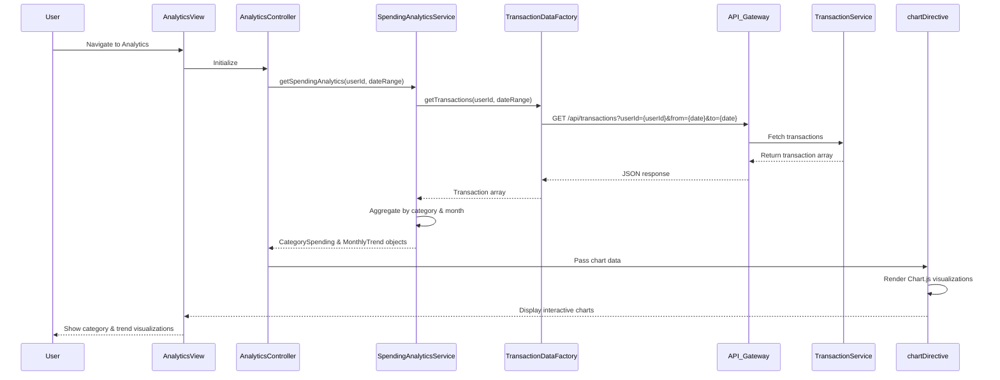

# Low-Level Design: QE-8414 - Spending Analytics and Transaction Insights

## a. Architecture Mapping

- **Analytics Dashboard UI** → AngularJS Module (`app.analytics`) + Controller (`AnalyticsController`)
- **Spending Analytics Logic** → AngularJS Service (`SpendingAnalyticsService`)
- **Transaction Data Retrieval** → AngularJS Factory (`TransactionDataFactory`)
- **Category Management** → AngularJS Service (`CategoryService`)
- **Chart Rendering** → AngularJS Directive (`chartDirective`) wrapping Chart.js or D3.js

**Recommended Folder Structure:**
```
app/
├── modules/
│   └── analytics/
│       ├── analytics.module.js
│       ├── analytics.controller.js
│       ├── analytics.html
│       └── analytics.css
├── services/
│   ├── spending-analytics.service.js
│   └── category.service.js
├── factories/
│   └── transaction-data.factory.js
├── directives/
│   └── chart.directive.js
└── assets/
    └── libs/ (Chart.js or D3.js)
```

## b. Component Specifications

| Component Name | Artifact Type | Responsibility | Key Dependencies |
|----------------|---------------|----------------|------------------|
| AnalyticsController | Controller | Manages analytics view state, handles filter interactions, binds analytics data to charts | SpendingAnalyticsService, CategoryService, $scope, $filter |
| SpendingAnalyticsService | Service | Aggregates transaction data by category, calculates monthly trends, generates chart data structures | TransactionDataFactory, CategoryService, $q |
| TransactionDataFactory | Factory | Fetches transaction history from REST API, supports pagination and filtering | $http, AuthService |
| CategoryService | Service | Provides nine spending categories, maps transactions to categories, returns category metadata | None (static configuration) |
| chartDirective | Directive | Wraps Chart.js/D3.js library, renders interactive visualizations, handles drill-down events | Chart.js or D3.js library |
| AnalyticsView | HTML Template | Displays category charts, monthly trend graphs, transaction list with Bootstrap responsive layout | Bootstrap CSS, chartDirective |

## c. Data Model

**Transaction (JavaScript Object):**
```javascript
{
  transactionId: String,
  cardId: String,
  amount: Number,
  category: String,
  merchantName: String,
  transactionDate: Date,
  description: String
}
```

**CategorySpending (JavaScript Object):**
```javascript
{
  category: String,
  totalAmount: Number,
  transactionCount: Number,
  percentage: Number
}
```

**MonthlyTrend (JavaScript Object):**
```javascript
{
  month: String,
  year: Number,
  totalSpend: Number,
  categoryBreakdown: Array<CategorySpending>
}
```

**SpendingCategories (Constant Array):**
```javascript
['Food & Dining', 'Fuel', 'Shopping', 'Travel', 'Entertainment', 'Utilities', 'Healthcare', 'Education', 'Miscellaneous']
```

## d. Data Flow

User navigates to analytics dashboard → AnalyticsView loads → AnalyticsController initializes and calls SpendingAnalyticsService → Service requests transaction data via TransactionDataFactory → Factory makes REST API call to Transaction Processing Service → Transactions are returned and passed to CategoryService for classification → SpendingAnalyticsService aggregates data by category and month → Chart data structures are generated → chartDirective receives data and renders interactive Chart.js visualizations → User interacts with filters (date range, category) → Controller updates service parameters → Charts re-render with filtered data via AngularJS digest cycle.

## e. Primary Sequence Diagram



## f. Implementation Notes

- Use AngularJS custom directive with isolated scope to wrap Chart.js for reusable chart components across different analytics views
- Implement ES6 array methods (map, filter, reduce) in SpendingAnalyticsService for efficient category aggregation and trend calculation
- Leverage AngularJS $filter service for date formatting and currency display in transaction lists and chart tooltips
- Use Chart.js responsive configuration to ensure visualizations adapt to mobile and desktop screen sizes
- Implement lazy loading for transaction history using AngularJS infinite scroll directive to handle 10,000+ transactions efficiently

## g. Error Handling

HTTP interceptor captures API errors; try/catch blocks in aggregation logic with fallback to empty datasets and user notification via toast messages.

## h. Security Notes

Standard input validation and secure API calls assumed; transaction data access controlled via user-scoped API endpoints with token authentication.