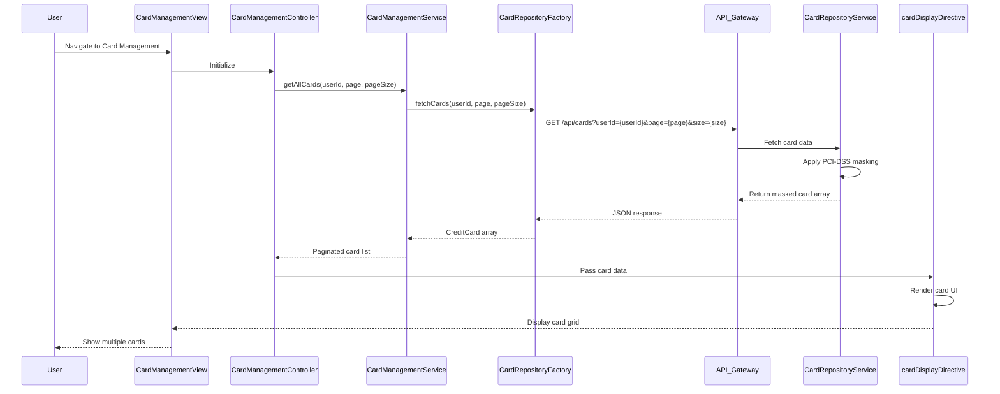

# Low-Level Design: QE-8415 - Multiple Credit Card Management and Visualization

## a. Architecture Mapping

- **Card Management UI** → AngularJS Module (`app.cardManagement`) + Controller (`CardManagementController`)
- **Card Data Management** → AngularJS Service (`CardManagementService`)
- **Card Repository Access** → AngularJS Factory (`CardRepositoryFactory`)
- **Card Comparison Logic** → AngularJS Service (`CardComparisonService`)
- **Card Display Component** → AngularJS Directive (`cardDisplayDirective`) for individual card rendering

**Recommended Folder Structure:**
```
app/
├── modules/
│   └── card-management/
│       ├── card-management.module.js
│       ├── card-management.controller.js
│       ├── card-management.html
│       └── card-management.css
├── services/
│   ├── card-management.service.js
│   └── card-comparison.service.js
├── factories/
│   └── card-repository.factory.js
├── directives/
│   └── card-display.directive.js
└── assets/
    └── images/card-icons/
```

## b. Component Specifications

| Component Name | Artifact Type | Responsibility | Key Dependencies |
|----------------|---------------|----------------|------------------|
| CardManagementController | Controller | Manages card list state, handles card selection, triggers comparison view, coordinates pagination | CardManagementService, CardComparisonService, $scope |
| CardManagementService | Service | Retrieves and manages multiple card data, implements pagination/lazy loading for 50+ cards | CardRepositoryFactory, $q |
| CardRepositoryFactory | Factory | Fetches card details from REST API with appropriate data masking, handles card-specific queries | $http, AuthService |
| CardComparisonService | Service | Compares card attributes (limits, balances, spending), generates comparison metrics | None (pure computation) |
| cardDisplayDirective | Directive | Renders individual card UI component with masked card number, type, limits, and balances | None (isolated scope) |
| CardManagementView | HTML Template | Displays card grid/list with Bootstrap responsive layout, comparison panel, card details modal | Bootstrap CSS, cardDisplayDirective |

## c. Data Model

**CreditCard (JavaScript Object):**
```javascript
{
  cardId: String,
  cardNumber: String,
  maskedCardNumber: String,
  cardType: String,
  cardIssuer: String,
  creditLimit: Number,
  availableCredit: Number,
  outstandingBalance: Number,
  monthlySpend: Number,
  cardStatus: String,
  expiryDate: String
}
```

**CardComparison (JavaScript Object):**
```javascript
{
  cards: Array<CreditCard>,
  metrics: {
    totalCreditLimit: Number,
    totalAvailableCredit: Number,
    totalOutstanding: Number,
    highestSpendCard: String,
    lowestUtilizationCard: String
  }
}
```

## d. Data Flow

User navigates to card management page → CardManagementView loads → CardManagementController initializes and calls CardManagementService → Service requests card list via CardRepositoryFactory → Factory makes REST API call to Credit Card Repository Service → API returns masked card data (last 4 digits visible) → Service implements pagination if user has more than 10 cards → Cards are bound to $scope → cardDisplayDirective renders each card in Bootstrap grid → User selects multiple cards for comparison → Controller invokes CardComparisonService → Comparison metrics are calculated and displayed in comparison panel → View updates via AngularJS two-way binding.

## e. Primary Sequence Diagram



## f. Implementation Notes

- Use AngularJS directive with isolated scope and templateUrl for cardDisplayDirective to ensure reusable, encapsulated card UI components
- Implement pagination using AngularJS ng-repeat with limitTo filter or custom pagination directive to handle 50 cards efficiently
- Use ES6 template literals in cardDisplayDirective for dynamic card number masking display (e.g., `**** **** **** ${lastFour}`)
- Leverage Bootstrap card component classes for consistent card styling and responsive grid layout (col-md-4, col-sm-6, col-xs-12)
- CardComparisonService uses pure JavaScript array methods (sort, reduce) for client-side comparison calculations without additional API calls

## g. Error Handling

HTTP interceptor-based error handling with retry logic for transient failures; user notification via Bootstrap alert components for persistent errors.

## h. Security Notes

Requires token-based auth via existing SSO; card numbers masked server-side following PCI-DSS standards before transmission to client.