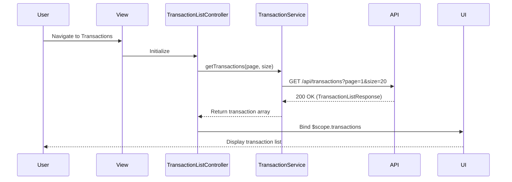

# Low-Level Design: Transaction Management and Viewing
**Epic ID:** QE-8416  
**Application Stack:** AngularJS 1.x, JavaScript ES6, HTML5, CSS3, Bootstrap, REST APIs, MVC Architecture

---

## a. Architecture Mapping

- **Transaction List Module** → AngularJS Module (`transactionModule`)
- **Transaction View Component** → AngularJS Controller (`TransactionListController`, `TransactionDetailController`)
- **API Layer** → AngularJS Service/Factory (`TransactionService`)
- **User Authorization** → AngularJS Service (`AuthService`) with HTTP interceptor
- **UI Components** → AngularJS Directives (`transactionCard`, `transactionFilter`)

**Recommended Folder Structure:**
```
/app
  /modules
    /transactions
      /controllers (TransactionListController.js, TransactionDetailController.js)
      /services (TransactionService.js)
      /directives (transactionCard.js, transactionFilter.js)
      /views (transaction-list.html, transaction-detail.html)
  /shared
    /services (AuthService.js, HttpInterceptor.js)
```

---

## b. Component Specifications

| Component Name | Artifact Type | Responsibility | Key Dependencies |
|---|---|---|---|
| `transactionModule` | Module | Root module for transaction management | `ngRoute`, `AuthService` |
| `TransactionListController` | Controller | Fetch and display paginated transaction list | `TransactionService`, `$scope` |
| `TransactionDetailController` | Controller | Display detailed view of a single transaction | `TransactionService`, `$routeParams` |
| `TransactionService` | Service | Handle API calls for transaction data retrieval | `$http`, `AuthService` |
| `transactionCard` | Directive | Render individual transaction card UI | None |
| `transactionFilter` | Directive | Provide filtering UI for transactions by date/card | `TransactionService` |
| `AuthService` | Service | Manage user authentication and authorization tokens | `$http`, `$window` |
| `HttpInterceptor` | Factory | Attach auth tokens to outgoing API requests | `AuthService` |

---

## c. Data Model

**Transaction Object:**
```javascript
{
  transactionId: String,
  cardId: String,
  cardName: String,
  amount: Number,
  currency: String,
  category: String,
  merchant: String,
  transactionDate: Date,
  description: String,
  status: String // 'posted', 'pending'
}
```

**TransactionListResponse Object:**
```javascript
{
  transactions: Array<Transaction>,
  totalCount: Number,
  pageNumber: Number,
  pageSize: Number
}
```

---

## d. Data Flow

User navigates to the transaction list view, triggering `TransactionListController` to invoke `TransactionService.getTransactions()` with pagination parameters. The service makes an authenticated REST API call (via `HttpInterceptor`) to the backend transaction endpoint. The API response (paginated transaction data) is bound to `$scope.transactions` and rendered in the view using `transactionCard` directives. User can click on a transaction to navigate to the detail view, where `TransactionDetailController` fetches and displays full transaction details via `TransactionService.getTransactionById()`.

---

## e. Primary Sequence Diagram



---

## f. Implementation Notes

- Use AngularJS Dependency Injection to inject `TransactionService` and `AuthService` into controllers.
- Implement pagination using `ng-repeat` with `limitTo` and `startFrom` filters or third-party pagination directives.
- Use ES6 arrow functions and `const`/`let` for service and controller logic.
- Leverage Bootstrap grid system and card components for responsive transaction list layout.
- API integration via `$http` service with promise-based `.then()` and `.catch()` handlers.

---

## g. Error Handling

Client-side errors are handled via HTTP interceptor that catches 4xx/5xx responses, logs errors, and displays user-friendly notifications using a toast/alert service.

---

## h. Security Notes

Requires token-based auth via existing SSO; tokens are attached to API requests via HTTP interceptor and validated server-side.