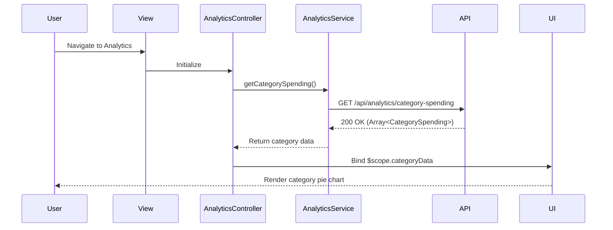

# Low-Level Design: Spending Analytics and Category Insights
**Epic ID:** QE-8417  
**Application Stack:** AngularJS 1.x, JavaScript ES6, HTML5, CSS3, Bootstrap, REST APIs, MVC Architecture

---

## a. Architecture Mapping

- **Analytics Module** → AngularJS Module (`analyticsModule`)
- **Analytics UI** → AngularJS Controller (`AnalyticsController`)
- **Visualization Engine** → AngularJS Directive (`spendingChart`, `categoryPieChart`) using Chart.js or D3.js
- **Analytics API** → AngularJS Service (`AnalyticsService`)
- **Categorization Service** → Backend REST API endpoint consumed by `AnalyticsService`

**Recommended Folder Structure:**
```
/app
  /modules
    /analytics
      /controllers (AnalyticsController.js)
      /services (AnalyticsService.js)
      /directives (spendingChart.js, categoryPieChart.js)
      /views (analytics-dashboard.html)
  /shared
    /services (AuthService.js)
```

---

## b. Component Specifications

| Component Name | Artifact Type | Responsibility | Key Dependencies |
|---|---|---|---|
| `analyticsModule` | Module | Root module for analytics and insights | `ngRoute`, `chart.js` |
| `AnalyticsController` | Controller | Fetch and prepare analytics data for visualization | `AnalyticsService`, `$scope` |
| `AnalyticsService` | Service | Retrieve category-wise and card-wise spending data from API | `$http`, `AuthService` |
| `spendingChart` | Directive | Render monthly spend trend line/bar chart | `chart.js` |
| `categoryPieChart` | Directive | Render category-wise spending pie/donut chart | `chart.js` |
| `cardWiseSpendTable` | Directive | Display card-wise spending breakdown in table format | None |

---

## c. Data Model

**CategorySpending Object:**
```javascript
{
  category: String, // 'Food & Dining', 'Fuel', etc.
  totalAmount: Number,
  transactionCount: Number,
  percentage: Number
}
```

**MonthlySpendTrend Object:**
```javascript
{
  month: String, // 'Jan 2026', 'Feb 2026'
  totalSpend: Number
}
```

**CardWiseSpend Object:**
```javascript
{
  cardId: String,
  cardName: String,
  totalSpend: Number,
  categoryBreakdown: Array<CategorySpending>
}
```

---

## d. Data Flow

User navigates to the analytics dashboard, triggering `AnalyticsController` to invoke `AnalyticsService.getCategorySpending()` and `AnalyticsService.getMonthlyTrends()`. The service makes authenticated REST API calls to backend analytics endpoints that return aggregated, categorized spending data. The controller processes the response and binds data to `$scope.categoryData` and `$scope.trendData`. Directives `categoryPieChart` and `spendingChart` watch these scope variables and render interactive visualizations using Chart.js, updating the UI dynamically.

---

## e. Primary Sequence Diagram



---

## f. Implementation Notes

- Use AngularJS `$watch` or one-way binding to trigger chart re-rendering when data changes.
- Integrate Chart.js via AngularJS directive wrappers for reusable chart components.
- Use ES6 `map`, `reduce`, and `filter` for data transformation and aggregation in controllers.
- Leverage Bootstrap responsive grid for side-by-side chart layout on desktop, stacked on mobile.
- Cache aggregated analytics data in `AnalyticsService` to reduce redundant API calls during user interactions.

---

## g. Error Handling

HTTP interceptor-based error handling with try/catch blocks in service methods; user notifications via toast alerts for API failures.

---

## h. Security Notes

Standard input validation and secure API calls assumed; token-based authentication enforced via HTTP interceptor.