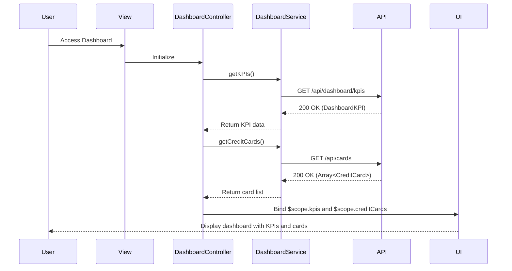

# Low-Level Design: Credit Card Dashboard and KPI Monitoring
**Epic ID:** QE-8418  
**Application Stack:** AngularJS 1.x, JavaScript ES6, HTML5, CSS3, Bootstrap, REST APIs, MVC Architecture

---

## a. Architecture Mapping

- **Dashboard Module** → AngularJS Module (`dashboardModule`)
- **Dashboard UI Layer** → AngularJS Controller (`DashboardController`)
- **API Gateway** → AngularJS Service (`DashboardService`)
- **KPI Calculation Service** → Backend REST API consumed by `DashboardService`
- **Credit Card Display** → AngularJS Directive (`creditCardTile`)
- **User Authentication** → AngularJS Service (`AuthService`) with HTTP interceptor

**Recommended Folder Structure:**
```
/app
  /modules
    /dashboard
      /controllers (DashboardController.js)
      /services (DashboardService.js)
      /directives (creditCardTile.js, kpiWidget.js)
      /views (dashboard.html)
  /shared
    /services (AuthService.js, HttpInterceptor.js)
```

---

## b. Component Specifications

| Component Name | Artifact Type | Responsibility | Key Dependencies |
|---|---|---|---|
| `dashboardModule` | Module | Root module for dashboard and KPI monitoring | `ngRoute`, `AuthService` |
| `DashboardController` | Controller | Fetch and display KPIs and credit card list | `DashboardService`, `$scope` |
| `DashboardService` | Service | Retrieve KPI data and credit card details from API | `$http`, `AuthService` |
| `creditCardTile` | Directive | Render individual credit card tile with key details | None |
| `kpiWidget` | Directive | Display KPI metric (monthly spend, credit limit, etc.) | None |
| `AuthService` | Service | Manage authentication tokens and user session | `$http`, `$window` |
| `HttpInterceptor` | Factory | Attach authorization headers to API requests | `AuthService` |

---

## c. Data Model

**CreditCard Object:**
```javascript
{
  cardId: String,
  cardName: String,
  cardNumber: String, // masked, e.g., '**** 1234'
  cardType: String, // 'Visa', 'MasterCard', etc.
  creditLimit: Number,
  availableCredit: Number,
  outstandingAmount: Number,
  expiryDate: String
}
```

**DashboardKPI Object:**
```javascript
{
  monthlySpend: Number,
  totalCreditLimit: Number,
  totalAvailableCredit: Number,
  totalOutstanding: Number
}
```

---

## d. Data Flow

User accesses the dashboard, triggering `DashboardController` to invoke `DashboardService.getKPIs()` and `DashboardService.getCreditCards()`. The service makes authenticated REST API calls to backend endpoints that return aggregated KPI metrics and a list of user's credit cards. The controller binds the response to `$scope.kpis` and `$scope.creditCards`. The view renders KPI widgets using `kpiWidget` directive and credit card tiles using `creditCardTile` directive, providing a consolidated, responsive dashboard interface.

---

## e. Primary Sequence Diagram



---

## f. Implementation Notes

- Use AngularJS Dependency Injection to inject `DashboardService` and `AuthService` into `DashboardController`.
- Implement responsive layout using Bootstrap grid (col-md-3 for KPI widgets, col-md-4 for card tiles).
- Use ES6 `Promise.all()` to parallelize KPI and card data fetching for faster dashboard load.
- Leverage AngularJS `ng-repeat` to iterate over `$scope.creditCards` and render `creditCardTile` directives.
- Cache KPI data in `DashboardService` with a TTL to reduce API calls on dashboard refresh.

---

## g. Error Handling

Interceptor-based error handling for API failures; try/catch in service methods with user notification via toast alerts.

---

## h. Security Notes

Requires token-based auth via existing SSO; tokens are validated server-side and attached to requests via HTTP interceptor.