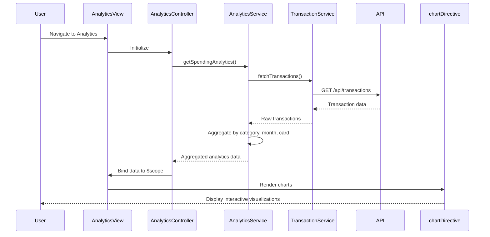

# Low-Level Design: QE-8419 - Spending Analytics and Insights

## a. Architecture Mapping

- **Analytics UI Component** → AngularJS Controller (`AnalyticsController`) + View Template (`analytics.html`)
- **Visualization Library** → Directive (`chartDirective`) wrapping Chart.js or D3.js for rendering interactive charts
- **Analytics Engine** → Service (`AnalyticsService`) for data aggregation and calculation logic
- **Data Aggregation Module** → Factory (`DataAggregationFactory`) for processing raw transaction data
- **Transaction Data Service** → Service (`TransactionService`) for fetching transaction records via REST API

**Recommended Folder Structure:**
```
/app
  /modules
    /analytics
      /controllers
        - analytics.controller.js
      /services
        - analytics.service.js
        - transaction.service.js
      /factories
        - data-aggregation.factory.js
      /directives
        - chart.directive.js
      /views
        - analytics.html
      /styles
        - analytics.css
```

## b. Component Specifications

| Component Name | Artifact Type | Responsibility | Key Dependencies |
|---|---|---|---|
| AnalyticsController | Controller | Manage analytics view state, handle user interactions, coordinate data fetching and visualization updates | AnalyticsService, $scope, $filter |
| AnalyticsService | Service | Aggregate spending data by category, calculate monthly trends, perform card-wise spend analysis | DataAggregationFactory, TransactionService, $q |
| TransactionService | Service | Fetch raw transaction data from REST API, cache transaction records | $http, $q |
| DataAggregationFactory | Factory | Process and transform raw transactions into aggregated datasets for visualization | - |
| chartDirective | Directive | Render interactive charts (category pie/bar, monthly trend line, card comparison bar) using Chart.js/D3.js | Chart.js or D3.js library |

## c. Data Model

**SpendingAnalytics** (JavaScript Object)
- `categorySpend`: Object - { "Food & Dining": Number, "Fuel": Number, "Shopping": Number, "Travel": Number, "Entertainment": Number, "Utilities": Number, "Healthcare": Number, "Education": Number, "Miscellaneous": Number }
- `monthlyTrend`: Array - [{ month: String (YYYY-MM), totalSpend: Number }]
- `cardWiseSpend`: Array - [{ cardId: String, cardName: String, totalSpend: Number }]

**Transaction** (JavaScript Object)
- `transactionId`: String
- `cardId`: String
- `amount`: Number
- `category`: String (one of 9 predefined categories)
- `date`: Date
- `merchant`: String

## d. Data Flow

User navigates to Analytics view → AnalyticsController initializes and calls AnalyticsService.getSpendingAnalytics() → AnalyticsService invokes TransactionService.fetchTransactions() to retrieve raw data via REST API → DataAggregationFactory processes transactions to compute category totals, monthly trends, and card-wise breakdowns → Aggregated data returned to AnalyticsController → Controller binds data to $scope → chartDirective watches scope changes and renders interactive visualizations (category chart, trend line, card comparison) → User interacts with charts (hover, filter) triggering scope updates and chart re-renders.

## e. Primary Sequence Diagram



## f. Implementation Notes

- Use AngularJS Dependency Injection to inject AnalyticsService, TransactionService, and DataAggregationFactory into controllers/services.
- Implement DataAggregationFactory using ES6 Array methods (map, reduce, filter) for efficient data transformation.
- Integrate Chart.js via custom directive with two-way data binding to enable reactive chart updates on scope changes.
- Use $http service with promise-based API calls; cache transaction data in TransactionService to minimize redundant API requests.
- Apply Bootstrap grid system for responsive layout; ensure charts resize dynamically using directive's link function with window resize listener.

## g. Error Handling

HTTP interceptor captures API errors; service-level try/catch blocks handle aggregation failures; user notified via toast/alert for data fetch or processing errors.

## h. Security Notes

Standard input validation and secure API calls assumed; token-based authentication via existing SSO for API access.