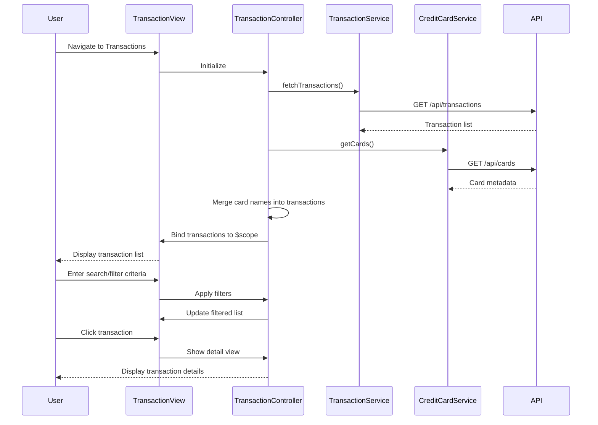

# Low-Level Design: QE-8420 - Transaction Management and Tracking

## a. Architecture Mapping

- **Transaction UI Component** → AngularJS Controller (`TransactionController`) + View Template (`transactions.html`)
- **Search and Filter Module** → Service (`FilterService`) + UI filters in view template
- **Transaction Service** → Service (`TransactionService`) for fetching and managing transaction data via REST API
- **Credit Card Service** → Service (`CreditCardService`) for retrieving card metadata and linking transactions to cards
- **Transaction Repository** → Backend REST API endpoint (`/api/transactions`)

**Recommended Folder Structure:**
```
/app
  /modules
    /transactions
      /controllers
        - transaction.controller.js
      /services
        - transaction.service.js
        - credit-card.service.js
        - filter.service.js
      /views
        - transactions.html
        - transaction-detail.html
      /styles
        - transactions.css
```

## b. Component Specifications

| Component Name | Artifact Type | Responsibility | Key Dependencies |
|---|---|---|---|
| TransactionController | Controller | Manage transaction list view, handle search/filter inputs, display transaction details | TransactionService, FilterService, CreditCardService, $scope |
| TransactionService | Service | Fetch transaction data from REST API, cache transactions, provide transaction by ID | $http, $q |
| CreditCardService | Service | Fetch credit card metadata, link card info to transactions | $http, $q |
| FilterService | Service | Apply search and filter logic (date range, amount, category, card) to transaction dataset | $filter |

## c. Data Model

**Transaction** (JavaScript Object)
- `transactionId`: String
- `cardId`: String
- `cardName`: String (populated via CreditCardService)
- `amount`: Number
- `merchant`: String
- `category`: String
- `date`: Date
- `description`: String

**TransactionFilter** (JavaScript Object)
- `searchTerm`: String (merchant or description keyword)
- `dateFrom`: Date
- `dateTo`: Date
- `minAmount`: Number
- `maxAmount`: Number
- `selectedCardIds`: Array of String
- `selectedCategories`: Array of String

## d. Data Flow

User navigates to Transaction view → TransactionController initializes and calls TransactionService.fetchTransactions() → Service retrieves transaction data via REST API → CreditCardService.getCards() fetches card metadata → Controller merges card names into transactions and binds to $scope → User enters search/filter criteria → FilterService applies filters to transaction array → Filtered results displayed in view → User clicks transaction row → Controller navigates to detail view showing full transaction attributes.

## e. Primary Sequence Diagram



## f. Implementation Notes

- Use AngularJS $http service with promise chaining to fetch transactions and card metadata concurrently using $q.all.
- Implement FilterService with AngularJS $filter for built-in filters (date, currency) and custom filter functions for multi-criteria search.
- Use ng-repeat with track by transactionId for efficient rendering of large transaction lists; apply limitTo and pagination for performance.
- Bind search/filter inputs using ng-model with two-way data binding; apply filters reactively using AngularJS filter pipe in view.
- Cache transaction data in TransactionService using a simple in-memory object to avoid redundant API calls on view re-entry.

## g. Error Handling

HTTP interceptor-based error handling for API failures; try/catch in service methods; user notified via alert/toast for fetch errors or empty results.

## h. Security Notes

Requires token-based auth via existing SSO; API endpoints secured with user-specific authorization to ensure transaction data isolation.