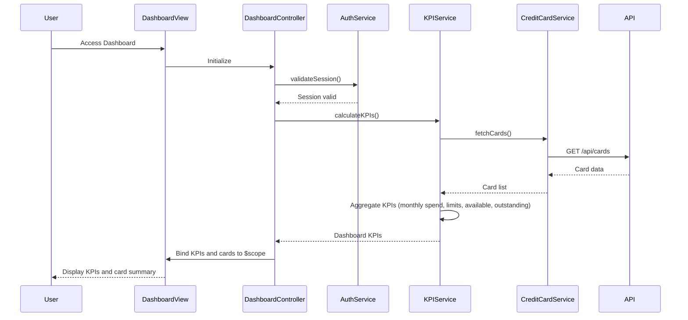

# Low-Level Design: QE-8421 - Credit Card Dashboard and KPIs

## a. Architecture Mapping

- **Dashboard UI Component** → AngularJS Controller (`DashboardController`) + View Template (`dashboard.html`)
- **Authentication Service** → Service (`AuthService`) for user authentication and session management
- **Credit Card Data Service** → Service (`CreditCardService`) for fetching card data via REST API
- **KPI Calculation Engine** → Service (`KPIService`) for calculating monthly spend, available credit, outstanding amounts
- **Data Repository** → Backend REST API endpoint (`/api/cards`, `/api/transactions`)

**Recommended Folder Structure:**
```
/app
  /modules
    /dashboard
      /controllers
        - dashboard.controller.js
      /services
        - auth.service.js
        - credit-card.service.js
        - kpi.service.js
      /views
        - dashboard.html
      /styles
        - dashboard.css
```

## b. Component Specifications

| Component Name | Artifact Type | Responsibility | Key Dependencies |
|---|---|---|---|
| DashboardController | Controller | Manage dashboard view state, fetch and display KPIs, handle multi-card view | KPIService, CreditCardService, AuthService, $scope |
| AuthService | Service | Authenticate user, manage session tokens, provide user context | $http, $window (for token storage) |
| CreditCardService | Service | Fetch credit card data (cards, balances, limits) from REST API | $http, $q |
| KPIService | Service | Calculate monthly spend, total credit limit, available credit, outstanding amount across all cards | CreditCardService, $q |

## c. Data Model

**CreditCard** (JavaScript Object)
- `cardId`: String
- `cardName`: String
- `cardNumber`: String (masked, e.g., "**** 1234")
- `creditLimit`: Number
- `outstandingAmount`: Number
- `availableCredit`: Number (calculated)

**DashboardKPI** (JavaScript Object)
- `monthlySpend`: Number (sum of current month transactions across all cards)
- `totalCreditLimit`: Number (sum of all card limits)
- `totalAvailableCredit`: Number (sum of available credit across all cards)
- `totalOutstanding`: Number (sum of outstanding amounts across all cards)

## d. Data Flow

User accesses dashboard → AuthService validates session token → DashboardController initializes and calls KPIService.calculateKPIs() → KPIService invokes CreditCardService.fetchCards() to retrieve card data via REST API → KPIService aggregates card data to compute monthly spend, total limits, available credit, and outstanding amounts → KPIs returned to DashboardController → Controller binds KPIs and card list to $scope → Dashboard view renders KPI widgets and multi-card summary using Bootstrap responsive grid → User views real-time KPIs and card details.

## e. Primary Sequence Diagram



## f. Implementation Notes

- Use AngularJS Dependency Injection to inject AuthService, CreditCardService, and KPIService into DashboardController.
- Implement KPIService using ES6 reduce method to aggregate card data for total limits, outstanding, and available credit calculations.
- Use $http service with promise-based API calls; implement token-based authentication by attaching JWT token to request headers via HTTP interceptor.
- Apply Bootstrap grid (col-md-3 for KPI cards) and responsive utilities (hidden-xs, visible-sm) for mobile/tablet/desktop layouts.
- Use AngularJS $interval or manual refresh button to periodically update KPIs (e.g., every 5 minutes) for near real-time data.

## g. Error Handling

HTTP interceptor captures API errors and authentication failures; service-level try/catch for calculation errors; user notified via alert/toast for fetch or session errors.

## h. Security Notes

Requires token-based auth via existing SSO; JWT token stored in sessionStorage and attached to all API requests; API endpoints secured with user authorization.