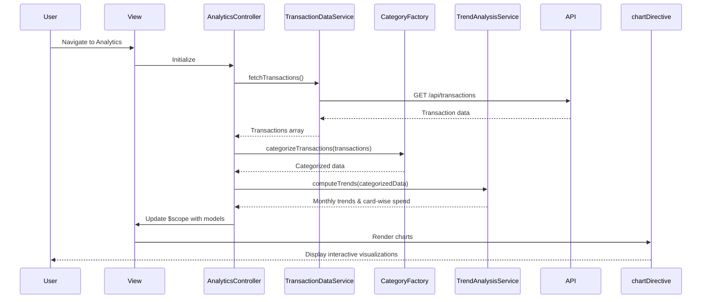

# Low-Level Design: QE-8422 - Spending Analytics and Category Insights

## a. Architecture Mapping

**HLD Component → AngularJS Artifact:**
- User Interface → AngularJS Module (`spendingAnalyticsModule`) + HTML5 Views with Bootstrap styling
- Analytics Controller → AngularJS Controller (`AnalyticsController`)
- Transaction Data Repository → AngularJS Service (`TransactionDataService`) for REST API calls
- Categorization Engine → AngularJS Factory (`CategoryFactory`) for client-side category logic
- Visualization Service → AngularJS Directive (`chartDirective`) wrapping Chart.js or D3.js
- Trend Analysis Module → AngularJS Service (`TrendAnalysisService`) for trend calculations

**Recommended Folder Structure:**
```
app/
├── modules/
│   └── spending-analytics/
│       ├── controllers/
│       │   └── analytics.controller.js
│       ├── services/
│       │   ├── transaction-data.service.js
│       │   └── trend-analysis.service.js
│       ├── factories/
│       │   └── category.factory.js
│       ├── directives/
│       │   └── chart.directive.js
│       ├── views/
│       │   └── analytics.html
│       └── spending-analytics.module.js
```

## b. Component Specifications

| Component Name | Artifact Type | Responsibility | Key Dependencies |
|----------------|---------------|----------------|------------------|
| spendingAnalyticsModule | Module | Root module for spending analytics feature | angular, ngRoute |
| AnalyticsController | Controller | Manages analytics view state, user interactions, and data binding | TransactionDataService, TrendAnalysisService, CategoryFactory, $scope |
| TransactionDataService | Service | Fetches transaction data from REST API endpoints | $http, $q |
| CategoryFactory | Factory | Provides category definitions and classification logic for 9 categories | None |
| chartDirective | Directive | Renders interactive charts (bar, pie, line) for spending visualization | Chart.js or D3.js library |
| TrendAnalysisService | Service | Computes monthly trends and card-wise spend aggregations | CategoryFactory |

## c. Data Model

**Transaction Model:**
```javascript
{
  transactionId: String,
  cardId: String,
  amount: Number,
  category: String, // One of: Food & Dining, Fuel, Shopping, Travel, Entertainment, Utilities, Healthcare, Education, Miscellaneous
  merchant: String,
  transactionDate: Date,
  description: String
}
```

**CategorySpend Model:**
```javascript
{
  category: String,
  totalSpend: Number,
  transactionCount: Number,
  percentage: Number
}
```

**MonthlyTrend Model:**
```javascript
{
  month: String, // Format: YYYY-MM
  totalSpend: Number,
  categoryBreakdown: Array<CategorySpend>
}
```

**CardSpend Model:**
```javascript
{
  cardId: String,
  cardName: String,
  totalSpend: Number,
  categoryBreakdown: Array<CategorySpend>
}
```

## d. Data Flow

User navigates to the Analytics view, triggering AnalyticsController initialization. The controller invokes TransactionDataService to fetch transaction history via REST API (`GET /api/transactions`). Upon receiving the response, CategoryFactory classifies transactions into 9 predefined categories. TrendAnalysisService processes the categorized data to compute monthly trends and card-wise spend aggregations. The controller binds the computed models to $scope, and chartDirective renders interactive visualizations (pie chart for category breakdown, line chart for monthly trends, bar chart for card-wise spend). User interactions (filters, drill-downs) trigger controller methods that re-compute data and update the view.

## e. Primary Sequence Diagram



## f. Implementation Notes

- Use AngularJS 1.x with ES6 modules and arrow functions for cleaner syntax; transpile with Babel if needed.
- Apply dependency injection for all services, factories, and controllers using explicit array notation to avoid minification issues.
- Leverage `$http` service with promise chaining for REST API calls; handle responses and errors in service layer.
- Implement chartDirective with isolated scope and two-way data binding to support dynamic chart updates on filter changes.
- Use Bootstrap grid system for responsive layout; ensure charts resize gracefully using CSS media queries and chart library responsive options.

## g. Error Handling

HTTP interceptor captures API errors; controller displays user-friendly notifications using Bootstrap alerts or toast library.

## h. Security Notes

Standard input validation and secure API calls assumed; token-based authentication via existing SSO for API requests.