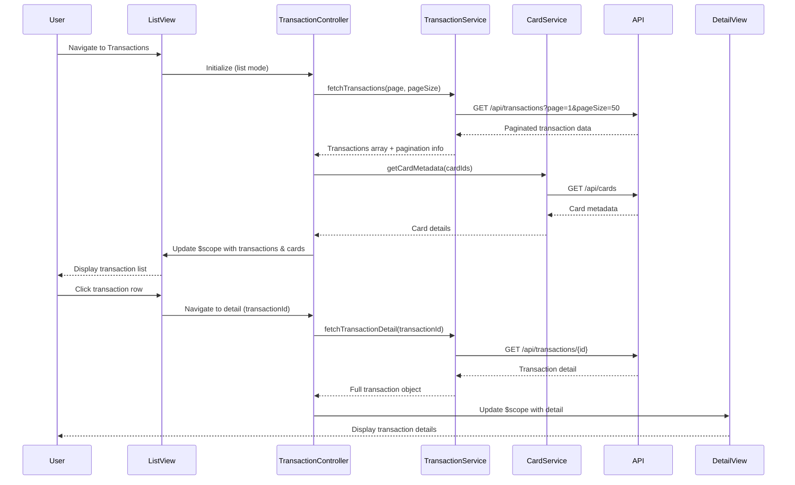

# Low-Level Design: QE-8423 - Transaction Monitoring and Management

## a. Architecture Mapping

**HLD Component → AngularJS Artifact:**
- User Interface → AngularJS Module (`transactionModule`) + HTML5 Views with Bootstrap tables
- Transaction Controller → AngularJS Controller (`TransactionController`)
- Search and Filter Service → AngularJS Service (`SearchFilterService`) for client-side filtering logic
- Transaction Data Source → AngularJS Service (`TransactionService`) for REST API calls
- Card Management System → AngularJS Service (`CardService`) for card metadata and linking

**Recommended Folder Structure:**
```
app/
├── modules/
│   └── transactions/
│       ├── controllers/
│       │   └── transaction.controller.js
│       ├── services/
│       │   ├── transaction.service.js
│       │   ├── card.service.js
│       │   └── search-filter.service.js
│       ├── views/
│       │   ├── transaction-list.html
│       │   └── transaction-detail.html
│       └── transaction.module.js
```

## b. Component Specifications

| Component Name | Artifact Type | Responsibility | Key Dependencies |
|----------------|---------------|----------------|------------------|
| transactionModule | Module | Root module for transaction monitoring feature | angular, ngRoute |
| TransactionController | Controller | Manages transaction list/detail views, pagination, search/filter state | TransactionService, CardService, SearchFilterService, $scope, $routeParams |
| TransactionService | Service | Fetches transaction data from REST API with pagination support | $http, $q |
| CardService | Service | Retrieves card metadata and links transactions to cards | $http, $q |
| SearchFilterService | Service | Applies search and filter logic on transaction datasets | None |

## c. Data Model

**Transaction Model:**
```javascript
{
  transactionId: String,
  cardId: String,
  cardName: String,
  amount: Number,
  category: String,
  merchant: String,
  transactionDate: Date,
  status: String, // e.g., Posted, Pending
  description: String
}
```

**Card Model:**
```javascript
{
  cardId: String,
  cardName: String,
  cardNumber: String, // Masked, e.g., **** **** **** 1234
  cardType: String // e.g., Visa, MasterCard
}
```

**Pagination Model:**
```javascript
{
  currentPage: Number,
  pageSize: Number,
  totalRecords: Number,
  totalPages: Number
}
```

**Filter Model:**
```javascript
{
  cardId: String,
  category: String,
  dateFrom: Date,
  dateTo: Date,
  minAmount: Number,
  maxAmount: Number,
  searchTerm: String
}
```

## d. Data Flow

User navigates to the Transaction List view, triggering TransactionController initialization. The controller invokes TransactionService to fetch paginated transaction data via REST API (`GET /api/transactions?page=1&pageSize=50`). CardService is called to retrieve card metadata for linking transactions to specific cards. The controller binds transaction data and pagination state to $scope, rendering the list in the view using Bootstrap tables. User applies search/filter criteria, which triggers SearchFilterService to filter the dataset client-side or sends a new API request with query parameters. User clicks on a transaction row to view details, navigating to transaction-detail view where TransactionController loads full transaction details via `GET /api/transactions/{id}`. The view updates with detailed information.

## e. Primary Sequence Diagram



## f. Implementation Notes

- Use AngularJS 1.x with ES6 syntax; apply explicit dependency injection array notation for minification safety.
- Implement pagination using `$http` query parameters; store pagination state in controller scope and bind to UI controls.
- Apply ng-repeat with track by transactionId for efficient list rendering; use limitTo filter for client-side pagination if needed.
- Leverage Bootstrap table-responsive class for mobile-friendly transaction tables; use ng-show/ng-hide for conditional rendering.
- Implement SearchFilterService with debounce (using $timeout) for search input to reduce API calls and improve performance.

## g. Error Handling

HTTP interceptor-based error handling with try/catch in service layer; user notifications via Bootstrap modals or inline alerts.

## h. Security Notes

Requires token-based auth via existing SSO; API endpoints secured with authentication headers; sensitive card data masked in UI.