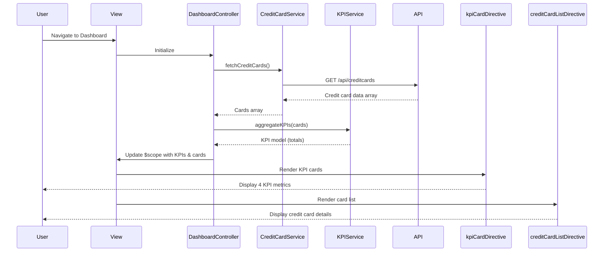

# Low-Level Design: QE-8424 - Credit Card Management and KPI Dashboard

## a. Architecture Mapping

**HLD Component → AngularJS Artifact:**
- User Interface → AngularJS Module (`dashboardModule`) + HTML5 Views with Bootstrap cards
- Dashboard Controller → AngularJS Controller (`DashboardController`)
- KPI Aggregation Service → AngularJS Service (`KPIService`) for aggregating KPI data
- Credit Card Data Repository → AngularJS Service (`CreditCardService`) for REST API calls
- Presentation Layer → AngularJS Directives (`kpiCardDirective`, `creditCardListDirective`) for reusable UI components

**Recommended Folder Structure:**
```
app/
├── modules/
│   └── dashboard/
│       ├── controllers/
│       │   └── dashboard.controller.js
│       ├── services/
│       │   ├── credit-card.service.js
│       │   └── kpi.service.js
│       ├── directives/
│       │   ├── kpi-card.directive.js
│       │   └── credit-card-list.directive.js
│       ├── views/
│       │   └── dashboard.html
│       └── dashboard.module.js
```

## b. Component Specifications

| Component Name | Artifact Type | Responsibility | Key Dependencies |
|----------------|---------------|----------------|------------------|
| dashboardModule | Module | Root module for dashboard feature | angular, ngRoute |
| DashboardController | Controller | Manages dashboard state, KPI display, and credit card list | CreditCardService, KPIService, $scope, $interval |
| CreditCardService | Service | Fetches credit card data from REST API | $http, $q |
| KPIService | Service | Aggregates KPIs (monthly spend, credit limit, available credit, outstanding) across cards | None |
| kpiCardDirective | Directive | Renders individual KPI card with icon, label, and value | None |
| creditCardListDirective | Directive | Renders list of credit cards with card details | None |

## c. Data Model

**CreditCard Model:**
```javascript
{
  cardId: String,
  cardName: String,
  cardNumber: String, // Masked, e.g., **** **** **** 1234
  cardType: String, // e.g., Visa, MasterCard, Amex
  creditLimit: Number,
  availableCredit: Number,
  outstandingAmount: Number,
  monthlySpend: Number,
  expiryDate: String, // Format: MM/YY
  status: String // e.g., Active, Blocked
}
```

**KPI Model:**
```javascript
{
  totalMonthlySpend: Number,
  totalCreditLimit: Number,
  totalAvailableCredit: Number,
  totalOutstanding: Number
}
```

## d. Data Flow

User navigates to the Dashboard view, triggering DashboardController initialization. The controller invokes CreditCardService to fetch all credit card data via REST API (`GET /api/creditcards`). Upon receiving the response, the controller passes the card array to KPIService, which aggregates monthly spend, total credit limit, available credit, and outstanding amounts across all cards. The controller binds the KPI model and card list to $scope. kpiCardDirective renders four KPI cards displaying aggregated metrics, while creditCardListDirective renders the list of credit cards with individual card details. An optional $interval refreshes the data periodically to simulate real-time updates. User interactions (e.g., clicking a card) can navigate to detailed views or trigger additional actions.

## e. Primary Sequence Diagram



## f. Implementation Notes

- Use AngularJS 1.x with ES6 syntax; apply explicit array notation for dependency injection to ensure minification compatibility.
- Implement CreditCardService using `$http` with promise-based API calls; cache responses using `$cacheFactory` if data refresh is infrequent.
- KPIService performs client-side aggregation using Array.reduce() for summing card-level metrics into dashboard-level KPIs.
- Create reusable directives (kpiCardDirective, creditCardListDirective) with isolated scopes and attribute bindings for flexibility.
- Use Bootstrap grid (col-md-3 for KPI cards, col-md-12 for card list) and card component for responsive, modern UI; apply CSS3 transitions for smooth interactions.

## g. Error Handling

HTTP interceptor captures API errors; controller displays user-friendly error messages using Bootstrap alerts.

## h. Security Notes

Requires token-based auth via existing SSO; sensitive card numbers masked in UI; API endpoints secured with authentication headers.