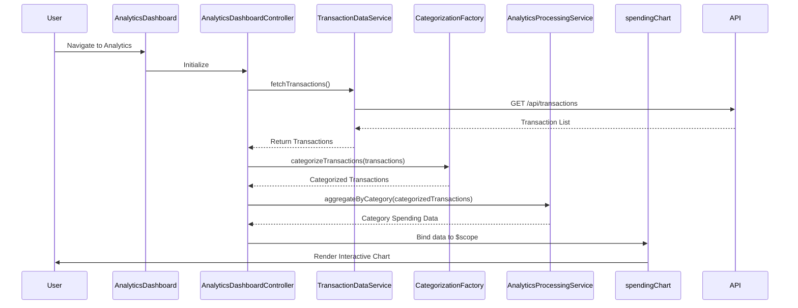

# Low-Level Design: QE-8425 - Transaction Analytics and Category-wise Spending Insights

## a. Architecture Mapping

- **Analytics Dashboard UI** → AngularJS Module (`creditCard.analytics`) + Controller (`AnalyticsDashboardController`)
- **Transaction Data Service** → AngularJS Service (`TransactionDataService`) for REST API calls
- **Categorization Engine** → AngularJS Factory (`CategorizationFactory`) for transaction classification logic
- **Analytics Processing Module** → AngularJS Service (`AnalyticsProcessingService`) for aggregation and computation
- **Visualization Renderer** → AngularJS Directive (`spendingChart`) wrapping Chart.js or D3.js

**Recommended Folder Structure:**
```
app/
  modules/
    analytics/
      controllers/
        AnalyticsDashboardController.js
      services/
        TransactionDataService.js
        AnalyticsProcessingService.js
      factories/
        CategorizationFactory.js
      directives/
        spendingChart.js
      views/
        analytics-dashboard.html
      analytics.module.js
```

## b. Component Specifications

| Component Name | Artifact Type | Responsibility | Key Dependencies |
|----------------|---------------|----------------|------------------|
| AnalyticsDashboardController | Controller | Orchestrate analytics view, fetch transaction data, trigger categorization and visualization | TransactionDataService, AnalyticsProcessingService, $scope |
| TransactionDataService | Service | Retrieve transaction records from REST API endpoint | $http, $q |
| CategorizationFactory | Factory | Classify transactions into predefined categories using rule-based logic | None |
| AnalyticsProcessingService | Service | Aggregate categorized transactions, compute category-wise totals and trends | CategorizationFactory |
| spendingChart | Directive | Render interactive charts (bar/pie/line) for category-wise spending | Chart.js or D3.js library |

## c. Data Model

**Transaction Model:**
```javascript
{
  transactionId: String,
  cardId: String,
  amount: Number,
  date: Date,
  merchant: String,
  category: String, // Food & Dining, Fuel, Shopping, Travel, Entertainment, Utilities, Healthcare, Education, Miscellaneous
  description: String
}
```

**CategorySpending Model:**
```javascript
{
  category: String,
  totalAmount: Number,
  transactionCount: Number,
  percentage: Number
}
```

## d. Data Flow

User navigates to the Analytics Dashboard; AnalyticsDashboardController calls TransactionDataService to fetch transaction records via REST API; retrieved transactions are passed to CategorizationFactory for automatic classification; AnalyticsProcessingService aggregates categorized data into category-wise totals; processed data is bound to $scope and consumed by spendingChart directive to render interactive visualizations; user interactions (e.g., date range filter) trigger re-computation and chart updates.

## e. Primary Sequence Diagram



## f. Implementation Notes

- Use AngularJS dependency injection to inject services and factories into controllers and directives.
- Leverage ES6 classes for service definitions; use arrow functions for callbacks to maintain lexical `this` context.
- Implement REST API calls using $http service with promise-based error handling ($q).
- Use Chart.js or D3.js wrapped in a custom AngularJS directive for reusable and interactive visualizations.
- Apply AngularJS filters for date formatting and currency display in transaction history views.

## g. Error Handling

Use $http interceptor to catch API errors globally; display user-friendly error notifications via a toast service; wrap categorization logic in try/catch blocks.

## h. Security Notes

Requires token-based authentication via existing SSO; all API calls include authorization headers; standard input validation and secure API calls assumed.