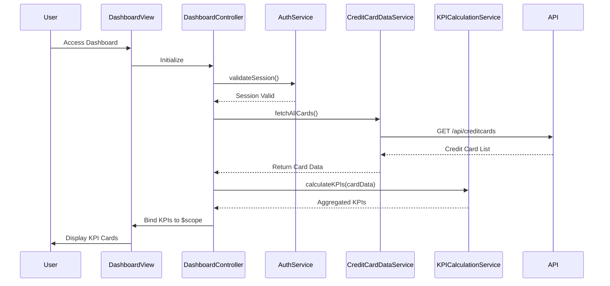

# Low-Level Design: QE-8426 - Credit Card Dashboard and KPI Management

## a. Architecture Mapping

- **User Interface - Dashboard** → AngularJS Module (`creditCard.dashboard`) + Controller (`DashboardController`)
- **Authentication Service** → AngularJS Service (`AuthService`) for session and token management
- **Dashboard Controller** → AngularJS Controller (`DashboardController`) orchestrating KPI display
- **Credit Card Data Service** → AngularJS Service (`CreditCardDataService`) for REST API calls
- **KPI Calculation Engine** → AngularJS Service (`KPICalculationService`) for aggregating metrics

**Recommended Folder Structure:**
```
app/
  modules/
    dashboard/
      controllers/
        DashboardController.js
      services/
        CreditCardDataService.js
        KPICalculationService.js
        AuthService.js
      views/
        dashboard.html
      dashboard.module.js
```

## b. Component Specifications

| Component Name | Artifact Type | Responsibility | Key Dependencies |
|----------------|---------------|----------------|------------------|
| DashboardController | Controller | Orchestrate dashboard view, fetch credit card data, display KPIs | CreditCardDataService, KPICalculationService, AuthService, $scope |
| AuthService | Service | Manage user authentication, session tokens, and secure access | $http, $window (for localStorage) |
| CreditCardDataService | Service | Retrieve credit card balances and transaction data from REST API | $http, $q, AuthService |
| KPICalculationService | Service | Aggregate monthly spend, total credit limit, available credit, outstanding amount across all cards | None |
| dashboard.html | View | Responsive HTML5 template displaying KPI cards using Bootstrap grid | Bootstrap CSS |

## c. Data Model

**CreditCard Model:**
```javascript
{
  cardId: String,
  cardNumber: String, // masked
  cardType: String, // Visa, MasterCard, etc.
  creditLimit: Number,
  availableCredit: Number,
  outstandingAmount: Number,
  monthlySpend: Number
}
```

**DashboardKPI Model:**
```javascript
{
  totalMonthlySpend: Number,
  totalCreditLimit: Number,
  totalAvailableCredit: Number,
  totalOutstandingAmount: Number
}
```

## d. Data Flow

User accesses the dashboard; AuthService validates session token; DashboardController calls CreditCardDataService to fetch all credit card data via REST API; retrieved card data is passed to KPICalculationService for aggregation; KPICalculationService computes total monthly spend, credit limit, available credit, and outstanding amount; aggregated KPIs are bound to $scope and rendered in the dashboard view using Bootstrap-responsive KPI cards; real-time data refresh is triggered via $interval or manual user action.

## e. Primary Sequence Diagram



## f. Implementation Notes

- Use AngularJS dependency injection to inject AuthService, CreditCardDataService, and KPICalculationService into DashboardController.
- Implement AuthService using $http interceptor to attach authorization tokens to all outgoing API requests.
- Leverage ES6 classes for service definitions; use arrow functions for promise chaining.
- Use Bootstrap grid system (col-xs, col-sm, col-md, col-lg) for responsive KPI card layout.
- Implement real-time data refresh using $interval with configurable refresh rate; clear interval on $scope.$destroy.

## g. Error Handling

Use $http interceptor to catch API errors; display user-friendly error messages via a notification service; handle session expiration by redirecting to login.

## h. Security Notes

Requires token-based auth via existing SSO; all API calls include authorization headers; sensitive card data is masked in the UI.