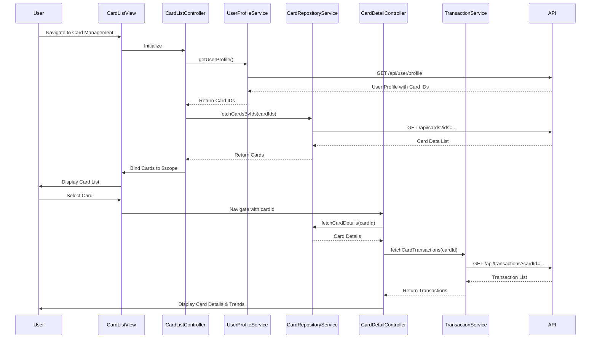

# Low-Level Design: QE-8427 - Multiple Credit Card Management and Monitoring

## a. Architecture Mapping

- **User Interface - Card List View** → AngularJS Module (`creditCard.management`) + Controller (`CardListController`)
- **User Profile Service** → AngularJS Service (`UserProfileService`) for user-card association
- **Card Management Controller** → AngularJS Controller (`CardManagementController`) for card operations
- **Credit Card Data Repository** → AngularJS Service (`CardRepositoryService`) for CRUD operations via REST API
- **Transaction Processing System** → AngularJS Service (`TransactionService`) for card-specific transaction data
- **Card Detail View** → AngularJS Controller (`CardDetailController`) + View (`card-detail.html`)

**Recommended Folder Structure:**
```
app/
  modules/
    card-management/
      controllers/
        CardListController.js
        CardDetailController.js
        CardManagementController.js
      services/
        UserProfileService.js
        CardRepositoryService.js
        TransactionService.js
      views/
        card-list.html
        card-detail.html
      card-management.module.js
```

## b. Component Specifications

| Component Name | Artifact Type | Responsibility | Key Dependencies |
|----------------|---------------|----------------|------------------|
| CardListController | Controller | Display list of all user credit cards, handle card selection | CardRepositoryService, UserProfileService, $scope |
| CardDetailController | Controller | Display individual card details, card-specific spend analysis, monthly trends | CardRepositoryService, TransactionService, $scope, $routeParams |
| CardManagementController | Controller | Orchestrate card management operations, navigation between cards | CardRepositoryService, $location |
| UserProfileService | Service | Retrieve user profile and associated card IDs from REST API | $http, $q |
| CardRepositoryService | Service | Perform CRUD operations on credit card data via REST API | $http, $q |
| TransactionService | Service | Fetch card-specific transaction data and compute spend trends | $http, $q |

## c. Data Model

**CreditCard Model:**
```javascript
{
  cardId: String,
  userId: String,
  cardNumber: String, // masked
  cardType: String,
  bankName: String,
  creditLimit: Number,
  availableCredit: Number,
  outstandingBalance: Number,
  monthlySpend: Number,
  expiryDate: String
}
```

**CardSpendTrend Model:**
```javascript
{
  cardId: String,
  month: String,
  totalSpend: Number,
  transactionCount: Number
}
```

## d. Data Flow

User navigates to the card management interface; CardListController calls UserProfileService to retrieve user profile and associated card IDs; CardRepositoryService fetches detailed card data for each card ID via REST API; card list is rendered in the view; user selects a specific card, triggering navigation to CardDetailController; CardDetailController retrieves card-specific data from CardRepositoryService and transaction history from TransactionService; card details, balance, and monthly spend trends are displayed; user can switch between cards using navigation controls.

## e. Primary Sequence Diagram



## f. Implementation Notes

- Use AngularJS dependency injection to inject services into controllers.
- Implement routing using ngRoute or ui-router to navigate between card list and card detail views.
- Leverage ES6 classes for service definitions; use arrow functions for promise chaining.
- Use $routeParams or $stateParams to pass cardId from card list to card detail view.
- Implement lazy loading or pagination for card list if the number of cards exceeds a threshold for performance optimization.

## g. Error Handling

Use $http interceptor for global API error handling; display user-friendly error messages via a toast notification service; handle empty card list gracefully with a placeholder message.

## h. Security Notes

Requires token-based authentication via existing SSO; all API calls include authorization headers; card numbers are masked in the UI; standard input validation and secure API calls assumed.