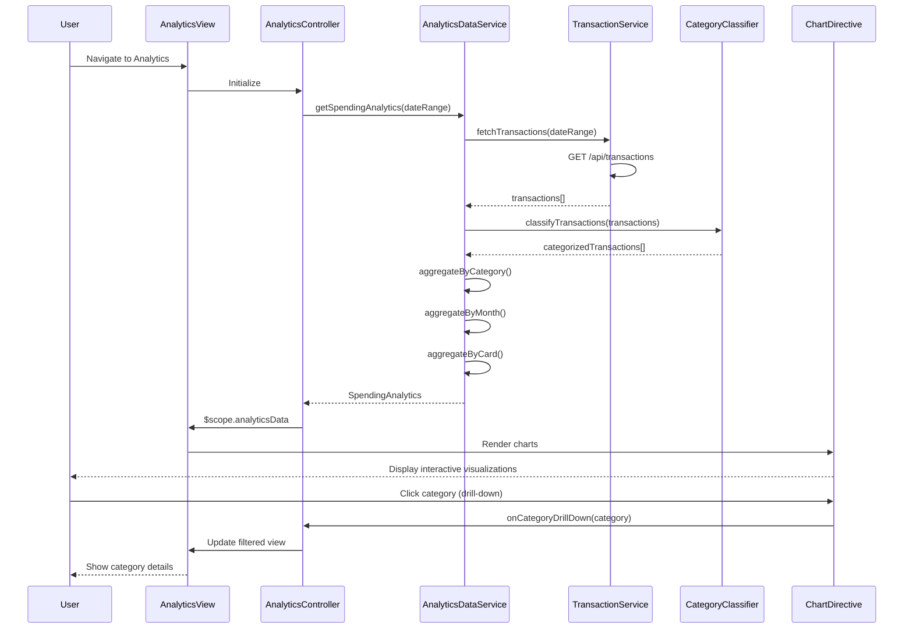

# Low-Level Design: QE-8434 - Spending Analytics and Insights

## a. Architecture Mapping

**Component to AngularJS Artifact Mapping:**

- Analytics UI → AngularJS Module (`app.analytics`) + Main View Template (`analytics.html`)
- Analytics Controller → AngularJS Controller (`AnalyticsController`)
- Data Aggregation Service → AngularJS Service (`AnalyticsDataService`)
- Category Classification → AngularJS Factory (`CategoryClassifier`)
- Transaction Data Service → AngularJS Service (`TransactionService`)
- Charting Library → Directive wrapper (`chartDirective`) for Chart.js or D3.js integration

**Recommended Folder Structure:**
```
app/
├── modules/
│   └── analytics/
│       ├── analytics.module.js
│       ├── analytics.controller.js
│       ├── analytics.service.js
│       ├── analytics.html
│       └── directives/
│           └── chart.directive.js
├── shared/
│   ├── services/
│   │   └── transaction.service.js
│   └── factories/
│       └── category-classifier.factory.js
└── assets/
    └── css/
        └── analytics.css
```

## b. Component Specifications

| Component Name | Artifact Type | Responsibility | Key Dependencies |
|----------------|---------------|----------------|------------------|
| app.analytics | Module | Root module for analytics feature, declares all analytics components | ngRoute, chart.js |
| AnalyticsController | Controller | Orchestrates analytics view, fetches aggregated data, manages chart state | AnalyticsDataService, CategoryClassifier, $scope |
| AnalyticsDataService | Service | Aggregates transaction data by category and month, calculates card-wise spend | TransactionService, $http, $q |
| CategoryClassifier | Factory | Classifies transactions into 9 predefined categories based on merchant/type | None |
| TransactionService | Service | Retrieves raw transaction data from REST API | $http, $q |
| chartDirective | Directive | Renders interactive charts with drill-down capability using Chart.js | Chart.js library |

## c. Data Model

**SpendingAnalytics (JS Object):**
```javascript
{
  categorySpend: [
    { category: String, amount: Number, percentage: Number, transactionCount: Number }
  ],
  monthlyTrends: [
    { month: String, totalSpend: Number, categoryBreakdown: Object }
  ],
  cardWiseSpend: [
    { cardId: String, cardName: String, totalSpend: Number, categorySpend: Array }
  ],
  dateRange: { startDate: Date, endDate: Date },
  totalSpend: Number
}
```

**Category (Enum):**
```javascript
['Food & Dining', 'Fuel', 'Shopping', 'Travel', 'Entertainment', 'Utilities', 'Healthcare', 'Education', 'Miscellaneous']
```

**Transaction (JS Object):**
```javascript
{
  id: String,
  cardId: String,
  amount: Number,
  merchant: String,
  category: String,
  date: Date,
  description: String
}
```

## d. Data Flow

User navigates to Analytics view → AnalyticsController initializes and calls AnalyticsDataService.getSpendingAnalytics() → Service fetches raw transactions via TransactionService REST API call → CategoryClassifier categorizes each transaction → AnalyticsDataService aggregates data by category, month, and card → Aggregated SpendingAnalytics model returned to controller → Controller binds data to $scope → chartDirective renders interactive visualizations → User interacts with charts (drill-down) triggering controller methods to filter/update view.

## e. Primary Sequence Diagram



## f. Implementation Notes

- Use AngularJS dependency injection to inject services and factories into controllers and directives
- Implement Chart.js via custom directive with isolated scope for reusability and two-way data binding
- Use $http service with Promise-based API calls; cache aggregated results in AnalyticsDataService for 5 minutes to reduce API load
- Apply ES6 arrow functions and const/let for cleaner service and factory code
- Implement responsive chart sizing using CSS media queries and Chart.js responsive options

## g. Error Handling

HTTP interceptor captures API errors; display user-friendly notifications via toastr; controller wraps service calls in try/catch with fallback to empty state.

## h. Security Notes

Requires token-based auth via existing SSO; all API calls include Authorization header with JWT token.