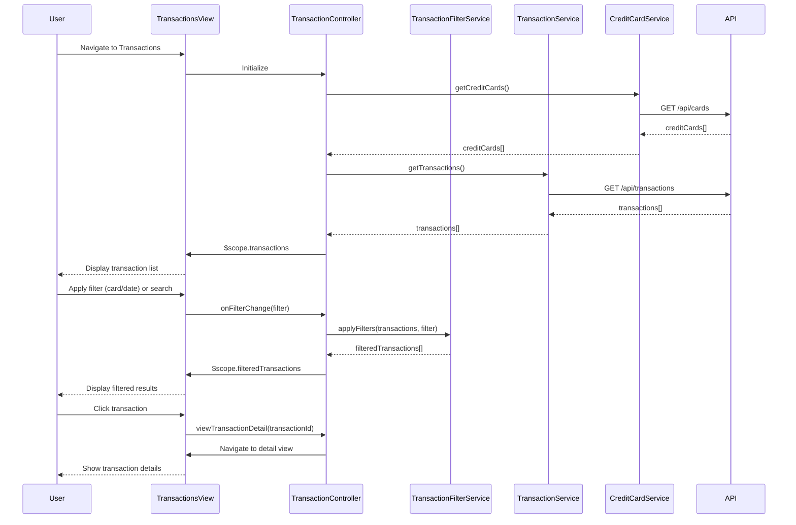

# Low-Level Design: QE-8435 - Transaction Management and Tracking

## a. Architecture Mapping

**Component to AngularJS Artifact Mapping:**

- User Interface → AngularJS Module (`app.transactions`) + View Template (`transactions.html`)
- Transaction Controller → AngularJS Controller (`TransactionController`)
- Search and Filter Engine → AngularJS Service (`TransactionFilterService`)
- Transaction Data Repository → REST API integration via AngularJS Service (`TransactionService`)
- Credit Card Service → AngularJS Service (`CreditCardService`)
- Encryption Service → Backend service (not implemented in AngularJS client)

**Recommended Folder Structure:**
```
app/
├── modules/
│   └── transactions/
│       ├── transactions.module.js
│       ├── transactions.controller.js
│       ├── transactions.html
│       ├── transaction-detail.html
│       └── services/
│           ├── transaction.service.js
│           └── transaction-filter.service.js
├── shared/
│   └── services/
│       └── credit-card.service.js
└── assets/
    └── css/
        └── transactions.css
```

## b. Component Specifications

| Component Name | Artifact Type | Responsibility | Key Dependencies |
|----------------|---------------|----------------|------------------|
| app.transactions | Module | Root module for transaction management feature | ngRoute, ngSanitize |
| TransactionController | Controller | Manages transaction list view, search, filter state, and detail navigation | TransactionService, TransactionFilterService, CreditCardService, $scope |
| TransactionService | Service | Fetches transaction data from REST API, handles pagination | $http, $q |
| TransactionFilterService | Service | Applies search and filter logic (card, date range, fuzzy search) | None |
| CreditCardService | Service | Retrieves user's credit card list for filter dropdown | $http, $q |

## c. Data Model

**Transaction (JS Object):**
```javascript
{
  id: String,
  cardId: String,
  cardName: String,
  amount: Number,
  merchant: String,
  category: String,
  date: Date,
  description: String,
  status: String // 'posted' | 'pending'
}
```

**TransactionFilter (JS Object):**
```javascript
{
  cardId: String,
  startDate: Date,
  endDate: Date,
  searchTerm: String
}
```

**CreditCard (JS Object):**
```javascript
{
  id: String,
  name: String,
  lastFourDigits: String
}
```

## d. Data Flow

User navigates to Transactions view → TransactionController initializes and calls TransactionService.getTransactions() → Service makes GET /api/transactions REST call → Transactions array returned and bound to $scope → User applies filter (card/date) or enters search term → Controller calls TransactionFilterService.applyFilters() → Filtered transactions updated in view → User clicks transaction row → Controller navigates to transaction detail view with transaction ID → Detail view displays full transaction information.

## e. Primary Sequence Diagram



## f. Implementation Notes

- Use AngularJS $http service with RESTful endpoints; implement query parameters for server-side filtering if dataset exceeds 10,000 records
- TransactionFilterService implements client-side fuzzy search using Fuse.js library or custom regex matching on merchant and description fields
- Apply AngularJS filters (date, currency) in view templates for consistent formatting
- Use ng-repeat with track by transaction.id for optimized list rendering
- Implement lazy loading or pagination if transaction count impacts performance

## g. Error Handling

HTTP interceptor-based error handling with user notifications via toastr; controller wraps API calls in try/catch with fallback to cached data or empty state.

## h. Security Notes

Requires token-based auth via existing SSO; transaction data encrypted at rest on backend; client validates input and sanitizes search terms to prevent XSS.