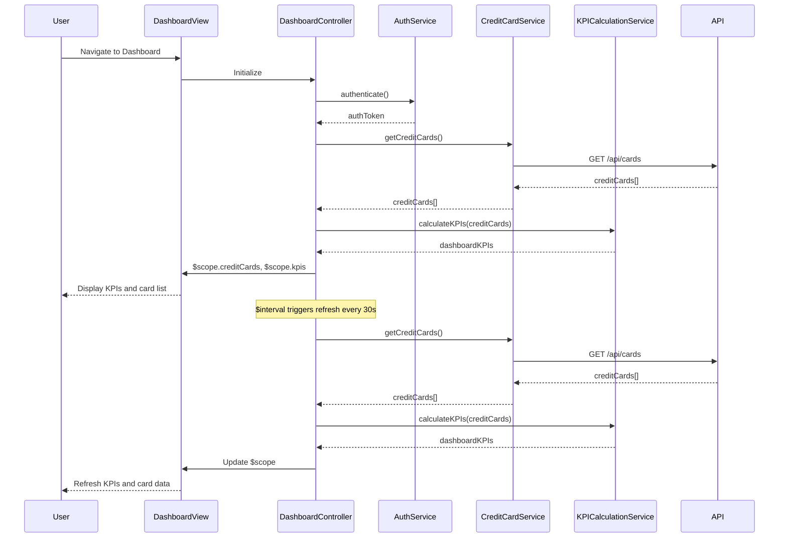

# Low-Level Design: QE-8436 - Dashboard KPIs and Credit Card Overview

## a. Architecture Mapping

**Component to AngularJS Artifact Mapping:**

- User Interface Layer → AngularJS Module (`app.dashboard`) + View Template (`dashboard.html`)
- Dashboard Controller → AngularJS Controller (`DashboardController`)
- KPI Calculation Engine → AngularJS Service (`KPICalculationService`)
- Credit Card Data Service → AngularJS Service (`CreditCardService`)
- User Authentication Service → AngularJS Service (`AuthService`)
- Data Store → Backend REST API (accessed via $http)

**Recommended Folder Structure:**
```
app/
├── modules/
│   └── dashboard/
│       ├── dashboard.module.js
│       ├── dashboard.controller.js
│       ├── dashboard.html
│       └── services/
│           ├── kpi-calculation.service.js
│           └── credit-card.service.js
├── shared/
│   └── services/
│       └── auth.service.js
└── assets/
    └── css/
        └── dashboard.css
```

## b. Component Specifications

| Component Name | Artifact Type | Responsibility | Key Dependencies |
|----------------|---------------|----------------|------------------|
| app.dashboard | Module | Root module for dashboard feature, declares all dashboard components | ngRoute, ngAnimate |
| DashboardController | Controller | Orchestrates dashboard view, fetches credit card data, triggers KPI calculations | KPICalculationService, CreditCardService, AuthService, $scope, $interval |
| KPICalculationService | Service | Calculates monthly spend, total credit limit, available credit, outstanding amount | None |
| CreditCardService | Service | Fetches credit card data from REST API, provides real-time refresh capability | $http, $q |
| AuthService | Service | Manages user authentication state and token | $http, $window |

## c. Data Model

**CreditCard (JS Object):**
```javascript
{
  id: String,
  name: String,
  lastFourDigits: String,
  creditLimit: Number,
  currentBalance: Number,
  availableCredit: Number,
  outstandingAmount: Number,
  monthlySpend: Number
}
```

**DashboardKPIs (JS Object):**
```javascript
{
  totalMonthlySpend: Number,
  totalCreditLimit: Number,
  totalAvailableCredit: Number,
  totalOutstandingAmount: Number,
  creditUtilizationPercentage: Number
}
```

## d. Data Flow

User logs in and navigates to Dashboard → DashboardController initializes and calls AuthService.authenticate() → Upon successful auth, controller calls CreditCardService.getCreditCards() → Service makes GET /api/cards REST call → Credit card array returned → Controller passes data to KPICalculationService.calculateKPIs() → Aggregated KPIs computed and returned → Controller binds credit cards and KPIs to $scope → View renders dashboard with KPI widgets and card list → $interval triggers periodic refresh every 30 seconds to update data.

## e. Primary Sequence Diagram



## f. Implementation Notes

- Use AngularJS dependency injection to inject AuthService, CreditCardService, and KPICalculationService into DashboardController
- Implement real-time refresh using $interval service with 30-second polling; cancel interval on $scope.$on('$destroy') to prevent memory leaks
- Apply Bootstrap grid system (col-md-3, col-sm-6, col-xs-12) for responsive KPI cards and card list layout
- Use AngularJS promises ($q) for async API calls; chain .then() for sequential operations
- Cache credit card data in CreditCardService for 2 minutes to reduce redundant API calls during navigation

## g. Error Handling

HTTP interceptor captures API errors and displays user-friendly toast notifications; controller wraps service calls in try/catch with fallback to last known good state.

## h. Security Notes

Requires token-based auth via existing SSO; all API requests include Authorization header with JWT token; AuthService validates token expiry before each request.