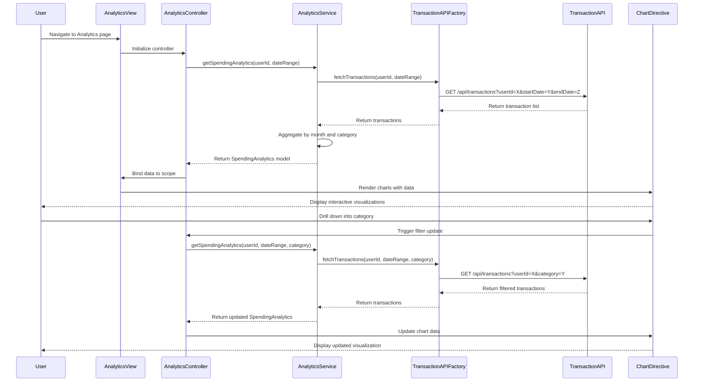

# Low-Level Design: QE-8437 - Spending Analytics and Insights

## a. Architecture Mapping

- **User Interface** → AngularJS Module (`analyticsModule`) with Controller (`AnalyticsController`) and Directives for chart rendering (`spendingChartDirective`, `categoryBreakdownDirective`)
- **Analytics Service** → AngularJS Service (`AnalyticsService`) for business logic and data transformation
- **Transaction Management System** → REST API integration via AngularJS Factory (`TransactionAPIFactory`)
- **Data Aggregation Service** → Backend REST API consumed by `AnalyticsService`
- **Visualization Engine** → Third-party charting library (e.g., Chart.js/D3.js) wrapped in AngularJS directives
- **Dashboard KPIs Module** → Shared AngularJS Service (`DashboardKPIService`) for consistent metrics

**Recommended Folder Structure:**
```
/app
  /modules
    /analytics
      analytics.module.js
      analytics.controller.js
      analytics.service.js
      /directives
        spending-chart.directive.js
        category-breakdown.directive.js
      /factories
        transaction-api.factory.js
  /shared
    /services
      dashboard-kpi.service.js
  /assets
    /css
      analytics.css
  /views
    analytics.html
```

## b. Component Specifications

| Component Name | Artifact Type | Responsibility | Key Dependencies |
|----------------|---------------|----------------|------------------|
| `analyticsModule` | Module | Root module for analytics feature | `ngRoute`, `chart.js` |
| `AnalyticsController` | Controller | Manages analytics view state and user interactions | `AnalyticsService`, `DashboardKPIService` |
| `AnalyticsService` | Service | Fetches, aggregates, and transforms transaction data for visualization | `TransactionAPIFactory`, `$q`, `$http` |
| `TransactionAPIFactory` | Factory | Handles REST API calls to transaction management system | `$http`, `$q` |
| `spendingChartDirective` | Directive | Renders monthly spend trend chart | `AnalyticsService`, Chart.js library |
| `categoryBreakdownDirective` | Directive | Renders category-wise spending breakdown chart | `AnalyticsService`, Chart.js library |
| `DashboardKPIService` | Service (Shared) | Provides consistent KPI calculations across modules | `$http` |

## c. Data Model

**SpendingAnalytics (JavaScript Object):**
```javascript
{
  userId: String,
  monthlyTrends: [
    {
      month: String,        // e.g., "2024-01"
      totalSpend: Number,   // Total spend for the month
      cardBreakdown: [
        {
          cardId: String,
          cardName: String,
          spend: Number
        }
      ]
    }
  ],
  categoryBreakdown: [
    {
      category: String,     // e.g., "Food & Dining", "Fuel", "Shopping", etc.
      totalSpend: Number,
      percentage: Number,
      transactions: Number
    }
  ],
  dateRange: {
    startDate: Date,
    endDate: Date
  }
}
```

**Transaction (JavaScript Object):**
```javascript
{
  transactionId: String,
  cardId: String,
  amount: Number,
  category: String,
  merchant: String,
  date: Date,
  description: String
}
```

## d. Data Flow

User navigates to the Analytics view, triggering `AnalyticsController` to initialize. The controller calls `AnalyticsService.getSpendingAnalytics()`, which uses `TransactionAPIFactory` to fetch transaction data from the Transaction Management System REST API. The service aggregates transactions by month and category, then returns the transformed `SpendingAnalytics` model to the controller. The controller binds this data to the view, where `spendingChartDirective` and `categoryBreakdownDirective` render interactive charts using Chart.js. User interactions (e.g., drill-down, date range selection) trigger controller methods that update service parameters, re-fetch data, and refresh the visualizations.

## e. Primary Sequence Diagram



## f. Implementation Notes

- Use AngularJS Dependency Injection to inject `AnalyticsService` and `DashboardKPIService` into `AnalyticsController`.
- Implement `AnalyticsService` as a singleton service to cache aggregated data and minimize redundant API calls.
- Use ES6 Promises (`$q`) for asynchronous API calls in `TransactionAPIFactory` with `.then()` and `.catch()` chaining.
- Wrap Chart.js in custom AngularJS directives to enable two-way data binding and watch for scope changes.
- Use AngularJS `$http` interceptor for adding authentication tokens and handling API errors globally.

## g. Error Handling

HTTP interceptor-based error handling with user-friendly notifications via toastr or similar library; service-level try/catch for data transformation errors.

## h. Security Notes

Requires token-based authentication via existing SSO; all API calls include Authorization header with JWT token.