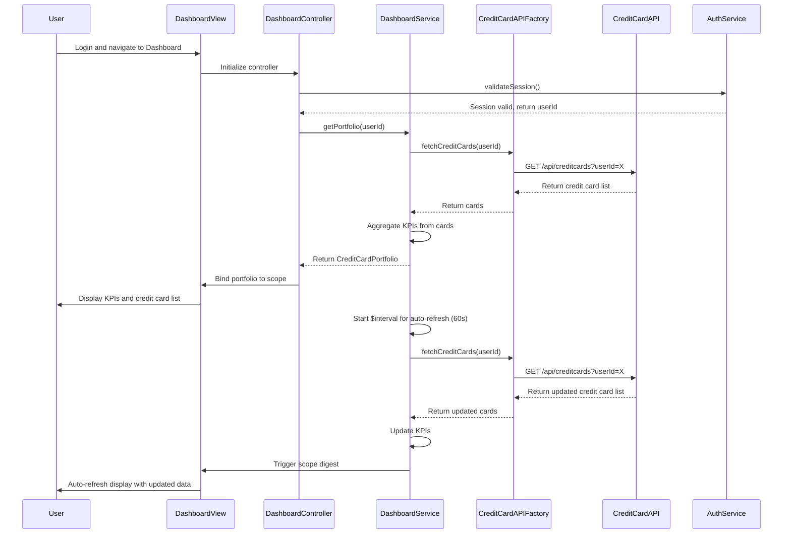

# Low-Level Design: QE-8438 - Dashboard KPIs and Credit Card Overview

## a. Architecture Mapping

- **User Interface** → AngularJS Module (`dashboardModule`) with Controller (`DashboardController`) and Directives for KPI display (`kpiCardDirective`, `creditCardListDirective`)
- **Dashboard Service** → AngularJS Service (`DashboardService`) for orchestrating KPI calculations and data fetching
- **Credit Card Data Service** → REST API integration via AngularJS Factory (`CreditCardAPIFactory`)
- **User Authentication Service** → Shared AngularJS Service (`AuthService`) for session management and token handling
- **Data Aggregation Layer** → Backend REST API consumed by `DashboardService`

**Recommended Folder Structure:**
```
/app
  /modules
    /dashboard
      dashboard.module.js
      dashboard.controller.js
      dashboard.service.js
      /directives
        kpi-card.directive.js
        credit-card-list.directive.js
      /factories
        credit-card-api.factory.js
  /shared
    /services
      auth.service.js
  /assets
    /css
      dashboard.css
  /views
    dashboard.html
```

## b. Component Specifications

| Component Name | Artifact Type | Responsibility | Key Dependencies |
|----------------|---------------|----------------|------------------|
| `dashboardModule` | Module | Root module for dashboard feature | `ngRoute`, `ui.bootstrap` |
| `DashboardController` | Controller | Manages dashboard view state and coordinates KPI display | `DashboardService`, `AuthService` |
| `DashboardService` | Service | Fetches credit card data, calculates KPIs, and aggregates portfolio metrics | `CreditCardAPIFactory`, `$q`, `$interval` |
| `CreditCardAPIFactory` | Factory | Handles REST API calls to credit card data service | `$http`, `$q` |
| `kpiCardDirective` | Directive | Renders individual KPI cards (monthly spend, credit limit, available credit, outstanding) | `DashboardService` |
| `creditCardListDirective` | Directive | Displays list of user's credit cards with summary details | `DashboardService` |
| `AuthService` | Service (Shared) | Manages user authentication state and token refresh | `$http`, `$window` |

## c. Data Model

**DashboardKPI (JavaScript Object):**
```javascript
{
  userId: String,
  monthlySpend: Number,
  totalCreditLimit: Number,
  availableCredit: Number,
  outstandingAmount: Number,
  lastUpdated: Date
}
```

**CreditCard (JavaScript Object):**
```javascript
{
  cardId: String,
  cardName: String,
  cardNumber: String,        // Masked, e.g., "**** **** **** 1234"
  cardType: String,          // e.g., "Visa", "Mastercard"
  creditLimit: Number,
  availableCredit: Number,
  outstandingBalance: Number,
  currentMonthSpend: Number,
  dueDate: Date,
  status: String             // e.g., "Active", "Blocked"
}
```

**CreditCardPortfolio (JavaScript Object):**
```javascript
{
  userId: String,
  cards: [CreditCard],
  kpis: DashboardKPI
}
```

## d. Data Flow

User logs in and navigates to the Dashboard view, triggering `DashboardController` to initialize. The controller calls `DashboardService.getPortfolio()`, which uses `CreditCardAPIFactory` to fetch credit card details and balances from the Credit Card Data Service REST API. The service aggregates data across all cards to compute `DashboardKPI` values (monthly spend, total credit limit, available credit, outstanding amount) and returns the `CreditCardPortfolio` model to the controller. The controller binds this data to the view, where `kpiCardDirective` displays each KPI in a card layout and `creditCardListDirective` renders the list of credit cards. The `DashboardService` uses `$interval` to poll the API every 60 seconds for near real-time updates, triggering automatic view refresh via two-way data binding.

## e. Primary Sequence Diagram



## f. Implementation Notes

- Use AngularJS Dependency Injection to inject `DashboardService` and `AuthService` into `DashboardController`.
- Implement `DashboardService` with `$interval` for polling the API every 60 seconds; cancel interval on scope destruction to prevent memory leaks.
- Use ES6 Promises (`$q`) in `CreditCardAPIFactory` for asynchronous API calls with error handling via `.catch()`.
- Implement responsive layout using Bootstrap grid system (col-xs, col-sm, col-md, col-lg) for KPI cards and credit card list.
- Use AngularJS `$http` interceptor to inject authentication tokens from `AuthService` into all API requests.

## g. Error Handling

HTTP interceptor-based error handling with automatic token refresh on 401 errors; user-friendly error notifications via toastr or modal dialogs.

## h. Security Notes

Requires token-based authentication via existing SSO; all API calls include Authorization header with JWT token; credit card numbers are masked on client-side.