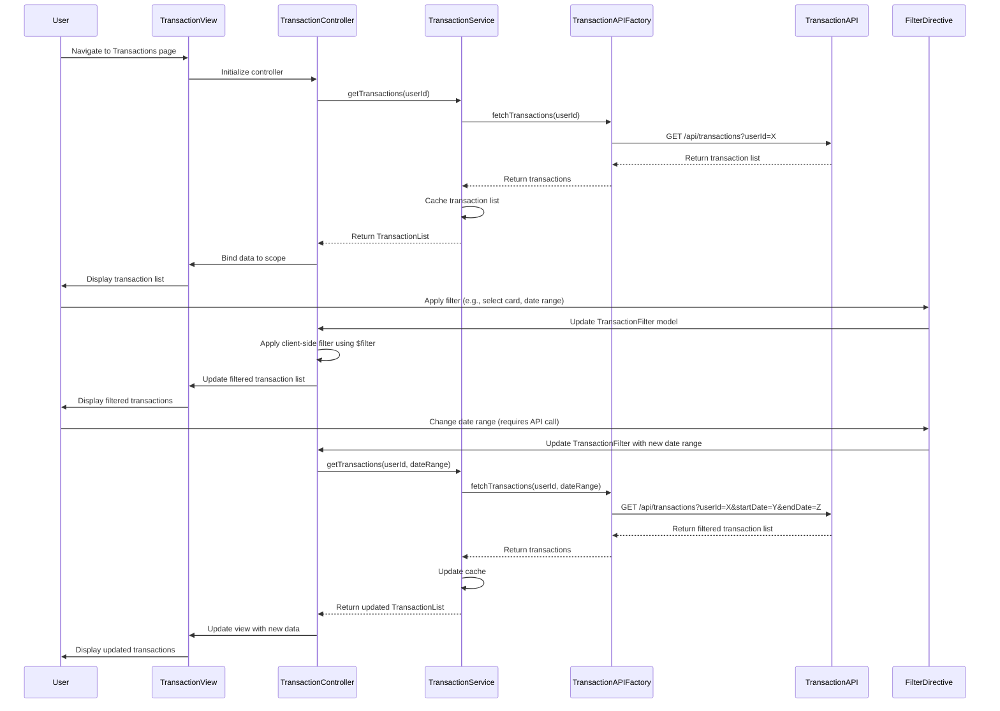

# Low-Level Design: QE-8439 - Transaction Management and Tracking

## a. Architecture Mapping

- **User Interface** → AngularJS Module (`transactionModule`) with Controller (`TransactionController`) and Directives for transaction display (`transactionListDirective`, `transactionFilterDirective`)
- **Transaction Management Service** → AngularJS Service (`TransactionService`) for business logic and transaction operations
- **Transaction Data Service** → REST API integration via AngularJS Factory (`TransactionAPIFactory`)
- **Search and Filter Engine** → Client-side filtering using AngularJS `$filter` service and custom filter functions
- **Dashboard KPIs Module** → Shared AngularJS Service (`DashboardKPIService`) for aggregated spending calculations
- **Analytics Module** → Shared AngularJS Service (`AnalyticsService`) for category-wise analysis

**Recommended Folder Structure:**
```
/app
  /modules
    /transactions
      transaction.module.js
      transaction.controller.js
      transaction.service.js
      /directives
        transaction-list.directive.js
        transaction-filter.directive.js
      /factories
        transaction-api.factory.js
      /filters
        transaction-search.filter.js
  /shared
    /services
      dashboard-kpi.service.js
      analytics.service.js
  /assets
    /css
      transactions.css
  /views
    transactions.html
```

## b. Component Specifications

| Component Name | Artifact Type | Responsibility | Key Dependencies |
|----------------|---------------|----------------|------------------|
| `transactionModule` | Module | Root module for transaction management feature | `ngRoute`, `ui.bootstrap` |
| `TransactionController` | Controller | Manages transaction view state, search, and filter operations | `TransactionService`, `$filter` |
| `TransactionService` | Service | Fetches, caches, and manages transaction data | `TransactionAPIFactory`, `$q`, `DashboardKPIService`, `AnalyticsService` |
| `TransactionAPIFactory` | Factory | Handles REST API calls to transaction data service | `$http`, `$q` |
| `transactionListDirective` | Directive | Renders paginated transaction list with card-wise segregation | `TransactionService` |
| `transactionFilterDirective` | Directive | Provides UI for filtering transactions by date, card, category, amount | `TransactionService`, `$filter` |
| `transactionSearchFilter` | Filter | Custom AngularJS filter for searching transactions by merchant or description | None |
| `DashboardKPIService` | Service (Shared) | Consumes transaction data for KPI aggregation | `$http` |
| `AnalyticsService` | Service (Shared) | Consumes transaction data for category-wise analysis | `$http` |

## c. Data Model

**Transaction (JavaScript Object):**
```javascript
{
  transactionId: String,
  userId: String,
  cardId: String,
  cardName: String,
  amount: Number,
  currency: String,           // e.g., "USD", "INR"
  category: String,           // e.g., "Food & Dining", "Fuel"
  merchant: String,
  description: String,
  transactionDate: Date,
  postingDate: Date,
  status: String,             // e.g., "Posted", "Pending"
  transactionType: String     // e.g., "Debit", "Credit"
}
```

**TransactionFilter (JavaScript Object):**
```javascript
{
  userId: String,
  cardIds: [String],          // Array of card IDs to filter by
  categories: [String],       // Array of categories to filter by
  dateRange: {
    startDate: Date,
    endDate: Date
  },
  amountRange: {
    min: Number,
    max: Number
  },
  searchTerm: String,         // For merchant or description search
  sortBy: String,             // e.g., "transactionDate", "amount"
  sortOrder: String           // "asc" or "desc"
}
```

**TransactionList (JavaScript Object):**
```javascript
{
  userId: String,
  transactions: [Transaction],
  totalCount: Number,
  pageSize: Number,
  currentPage: Number,
  appliedFilters: TransactionFilter
}
```

## d. Data Flow

User navigates to the Transactions view, triggering `TransactionController` to initialize. The controller calls `TransactionService.getTransactions()`, which uses `TransactionAPIFactory` to fetch transaction data from the Transaction Data Service REST API. The service caches the transaction list and returns the `TransactionList` model to the controller. The controller binds this data to the view, where `transactionListDirective` renders the paginated transaction list with card-wise segregation. User applies filters via `transactionFilterDirective`, which updates the `TransactionFilter` model in the controller. The controller calls `$filter` service with the custom `transactionSearchFilter` to filter the cached transaction list client-side, then updates the view. When filters change significantly (e.g., date range), the controller calls `TransactionService.getTransactions()` again to fetch fresh data from the API. The `TransactionService` also notifies `DashboardKPIService` and `AnalyticsService` of transaction updates for cross-module data consistency.

## e. Primary Sequence Diagram



## f. Implementation Notes

- Use AngularJS Dependency Injection to inject `TransactionService` and `$filter` into `TransactionController`.
- Implement `TransactionService` with in-memory caching to minimize API calls; use client-side filtering for card/category/merchant filters.
- Use ES6 Promises (`$q`) in `TransactionAPIFactory` for asynchronous API calls with `.then()` and `.catch()` chaining.
- Implement pagination using AngularJS `limitTo` filter or third-party library like `ui-bootstrap` pagination component.
- Use AngularJS `$http` interceptor for adding authentication tokens and handling API errors globally; notify `DashboardKPIService` and `AnalyticsService` via event broadcasting (`$rootScope.$broadcast`).

## g. Error Handling

HTTP interceptor-based error handling with retry logic for transient failures; user-friendly error notifications via toastr; client-side validation for filter inputs.

## h. Security Notes

Requires token-based authentication via existing SSO; all API calls include Authorization header with JWT token; transaction data is sanitized before display to prevent XSS.