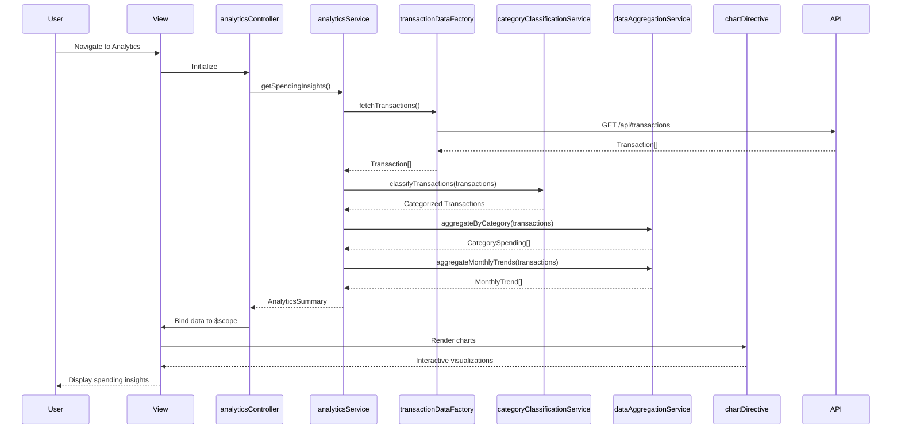

# Low-Level Design: Transaction Analytics and Spending Insights
**Epic ID:** QE-8486

## a. Architecture Mapping

- **Analytics UI** → AngularJS View (HTML5/CSS3/Bootstrap) + Controller (`analyticsController`)
- **Analytics Engine** → AngularJS Service (`analyticsService`)
- **Transaction Data Service** → AngularJS Factory (`transactionDataFactory`) + REST API integration
- **Category Classification Engine** → AngularJS Service (`categoryClassificationService`)
- **Data Aggregation Module** → AngularJS Service (`dataAggregationService`)
- **Visualization Library** → Directive (`chartDirective`) wrapping Chart.js/D3.js

**Folder Structure:**
```
/app
  /modules
    /analytics
      /controllers (analyticsController.js)
      /services (analyticsService.js, categoryClassificationService.js, dataAggregationService.js)
      /factories (transactionDataFactory.js)
      /directives (chartDirective.js)
      /views (analytics.html)
  /assets
    /css (analytics.css)
```

## b. Component Specifications

| Name | Artifact Type | Responsibility | Key Dependencies |
|------|---------------|----------------|------------------|
| analyticsController | Controller | Manages analytics view state, handles user interactions, binds data to view | analyticsService, $scope |
| analyticsService | Service | Orchestrates analytics workflow, coordinates between data retrieval and visualization | transactionDataFactory, categoryClassificationService, dataAggregationService |
| transactionDataFactory | Factory | Fetches transaction data from REST API endpoints | $http, $q |
| categoryClassificationService | Service | Classifies transactions into 9 predefined categories | None |
| dataAggregationService | Service | Aggregates transaction data by category and month for trend analysis | None |
| chartDirective | Directive | Renders interactive charts using Chart.js/D3.js library | Chart.js/D3.js |
| analyticsView | View | Displays spending insights, category breakdown, and monthly trends | Bootstrap, CSS3 |

## c. Data Model

```javascript
// Transaction Model
Transaction = {
  id: String,
  cardId: String,
  amount: Number,
  category: String, // One of 9 categories
  date: Date,
  description: String,
  merchantName: String
}

// Category Spending Model
CategorySpending = {
  category: String, // Food & Dining, Fuel, Shopping, Travel, Entertainment, Utilities, Healthcare, Education, Miscellaneous
  totalAmount: Number,
  transactionCount: Number,
  percentage: Number
}

// Monthly Trend Model
MonthlyTrend = {
  month: String, // YYYY-MM
  totalSpend: Number,
  categoryBreakdown: Array<CategorySpending>
}

// Analytics Summary Model
AnalyticsSummary = {
  currentMonthSpend: Number,
  categorySpending: Array<CategorySpending>,
  monthlyTrends: Array<MonthlyTrend>,
  topCategory: String
}
```

## d. Data Flow

User navigates to analytics view → analyticsController initializes and calls analyticsService.getSpendingInsights() → analyticsService invokes transactionDataFactory.fetchTransactions() to retrieve transaction data via REST API → categoryClassificationService categorizes each transaction into one of nine categories → dataAggregationService computes category-wise totals and monthly trends → analyticsService returns AnalyticsSummary to controller → controller binds data to $scope → chartDirective renders interactive visualizations → view displays spending patterns, category breakdown, and monthly trends with real-time updates.

## e. Primary Sequence Diagram



## f. Implementation Notes

- Use AngularJS dependency injection to inject services and factories into controllers and directives
- Leverage ES6 arrow functions, const/let, and template literals for cleaner code
- Implement REST API calls using $http service with promise-based error handling
- Use Chart.js or D3.js wrapped in custom directive for reusable chart components
- Apply Bootstrap grid system for responsive layout across devices

## g. Error Handling

HTTP interceptor captures API errors; controller-level try/catch with user notification via Bootstrap alerts or toast service.

## h. Security Notes

Standard input validation and secure API calls assumed.