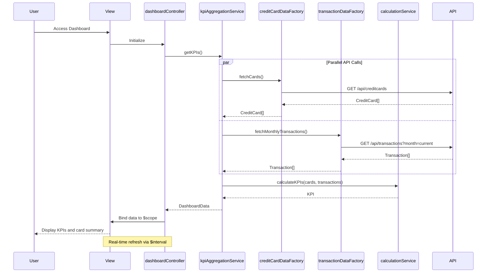

# Low-Level Design: Credit Card Dashboard and KPI Management
**Epic ID:** QE-8487

## a. Architecture Mapping

- **Dashboard UI** → AngularJS View (HTML5/CSS3/Bootstrap) + Controller (`dashboardController`)
- **KPI Aggregation Service** → AngularJS Service (`kpiAggregationService`)
- **Credit Card Data Source** → AngularJS Factory (`creditCardDataFactory`) + REST API integration
- **Transaction Data Service** → AngularJS Factory (`transactionDataFactory`) + REST API integration
- **Calculation Engine** → AngularJS Service (`calculationService`)

**Folder Structure:**
```
/app
  /modules
    /dashboard
      /controllers (dashboardController.js)
      /services (kpiAggregationService.js, calculationService.js)
      /factories (creditCardDataFactory.js, transactionDataFactory.js)
      /views (dashboard.html)
  /assets
    /css (dashboard.css)
```

## b. Component Specifications

| Name | Artifact Type | Responsibility | Key Dependencies |
|------|---------------|----------------|------------------|
| dashboardController | Controller | Manages dashboard state, handles user interactions, binds KPI data to view | kpiAggregationService, $scope, $interval |
| kpiAggregationService | Service | Orchestrates KPI calculation workflow, coordinates data retrieval and computation | creditCardDataFactory, transactionDataFactory, calculationService |
| creditCardDataFactory | Factory | Fetches credit card details, balances, and limits from REST API | $http, $q |
| transactionDataFactory | Factory | Fetches transaction data for monthly spend calculation from REST API | $http, $q |
| calculationService | Service | Computes monthly spend, total credit limit, available credit, and outstanding amount | None |
| dashboardView | View | Displays consolidated KPIs with responsive layout | Bootstrap, CSS3 |

## c. Data Model

```javascript
// Credit Card Model
CreditCard = {
  id: String,
  cardNumber: String, // Masked
  cardHolderName: String,
  creditLimit: Number,
  currentBalance: Number,
  availableCredit: Number,
  outstandingAmount: Number
}

// KPI Model
KPI = {
  monthlySpend: Number,
  totalCreditLimit: Number,
  totalAvailableCredit: Number,
  totalOutstandingAmount: Number,
  cardCount: Number
}

// Dashboard Data Model
DashboardData = {
  kpi: KPI,
  cards: Array<CreditCard>,
  lastUpdated: Date
}
```

## d. Data Flow

User accesses dashboard → dashboardController initializes and calls kpiAggregationService.getKPIs() → kpiAggregationService invokes creditCardDataFactory.fetchCards() and transactionDataFactory.fetchMonthlyTransactions() concurrently via REST APIs → calculationService computes monthly spend from transactions, aggregates total credit limits, calculates total available credit, and sums outstanding amounts across all cards → kpiAggregationService returns DashboardData to controller → controller binds data to $scope and sets up $interval for real-time refresh → view displays consolidated KPIs in responsive layout with periodic updates.

## e. Primary Sequence Diagram



## f. Implementation Notes

- Use AngularJS dependency injection for all services, factories, and controllers
- Implement $interval service for periodic KPI refresh (e.g., every 30 seconds)
- Use $q.all() for parallel REST API calls to optimize load time
- Apply Bootstrap responsive grid (col-xs, col-sm, col-md, col-lg) for multi-device support
- Leverage ES6 features including arrow functions, destructuring, and promises

## g. Error Handling

HTTP interceptor for API error handling; controller-level try/catch with user notification via Bootstrap modal or alert component.

## h. Security Notes

Requires token-based auth via existing SSO; card numbers displayed in masked format.