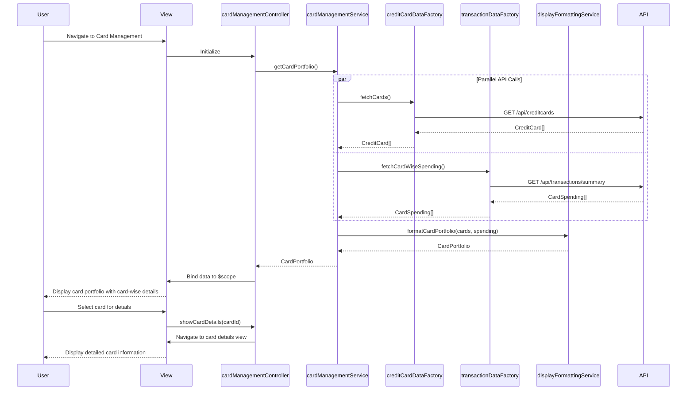

# Low-Level Design: Credit Card Management and Viewing
**Epic ID:** QE-8488

## a. Architecture Mapping

- **User Interface** → AngularJS View (HTML5/CSS3/Bootstrap) + Controller (`cardManagementController`)
- **Card Management Service** → AngularJS Service (`cardManagementService`)
- **Credit Card Data Repository** → AngularJS Factory (`creditCardDataFactory`) + REST API integration
- **Transaction Service** → AngularJS Factory (`transactionDataFactory`) + REST API integration
- **Display Engine** → AngularJS Service (`displayFormattingService`)

**Folder Structure:**
```
/app
  /modules
    /cardManagement
      /controllers (cardManagementController.js)
      /services (cardManagementService.js, displayFormattingService.js)
      /factories (creditCardDataFactory.js, transactionDataFactory.js)
      /views (card-management.html, card-details.html)
  /assets
    /css (card-management.css)
```

## b. Component Specifications

| Name | Artifact Type | Responsibility | Key Dependencies |
|------|---------------|----------------|------------------|
| cardManagementController | Controller | Manages card portfolio view, handles card selection and navigation | cardManagementService, $scope, $routeParams |
| cardManagementService | Service | Orchestrates card data retrieval and card-wise spend analysis | creditCardDataFactory, transactionDataFactory, displayFormattingService |
| creditCardDataFactory | Factory | Fetches and stores credit card information via REST API | $http, $q |
| transactionDataFactory | Factory | Fetches card-wise spending data via REST API | $http, $q |
| displayFormattingService | Service | Formats and aggregates card data for display including balances and limits | None |
| cardManagementView | View | Displays multiple cards with card-specific details and spend analysis | Bootstrap, CSS3 |
| cardDetailsView | View | Shows detailed information for a selected card | Bootstrap, CSS3 |

## c. Data Model

```javascript
// Credit Card Model
CreditCard = {
  id: String,
  cardNumber: String, // Masked
  cardHolderName: String,
  cardType: String, // Visa, MasterCard, etc.
  expiryDate: String, // MM/YY
  creditLimit: Number,
  currentBalance: Number,
  availableCredit: Number,
  outstandingAmount: Number,
  status: String // Active, Blocked, Expired
}

// Card Spending Model
CardSpending = {
  cardId: String,
  currentMonthSpend: Number,
  lastMonthSpend: Number,
  yearToDateSpend: Number,
  transactionCount: Number
}

// Card Portfolio Model
CardPortfolio = {
  cards: Array<CreditCard>,
  cardSpending: Map<String, CardSpending>, // Key: cardId
  totalCards: Number
}
```

## d. Data Flow

User navigates to card management view → cardManagementController initializes and calls cardManagementService.getCardPortfolio() → cardManagementService invokes creditCardDataFactory.fetchCards() to retrieve all card details and transactionDataFactory.fetchCardWiseSpending() for spending data via REST APIs → displayFormattingService aggregates and formats card information with corresponding spending metrics → cardManagementService returns CardPortfolio to controller → controller binds data to $scope → view displays multiple cards with individual card metrics including balances, limits, and card-specific spending analysis → user can select a card to view detailed information in cardDetailsView.

## e. Primary Sequence Diagram



## f. Implementation Notes

- Use AngularJS dependency injection for services, factories, and controllers
- Implement $routeParams for card selection and navigation to detail view
- Use $q.all() for parallel REST API calls to fetch cards and spending data
- Apply Bootstrap card components and responsive grid for multi-card display
- Leverage ES6 Map for efficient card-to-spending lookup

## g. Error Handling

HTTP interceptor for API failures; controller-level error handling with user notification via Bootstrap alert component.

## h. Security Notes

Standard input validation and secure API calls assumed; card numbers masked for security.