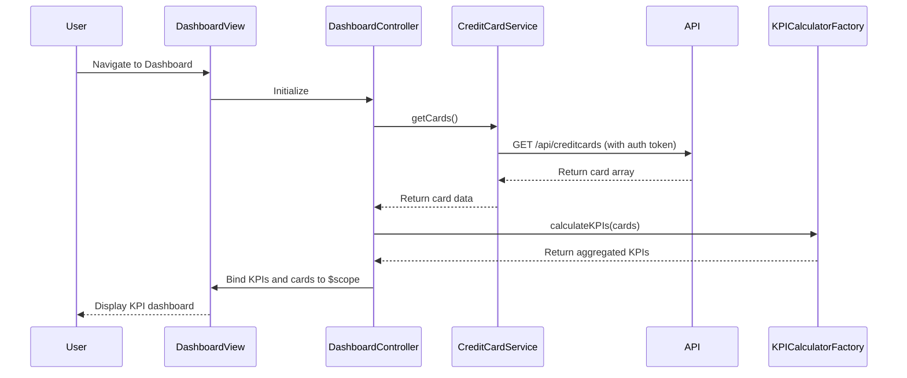

# Low-Level Design: Credit Card Portfolio Management and KPI Dashboard
**Epic ID:** QE-8501

## a. Architecture Mapping

- **Dashboard Module** → AngularJS Module (`app.dashboard`)
- **Dashboard Controller** → AngularJS Controller (`DashboardController`) - manages KPI display and card list
- **Credit Card Service** → AngularJS Service (`CreditCardService`) - fetches card data via REST API
- **KPI Calculator** → AngularJS Factory (`KPICalculatorFactory`) - computes aggregated metrics client-side
- **Authentication Interceptor** → AngularJS HTTP Interceptor (`AuthInterceptor`) - injects auth tokens

**Folder Structure:**
```
/app
  /modules
    /dashboard
      dashboard.module.js
      dashboard.controller.js
      dashboard.html
  /services
    creditcard.service.js
  /factories
    kpi-calculator.factory.js
  /interceptors
    auth.interceptor.js
  /styles
    dashboard.css
```

## b. Component Specifications

| Name | Artifact Type | Responsibility | Key Dependencies |
|------|---------------|----------------|------------------|
| DashboardController | Controller | Orchestrates KPI display, fetches card data, binds to view | CreditCardService, KPICalculatorFactory, $scope |
| CreditCardService | Service | Calls REST API to retrieve card details, balances, limits | $http, AuthInterceptor |
| KPICalculatorFactory | Factory | Computes total credit limit, available credit, monthly spend, outstanding amount | None |
| AuthInterceptor | HTTP Interceptor | Attaches authentication token to outgoing API requests | $q, $window (localStorage) |
| DashboardView | HTML Template | Renders KPI cards, credit card list, responsive layout using Bootstrap grid | DashboardController |

## c. Data Model

**CreditCard Object:**
```javascript
{
  cardId: String,
  cardNumber: String (masked),
  cardType: String,
  creditLimit: Number,
  availableCredit: Number,
  outstandingAmount: Number,
  monthlySpend: Number
}
```

**KPI Object:**
```javascript
{
  totalCreditLimit: Number,
  totalAvailableCredit: Number,
  totalOutstanding: Number,
  totalMonthlySpend: Number
}
```

## d. Data Flow

User navigates to dashboard → DashboardController initializes and calls CreditCardService.getCards() → Service makes authenticated GET request to `/api/creditcards` via $http → AuthInterceptor injects token → API returns card array → KPICalculatorFactory aggregates metrics from card data → Controller binds KPI and card list to $scope → View renders KPI summary cards and card list using Bootstrap responsive grid → UI updates complete within 2 seconds.

## e. Primary Sequence Diagram



## f. Implementation Notes

- Use AngularJS 1.x module pattern with dependency injection for all services and controllers
- Implement HTTP interceptor for centralized token-based authentication on all API calls
- Use ES6 arrow functions and const/let for service and factory implementations
- Leverage Bootstrap 3/4 grid system (col-xs/sm/md/lg) for responsive KPI card layout
- Cache card data in service using $cacheFactory to optimize repeat dashboard loads under 2-second NFR

## g. Error Handling

HTTP interceptor captures API errors (4xx/5xx) and displays user-friendly notifications via a toast service; controller-level try/catch for KPI calculation errors.

## h. Security Notes

Requires token-based auth via existing SSO; AuthInterceptor attaches JWT to all API requests.