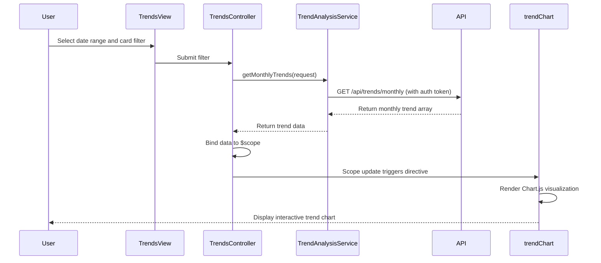

# Low-Level Design: Monthly Spend Trends and Card-wise Analysis
**Epic ID:** QE-8502

## a. Architecture Mapping

- **Trends Module** → AngularJS Module (`app.trends`)
- **Trends Controller** → AngularJS Controller (`TrendsController`) - manages trend visualization and card filter
- **Trend Analysis Service** → AngularJS Service (`TrendAnalysisService`) - fetches time-series and card-wise data via REST API
- **Chart Directive** → AngularJS Directive (`trendChart`) - renders interactive charts using Chart.js or D3.js
- **Date Filter Factory** → AngularJS Factory (`DateFilterFactory`) - formats and validates date ranges

**Folder Structure:**
```
/app
  /modules
    /trends
      trends.module.js
      trends.controller.js
      trends.html
  /services
    trend-analysis.service.js
  /directives
    trend-chart.directive.js
  /factories
    date-filter.factory.js
  /styles
    trends.css
```

## b. Component Specifications

| Name | Artifact Type | Responsibility | Key Dependencies |
|------|---------------|----------------|------------------|
| TrendsController | Controller | Manages date range selection, card filter, binds trend data to view | TrendAnalysisService, DateFilterFactory, $scope |
| TrendAnalysisService | Service | Calls REST API for monthly trends and card-wise spending data | $http, AuthInterceptor |
| trendChart | Directive | Renders interactive line/bar charts for monthly trends and card comparison | Chart.js or D3.js library |
| DateFilterFactory | Factory | Validates date range (min 12 months), formats dates for API calls | None |
| TrendsView | HTML Template | Displays date picker, card dropdown, trend charts using Bootstrap layout | TrendsController, trendChart |

## c. Data Model

**MonthlyTrend Object:**
```javascript
{
  month: String (YYYY-MM),
  totalSpend: Number,
  transactionCount: Number
}
```

**CardWiseSpend Object:**
```javascript
{
  cardId: String,
  cardName: String,
  totalSpend: Number,
  percentage: Number
}
```

**TrendRequest Object:**
```javascript
{
  userId: String,
  startDate: String (YYYY-MM-DD),
  endDate: String (YYYY-MM-DD),
  cardIds: Array<String> (optional)
}
```

## d. Data Flow

User selects date range and card filter in TrendsView → TrendsController validates input via DateFilterFactory → Controller calls TrendAnalysisService.getMonthlyTrends(request) and getCardWiseSpend(request) → Service makes authenticated GET requests to `/api/trends/monthly` and `/api/trends/cardwise` → API returns aggregated time-series and card-specific data → Controller binds data to $scope → trendChart directive watches scope changes and renders interactive Chart.js visualizations → User interacts with charts (hover, zoom) for detailed insights.

## e. Primary Sequence Diagram



## f. Implementation Notes

- Use AngularJS directive with isolated scope for reusable chart component; watch data changes to re-render charts
- Implement Chart.js for lightweight, responsive visualizations; configure tooltips and legends for interactivity
- Use $q.all() to parallelize API calls for monthly trends and card-wise data for faster rendering
- Apply ES6 template literals for dynamic API endpoint construction with date parameters
- Debounce date picker changes (300ms) to avoid excessive API calls during user input

## g. Error Handling

Service-level error handling with $q.reject() propagates API failures to controller; controller displays error banner and logs to console.

## h. Security Notes

Standard input validation for date ranges and card IDs; secure API calls with token-based auth via existing interceptor.