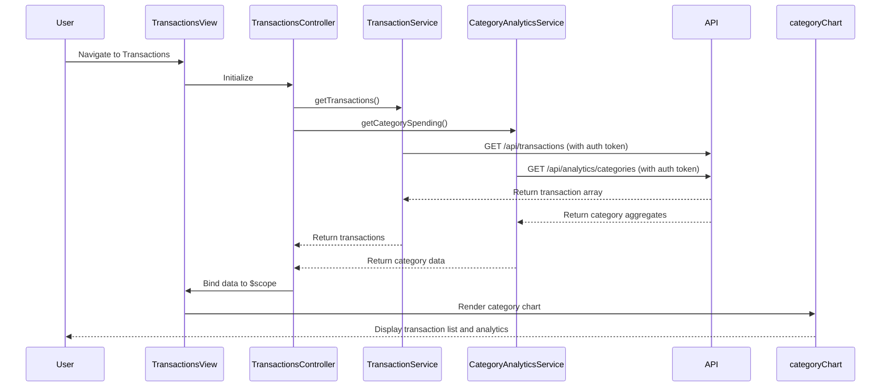

# Low-Level Design: Transaction Monitoring and Spending Analytics
**Epic ID:** QE-8503

## a. Architecture Mapping

- **Transactions Module** → AngularJS Module (`app.transactions`)
- **Transactions Controller** → AngularJS Controller (`TransactionsController`) - manages transaction list and category filters
- **Transaction Service** → AngularJS Service (`TransactionService`) - fetches transaction data via REST API
- **Category Analytics Service** → AngularJS Service (`CategoryAnalyticsService`) - retrieves category-wise spending via REST API
- **Category Chart Directive** → AngularJS Directive (`categoryChart`) - renders pie/donut charts for category breakdown

**Folder Structure:**
```
/app
  /modules
    /transactions
      transactions.module.js
      transactions.controller.js
      transactions.html
  /services
    transaction.service.js
    category-analytics.service.js
  /directives
    category-chart.directive.js
  /styles
    transactions.css
```

## b. Component Specifications

| Name | Artifact Type | Responsibility | Key Dependencies |
|------|---------------|----------------|------------------|
| TransactionsController | Controller | Fetches and displays transaction list, manages category filter, binds analytics data | TransactionService, CategoryAnalyticsService, $scope |
| TransactionService | Service | Calls REST API to retrieve transaction history (12 months) | $http, AuthInterceptor |
| CategoryAnalyticsService | Service | Calls REST API to retrieve category-wise spending aggregates | $http, AuthInterceptor |
| categoryChart | Directive | Renders interactive pie/donut chart for 9 spending categories using Chart.js | Chart.js library |
| TransactionsView | HTML Template | Displays transaction table, category filter dropdown, and category chart | TransactionsController, categoryChart |

## c. Data Model

**Transaction Object:**
```javascript
{
  transactionId: String,
  cardId: String,
  amount: Number,
  category: String,
  merchantName: String,
  transactionDate: String (ISO 8601),
  description: String
}
```

**CategorySpend Object:**
```javascript
{
  category: String,
  totalSpend: Number,
  transactionCount: Number,
  percentage: Number
}
```

**Categories Enum:**
```javascript
['Food & Dining', 'Fuel', 'Shopping', 'Travel', 'Entertainment', 'Utilities', 'Healthcare', 'Education', 'Miscellaneous']
```

## d. Data Flow

User navigates to transactions page → TransactionsController calls TransactionService.getTransactions() and CategoryAnalyticsService.getCategorySpending() → Services make authenticated GET requests to `/api/transactions` and `/api/analytics/categories` → API returns transaction array and category aggregates → Controller binds data to $scope → TransactionsView renders transaction table with ng-repeat and categoryChart directive visualizes category breakdown → User filters by category, controller updates view with filtered transactions → Chart updates reactively within 1.5 seconds.

## e. Primary Sequence Diagram



## f. Implementation Notes

- Use AngularJS ng-repeat with track by transactionId for efficient transaction list rendering
- Implement pagination or virtual scrolling (e.g., ng-infinite-scroll) for large transaction datasets (12 months)
- Use Chart.js pie chart with onClick handler to filter transactions by selected category slice
- Apply ES6 Array.filter() and reduce() for client-side category filtering and aggregation if needed
- Cache transaction data in service using $cacheFactory with TTL to meet 1.5-second render NFR

## g. Error Handling

Interceptor-based error handling for API failures; controller displays error message and retry button for failed data loads.

## h. Security Notes

Standard input validation and secure API calls assumed; token-based auth via existing SSO interceptor.